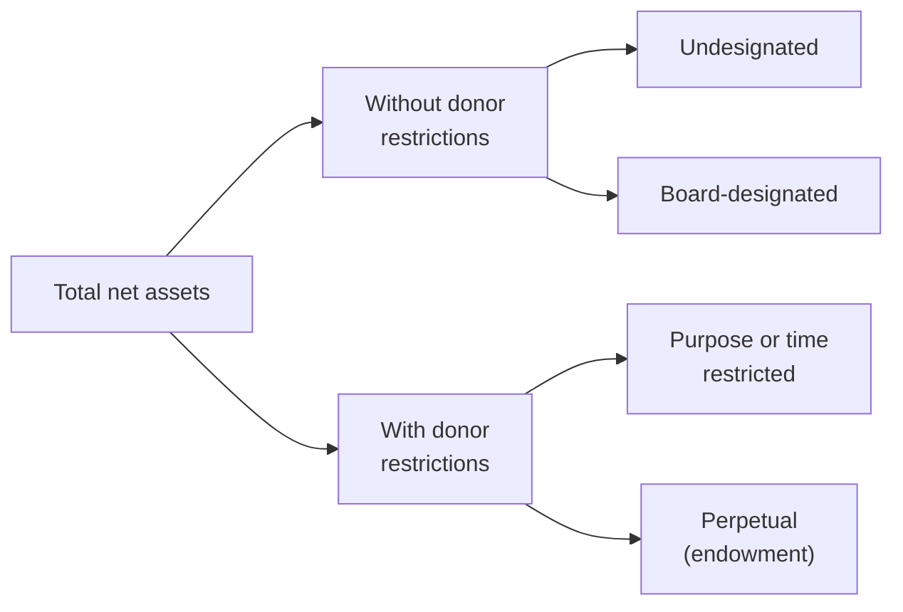
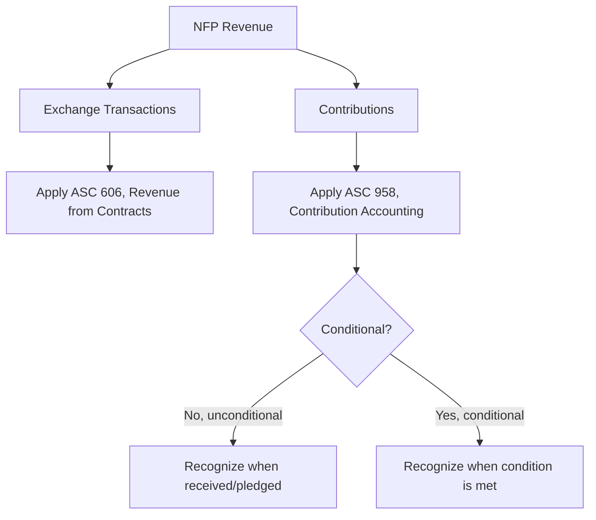
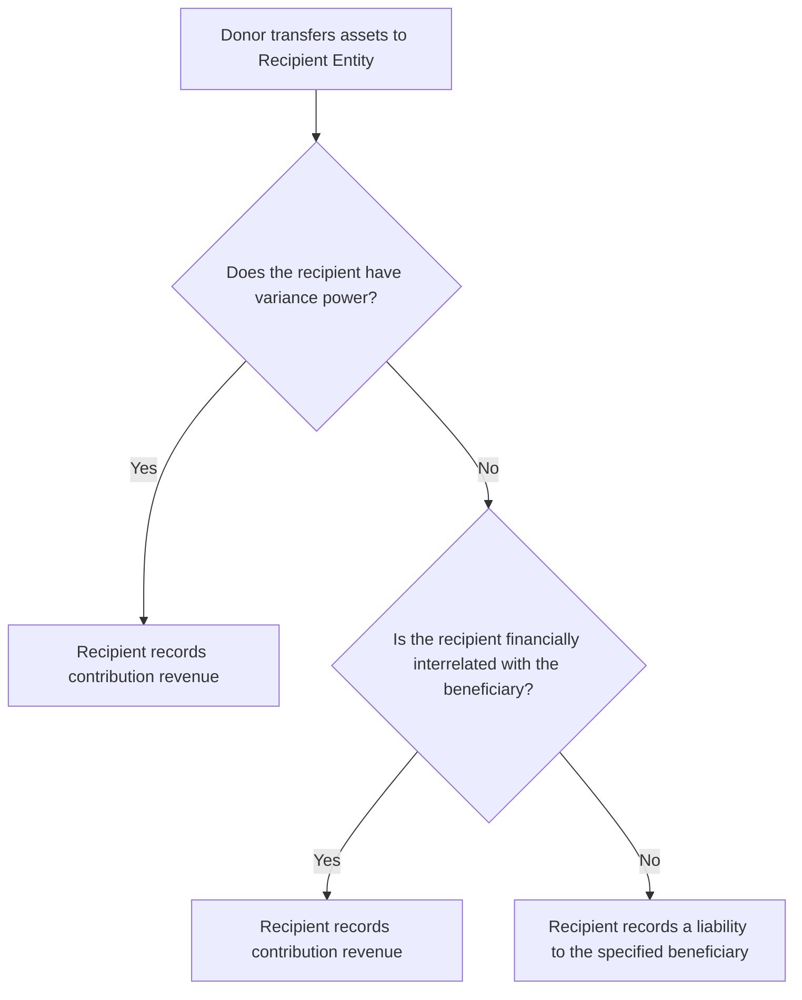

# Not-for-Profit Accounting

Private colleges, museums, charities, and nongovernmental hospitals have no owners and no profit motive, but they still need financial statements. Their readers, mainly donors, grantors, creditors, and members, want to know what resources the organization has, what restrictions donors have placed on them, and how much of its spending goes to its mission. Nongovernmental not-for-profit entities (NFPs) follow generally accepted accounting principles (GAAP) set by the Financial Accounting Standards Board (FASB), mainly Topic 958 of the Accounting Standards Codification (ASC), and they use the **full accrual basis**. FAR tests the NFP financial statements, how contributions are recognized and classified, contributed services, and transfers through intermediaries. This chapter starts with the three statements, then covers contributions and the other revenue streams, and ends with a worked statement of activities.

---

## Financial Statements Overview

NFPs prepare three financial statements, where a business prepares four:

| NFP Statement | Commercial Equivalent |
|---|---|
| Statement of Financial Position | Balance Sheet |
| Statement of Activities | Income Statement (and statement of changes in equity) |
| Statement of Cash Flows | Statement of Cash Flows |

There is no statement of stockholders' equity, because an NFP has no owners. **Net assets** take the place of equity, and the statement of activities reports their changes.

Every NFP must also present an **analysis of expenses by both function and nature** in one location: on the face of the statement of activities, in a separate statement (often called a statement of functional expenses), or in the notes.

| Classification Type | Examples |
|---|---|
| **Functional** (what the money was spent for) | Program services, management and general, fundraising |
| **Natural** (what kind of cost it was) | Salaries, rent, depreciation, supplies |

---

## Statement of Financial Position

The statement of financial position reports assets, liabilities, and net assets. Its purpose is to give donors, creditors, and others information about the NFP's **liquidity**, its **financial flexibility**, and the relationship between its assets and liabilities. Assets are presented in order of liquidity or classified as current and noncurrent. Net assets are divided into two classes:



### Net Assets Without Donor Restrictions

These are resources with **no donor-imposed restrictions**. The governing board may set some of them aside for a purpose, creating **board-designated** funds (a board-designated endowment is sometimes called a **quasi-endowment**). Board-designated funds stay in the **without donor restrictions** class, because the board can reverse its own designation at any time. They may be shown separately within that class or disclosed in the notes.

### Net Assets With Donor Restrictions

These are resources subject to **donor-imposed** stipulations of two kinds:

- **Purpose or time restrictions**: the donor specifies how or when the funds may be used (for example, "use for scholarships next year").
- **Perpetual restrictions**: the donor requires that the principal be maintained permanently, as in an endowment. Only the investment return may be spent, subject to any further restrictions.

Notes to the statement of financial position describe the amounts and purposes of donor restrictions and board designations. NFPs also disclose information about **liquidity**: qualitative information on how they manage liquid resources to meet cash needs for general expenditures within one year, and quantitative information on the financial assets available for those expenditures within one year of the balance sheet date.

---

## Statement of Activities

The statement of activities reports revenues, expenses, gains, and losses, and the change in each class of net assets and in total net assets.

| Line Item | Description |
|---|---|
| Change in net assets without donor restrictions | Unrestricted revenues and gains, plus net assets released from restrictions, minus expenses |
| Change in net assets with donor restrictions | Restricted contributions and investment returns, minus net assets released from restrictions |
| Change in total net assets | Sum of both classes |

**Expenses are always reported in the without donor restrictions column.** When the NFP spends restricted resources for their intended purpose, the restriction is satisfied, and the amount is **reclassified** from with donor restrictions to without donor restrictions:

```journal
Dr. Net assets with donor restrictions[e] 50,000
    Cr. Net assets without donor restrictions[e] 50,000
```

This reclassification appears in the statement of activities as **net assets released from restrictions**: a decrease in the with-restrictions column and an increase in the without-restrictions column, where the related expense is reported. A time restriction is released the same way when the time passes.

If a contribution is received and its restriction is satisfied in the **same reporting period**, the NFP may elect to report it directly as without donor restrictions. The election is an accounting policy that must be applied consistently and disclosed.

### Program Services vs. Supporting Services

Expenses are reported by **function**:

| Category | Examples |
|---|---|
| **Program services** | Direct mission activities, such as education, patient care, and research |
| **Supporting services: management and general** | Accounting, human resources, the executive office |
| **Supporting services: fundraising** | Donor solicitation, special events, grant writing |

### Joint Cost Allocation

Some activities serve both program and fundraising functions, such as a mailing that educates the public and also asks for donations. The **joint costs** of such an activity may be allocated between functions only if all three criteria are met: **purpose**, **audience**, and **content**. If any criterion is not met, all costs of the activity are reported as fundraising.

Bruin Community Foundation mails 100,000 brochures about childhood literacy (a program purpose) that also include a donation envelope. Total cost is \$200,000. The foundation meets all three criteria and determines that 60% of the cost relates to the educational content, so it reports \$120,000 as program expense and \$80,000 as fundraising expense.

---

## Statement of Cash Flows

NFPs follow the same **ASC 230** rules as businesses and classify cash flows as operating, investing, or financing. Either the direct or the indirect method may be used.

| Activity | Examples |
|---|---|
| **Operating** | Cash from service recipients, contributions without donor restrictions, contributions restricted for current operations, interest and dividends received |
| **Investing** | Purchases and sales of investments, purchases of equipment |
| **Financing** | Proceeds from borrowing, contributions **restricted by donors for long-term purposes** (acquiring long-lived assets or adding to endowments) |

:::tip[Exam rule]

Contributions that donors restrict for the **acquisition of long-lived assets** or for **endowment** are **financing** inflows, not operating. A contribution the **board** designates for construction, with no donor restriction, remains an **operating** inflow.

:::

Polar University receives a \$500,000 unrestricted donation, and the board votes to set it aside for a new library wing. The \$500,000 is an operating cash inflow, because the restriction is internal, not donor-imposed. Likewise, under ASU 2023-08, crypto assets received as a contribution and converted into cash nearly immediately produce an operating cash inflow.

### Indirect Method

Under the indirect method, an NFP reconciles the **change in total net assets** (its counterpart to net income) to net cash from operating activities. The reconciliation adds back noncash expenses, adjusts for changes in operating assets and liabilities, and **subtracts contributions restricted for long-term purposes**, because those cash receipts belong in financing activities.

Polar University reports a \$900,000 increase in total net assets. That change includes a \$400,000 cash contribution restricted by the donor for a new laboratory building and \$150,000 of depreciation. Accounts receivable increased by \$50,000, and accounts payable increased by \$20,000.

| | Amount |
|---|---:|
| Change in net assets | \$900,000 |
| Add: depreciation | 150,000 |
| Less: increase in accounts receivable | (50,000) |
| Add: increase in accounts payable | 20,000 |
| Less: contributions restricted for long-term purposes | (400,000) |
| **Net cash provided by operating activities** | **\$620,000** |

The \$400,000 appears instead in financing activities as "proceeds from contributions restricted for the acquisition of long-lived assets."

---

## Revenue Recognition for NFPs

NFP revenue falls into two broad groups: **exchange transactions** and **contributions**.



### Exchange Transactions

In an exchange transaction, each party receives and gives up approximately **equal value**. Tuition, patient fees, and membership dues that provide substantial benefits to members are examples. Exchange transactions follow ASC 606, the same revenue rules businesses use: revenue is recognized when (or as) the NFP satisfies a performance obligation. Exchange revenue is classified as **without donor restrictions**.

Receivables from exchange transactions are measured like any business's receivables, using the current expected credit loss (CECL) model. ASU 2025-12, eligible for testing January 1, 2027, makes that explicit for NFPs. And under ASU 2025-05, an NFP, like any entity that is not a public business entity, may elect a practical expedient for current receivables that assumes conditions at the balance sheet date do not change, and may also consider collections after the balance sheet date.

### Contributions: General Rules

A **contribution** is an unconditional, voluntary, nonreciprocal transfer of assets (or settlement of liabilities) in which the resource provider does not receive equal value in return.

| Concept | Rule |
|---|---|
| Unconditional promise (pledge) | Recognize a receivable and **revenue** when the promise is made, net of estimated uncollectible amounts |
| Conditional promise | Do **not** recognize until the condition is met |
| Cash contributions | Recognize at the amount received |
| Noncash contributions | Recognize at **fair value** on the date of the gift |

A promise is **conditional** only if it contains both a **barrier** (something the NFP must achieve, or that must happen, before it is entitled to the assets) and a **right of return** of assets transferred or a **right of release** from the promise if the barrier is not overcome. A restriction on how the money may be used is **not** a condition. A gift "for scholarships" is unconditional and restricted; a gift "if you raise a matching \$500,000" is conditional.

Grants to NFPs from governments follow these same contribution rules. ASU 2025-10, which creates a separate model for government grants, applies only to business entities and excludes NFPs.

### Unconditional Promises to Give (Pledges)

When a donor makes an unconditional pledge, the NFP records a receivable and revenue immediately, even though the cash comes later.

On November 15, a donor pledges \$100,000 to Bruin Community Foundation, payable in full on March 1 of the following year. The foundation estimates that 3% will be uncollectible. Because the cash is due in a later period, the pledge carries an **implied time restriction**, so the revenue is reported as with donor restrictions:

```journal
Nov 15
Dr. Pledges receivable[a] 100,000
    Cr. Allowance for uncollectible pledges[ca] 3,000
    Cr. Contribution revenue (with donor restrictions)[e] 97,000
```

Pledges due in more than one year are recorded at the **present value** of the estimated future cash flows. The discount is later accreted as additional **contribution revenue**, not interest income.

### Conditional Promises

A conditional promise is **not** recognized as revenue or a receivable until the condition is met. Kodiak Partners pledges \$200,000 to Bear Valley Hospital on the condition that the hospital raises \$500,000 in matching funds by December 31. Until the hospital reaches the \$500,000 threshold, it records nothing. Once the condition is met:

```journal
Dr. Pledges receivable[a] 200,000
    Cr. Contribution revenue[e] 200,000
```

### Contributed Services

Volunteers give NFPs enormous amounts of time, but most of it is not recorded. Contributed services are recognized as contribution revenue only if **either** of these criteria is met:

1. The services **create or enhance a nonfinancial asset** (for example, a contractor builds a wall for a charity), **or**
2. **All three** of the following are true: the services require **specialized skills**, the person providing them **possesses those skills**, and the services would typically need to be **purchased** if not donated (for example, an attorney donates legal work).

When a service qualifies, the NFP records contribution revenue and an equal expense (or an asset, if the service created or enhanced a nonfinancial asset), measured at fair value.

A licensed CPA donates 40 hours of accounting services to Polar University. The CPA's normal billing rate is \$250 per hour, so the services are worth \$10,000 (40 × \$250). The services require specialized skills that the university would otherwise purchase:

```journal
Dr. Accounting expense 10,000
    Cr. Contribution revenue (donated services)[e] 10,000
```

By contrast, fifteen volunteers who spend 200 hours sorting donations at Bruin Community Foundation's warehouse provide valuable help, but the work requires no specialized skills and does not enhance a nonfinancial asset. **No entry** is recorded. The same is true of general volunteers at a soup kitchen or gift shop.

### Contributed Collection Items

Works of art, historical treasures, and similar items **need not be capitalized** if all three conditions are met:

1. The items are **held for public exhibition, education, or research** in furtherance of public service, not for financial gain.
2. The items are **protected, kept unencumbered, cared for, and preserved**.
3. The NFP's policy requires proceeds from sales of collection items to be used to acquire **other collection items** or for the **direct care** of existing collections.

If the NFP elects not to capitalize, it records neither an asset nor revenue. The policy must be applied consistently and disclosed.

### Contributed Materials and Supplies

Significant contributed materials are recognized at **fair value** as both an asset (or an expense, if used immediately) and contribution revenue:

```journal
Dr. Inventory (donated supplies)[a] 15,000
    Cr. Contribution revenue (donated materials)[e] 15,000
```

Contributed nonfinancial assets (gifts in kind) are presented as a **separate line item** in the statement of activities, apart from contributions of cash and other financial assets, and the notes disaggregate them by category.

### Timing of Restricted Contributions

A restriction affects **classification**, not **timing**. Contributions with donor restrictions are recognized as revenue with donor restrictions in the period they are received or unconditionally pledged. They are not deferred until the restriction is met. When the restriction is later satisfied, the release moves the amount to without donor restrictions.

---

## Fundraising Events

When an NFP holds a fundraising event that gives donors something of value in return, such as a dinner or concert, the donor's payment is part exchange and part contribution:

| Component | Treatment |
|---|---|
| Fair value of the benefit the donor receives | **Exchange (special event) revenue** |
| Payment in excess of that fair value | **Contribution revenue** |
| Cost of the benefit provided | **Expense** (reported as fundraising or as costs of direct benefits to donors) |

Grizzly Wildlife Fund, an NFP, holds a gala dinner. Tickets cost \$500 each, and the fair value of the dinner is \$120. For each ticket sold, contribution revenue is \$380 (\$500 - \$120) and special event revenue is \$120:

```journal
Dr. Cash[a] 500
    Cr. Contribution revenue[e] 380
    Cr. Special event revenue[e] 120
```

The cost of the dinner, \$80 per plate, is recorded as an expense:

```journal
Dr. Fundraising expense 80
    Cr. Cash[a] 80
```

---

## Transfers Through Intermediaries

Sometimes a donor gives assets to one organization (the **recipient**, such as a community foundation) for the benefit of another (the **specified beneficiary**). Whether the recipient has received a contribution or is simply acting as an agent depends on two factors:



| Term | Meaning |
|---|---|
| **Variance power** | The donor has explicitly given the recipient the unilateral power to redirect the assets to a beneficiary other than the one specified |
| **Financially interrelated** | (1) One entity has the ability to **influence the operating and financial decisions** of the other, **and** (2) one entity has an **ongoing economic interest** in the other's net assets |
| **Specified beneficiary** | The entity the donor intends to receive the assets ultimately |

Panda Industries donates \$300,000 to Bruin Community Foundation, specifying Bear Valley Hospital as the beneficiary. The foundation's entry depends on the facts:

| Facts | Foundation Records |
|---|---|
| The foundation has **variance power** | Dr. Cash \$300,000; Cr. Contribution revenue \$300,000 |
| No variance power, but the foundation and hospital are **financially interrelated** | Dr. Cash \$300,000; Cr. Contribution revenue \$300,000 |
| **Neither** | Dr. Cash \$300,000; Cr. Liability to Bear Valley Hospital \$300,000 |

In the last case the foundation is only an agent or intermediary, so the transfer is **not** its contribution.

The specified beneficiary, Bear Valley Hospital, recognizes its **right to the assets** held by the recipient **unless** the donor explicitly granted the recipient variance power. If the two entities are financially interrelated, the hospital reports an **interest in the net assets** of the foundation. Otherwise, it reports a receivable (or a beneficial interest) and contribution revenue.

---

## Investments

NFPs report investments in **debt securities** and in **equity securities with readily determinable fair values** at **fair value**, with limited exceptions such as equity method investments. NFPs have no other comprehensive income, so both **realized and unrealized gains and losses** are reported in the **statement of activities**. Investment return is reported **net of external and direct internal investment expenses**, and it is classified as without donor restrictions unless a donor or the law restricts it.

### Underwater Endowments

An endowment is **underwater** when its fair value falls below the original gift amount or the amount the donor or law requires to be maintained.

A donor gave \$1,000,000 to Bruin Community Foundation as a permanent endowment. After market declines, the endowment's fair value drops to \$920,000:

```journal
Dr. Unrealized loss on endowment investments 80,000
    Cr. Investment in endowment[a] 80,000
```

The \$80,000 loss is reported in **net assets with donor restrictions**, and the endowment stays in that class even though it is underwater. NFPs disclose the fair value of underwater endowment funds, the original gift amounts (or the amounts required to be maintained), the aggregate amount by which the funds are underwater, and the governing board's policy on spending from underwater endowments.

---

## Industry Notes: Colleges and Health Care

**Colleges and universities.** Tuition revenue is reported net of scholarships that require no service from the student, which are shown as a **scholarship allowance** (a reduction of gross tuition). Payments to students who perform services, such as teaching assistantships, are **expenses**. If Polar University bills \$10,000,000 of tuition, awards \$1,500,000 of merit scholarships, and pays \$400,000 of assistantship stipends, it reports net tuition revenue of \$8,500,000 and \$400,000 of compensation expense.

**Health care.** NFP hospitals follow ASC 606 for patient revenue, reported at the amount the provider expects to be entitled to: gross charges less contractual adjustments with insurers, discounts, and **implicit price concessions** (amounts the provider does not expect to collect at the time of service). **Charity care**, service provided to patients who are not expected to pay, is **never recognized as revenue**; the notes disclose the charity care policy and its cost. **Bad debt expense** arises only when a patient's ability to pay declines after the service.

Bear Valley Hospital has gross charges of \$5,000,000, contractual adjustments of \$1,200,000, and \$150,000 it expects not to collect from self-pay patients at the time of service. Charity care at standard rates would have been \$300,000.

| Line | Amount |
|---|---|
| Gross patient charges | \$5,000,000 |
| Less: contractual adjustments | (\$1,200,000) |
| Less: implicit price concessions | (\$150,000) |
| Net patient service revenue | \$3,650,000 |

The \$300,000 of charity care is excluded from revenue entirely and disclosed at cost.

---

## Putting It Together: Statement of Activities

Bruin Community Foundation reports the following activity for the year ended December 31:

| Transaction | Amount | Classification |
|---|---|---|
| Unrestricted contributions received | \$800,000 | Without donor restrictions |
| Donor-restricted contribution for scholarships | \$200,000 | With donor restrictions |
| Scholarships awarded (satisfying the restriction; expense included in program services) | \$120,000 | Release from restrictions |
| Unrestricted investment return, net of fees | \$45,000 | Without donor restrictions |
| Unrealized loss on endowment (underwater) | \$30,000 | With donor restrictions |
| Program services expense | \$600,000 | Without donor restrictions |
| Management and general expense | \$110,000 | Without donor restrictions |
| Fundraising expense | \$55,000 | Without donor restrictions |

**Bruin Community Foundation: Statement of Activities (simplified)**

| | Without Donor Restrictions | With Donor Restrictions | Total |
|---|---|---|---|
| Contributions | \$800,000 | \$200,000 | \$1,000,000 |
| Investment return | 45,000 | (30,000) | 15,000 |
| Net assets released from restrictions | 120,000 | (120,000) | 0 |
| **Total revenues, gains, and other support** | **965,000** | **50,000** | **1,015,000** |
| Program services | (600,000) | 0 | (600,000) |
| Management and general | (110,000) | 0 | (110,000) |
| Fundraising | (55,000) | 0 | (55,000) |
| **Change in net assets** | **\$200,000** | **\$50,000** | **\$250,000** |

Notice the pattern that makes NFP statements balance: all expenses sit in the without donor restrictions column, the release of restrictions moves resources into that column to cover the scholarships, and the two columns together explain the \$250,000 change in total net assets.
