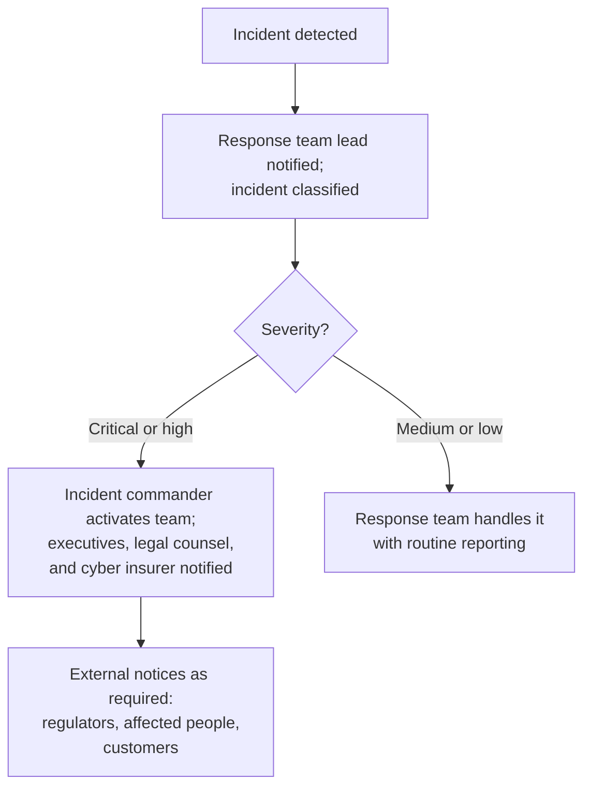

# Incident Response

Sooner or later, every organization has a security incident. What separates a contained problem from a disaster is usually the response: how quickly the incident is recognized, who takes charge, what is shut down, who is told, and how fast normal operations resume. **Incident response** is the organized approach to detecting, containing, and recovering from security incidents, and an **incident response plan** is the document that sets that approach out in advance.

This chapter first distinguishes security events from incidents, then covers cyber insurance as a way to mitigate an incident's financial impact. It describes what an incident response plan contains, including the notification deadlines it must track, and the phases of a response. It closes with the procedures a CPA performs to test whether an entity actually followed its plan, which the blueprint tests at the Application level.

---

## Security Events and Security Incidents

Security tools record millions of occurrences, and nearly all of them are harmless. The first job is to separate the few that matter.

| Term | Definition | Examples |
|---|---|---|
| **Security event** | Any observable occurrence in a system or network that may be relevant to security | A user logging in, a firewall blocking a port scan, antivirus flagging a file, a single failed login |
| **Security incident** | An event, or series of events, that actually or imminently jeopardizes the confidentiality, integrity, or availability of information or systems, or violates security policy | Ransomware encrypting servers, an outsider logged in to a financial system, customer data copied out of the network |

Every incident begins as one or more events, but few events become incidents. A firewall blocking a port scan is an event: the control worked and nothing was compromised. Malware that runs on a laptop and begins contacting an outside server is an incident.

Organizations decide whether to escalate an event using defined criteria: its actual or likely **impact** on confidentiality, integrity, or availability; its **scope** (how many systems, users, or records); the **sensitivity** of the data involved; whether it could trigger **legal notification** duties; and its **business impact**. Incidents are then given a severity level that sets the speed of the response. A typical scheme:

| Level | Description | Example | Response |
|---|---|---|---|
| **Critical** | Confirmed compromise of sensitive data or systems with major business impact | Ransomware encrypts production databases | Full response team activated immediately |
| **High** | Likely compromise or active threat that could cause major harm | An attacker controls a privileged account | Response team activated within an hour |
| **Medium** | Suspicious activity needing investigation, no confirmed compromise | Unusual outbound data transfers | Investigated within hours |
| **Low** | Minor events handled by routine operations | Malware caught and quarantined by antivirus | Logged and monitored |

**Example:** **Bear Co.**'s security information and event management (SIEM) system collects about 10,000 events a day and uses correlation rules to find the few that matter. One morning it links a burst of failed logins on the CFO's account, a successful login from an unfamiliar country, and a large download from the finance file share. The combination is escalated automatically as a **high-severity incident**.

---

## Cyber Insurance

**Cyber insurance** pays for some of the financial consequences of security incidents and data breaches. It does not prevent incidents. As a risk response, it **transfers** part of the financial impact to the insurer, which mitigates the cost to the organization of an incident that does occur.

| Coverage | What It Pays For |
|---|---|
| **First-party coverage** (the insured's own losses) | Forensic investigation, legal advice, notifying affected people, credit monitoring, restoring data, business interruption losses, crisis communications, and in some policies ransom payments where lawful |
| **Third-party coverage** (claims by others) | Defending and settling lawsuits by customers and others, regulatory defense costs, regulatory fines where insurable, and payment card assessments |

Policies commonly **exclude** acts of war (and, in many policies, certain state-backed attacks), incidents that began before the policy started, losses caused by failing to maintain security controls the policy requires, intentional acts by the insured, and failures of infrastructure such as power grids.

Insurance and incident response are tied together in several ways:

- **Required controls.** Insurers often require specific controls, such as multi-factor authentication, endpoint protection, and offline backups, as a condition of coverage, and they ask about them at every renewal.
- **Approved vendors.** Many policies require the insured to use the insurer's approved forensic firms, lawyers, and notification vendors.
- **Prompt notice.** Policies require the insured to notify the insurer quickly; late notice can jeopardize coverage, so the response plan should include it.
- **Limits.** Policies have overall limits and smaller sub-limits for particular costs, which may be far less than an actual incident costs.

**Example:** **Polar Inc.** carries a cyber policy with a \$5 million limit. After ransomware encrypts its accounting systems, the insurer pays for the forensic investigation (\$250,000), business interruption losses (\$800,000), and notification costs (\$150,000). It denies the data recovery claim, however, because Polar Inc. had not kept the offline backups the policy required. Insurance supplements a security program; it does not replace one.

---

## The Incident Response Plan

An **incident response plan (IRP)** documents how the organization will detect, respond to, contain, and recover from incidents. Senior management should approve it, and it should be tested (for example, through tabletop exercises) and updated after every significant incident. The blueprint lists roles, responsibilities, methods, steps, and timelines as typical contents:

| Component | What It Covers |
|---|---|
| **Purpose and scope** | What counts as an incident, which systems the plan covers, and the plan's objectives |
| **Roles and responsibilities** | Who is on the response team and what each person does |
| **Classification and escalation** | How incidents are rated and when they are escalated |
| **Methods** | The tools and techniques for detecting and analyzing incidents, such as SIEM alerts and log analysis |
| **Response steps** | Containment, eradication, and recovery procedures |
| **Communication** | Who must be told, inside and outside the organization, and how |
| **Timelines** | Target response times for each severity level and the legal deadlines for notifications |
| **Documentation and evidence** | What to record during the incident and how to preserve evidence |
| **Post-incident review** | How lessons learned are captured and the plan is updated |

### Roles and Responsibilities

| Role | Responsibilities |
|---|---|
| **Incident commander** | Overall authority during the incident; decides on escalation and resources |
| **Response team lead** | Directs the hands-on technical response |
| **Security and IT analysts** | Investigate, contain, eradicate, and recover |
| **Legal counsel** | Advises on notification duties, evidence preservation, and liability |
| **Communications** | Handles messages to customers, the media, and employees |
| **Executive management** | Receives briefings and makes major decisions, such as shutting down a business system |
| **Human resources** | Joins when an insider is involved or discipline may follow |
| **Outside specialists** | Forensic firms, outside counsel, and notification services, often arranged in advance |

### Communication and Escalation

The communication protocol sets who is told what, and when. A simple version:

### Notification Deadlines the Plan Must Track

Many incidents trigger legal duties to notify regulators or affected people within fixed periods, so the plan's timelines must reflect every regime that applies to the organization:

| Regime | Who Is Notified | Deadline |
|---|---|---|
| **GDPR** | The supervisory authority; affected individuals when the risk to them is high | Authority within 72 hours of becoming aware, unless the breach is unlikely to result in a risk to individuals; individuals without undue delay |
| **HIPAA Breach Notification Rule** | Affected individuals, HHS, and in larger breaches the media | Individuals without unreasonable delay and within 60 days of discovery |
| **SEC rules for public companies** | Investors, through a Form 8-K filing | Within four business days after the company determines the incident is material |
| **SEC Regulation S-P** (broker-dealers, investment advisers, and other covered financial firms) | Affected individuals whose sensitive customer information was involved | As soon as practicable, and within 30 days |
| **State breach notification laws** | Affected residents, and often the state attorney general | Varies by state |
| **Cyber insurance policy** | The insurer | As the policy requires, often immediately |

:::note[SEC Cybersecurity Disclosure Rules]

These SEC rules are not in the ISC References, so treat them as background, but they shape how public companies plan incident response. Since December 2023, a public company that experiences a cybersecurity incident must determine without unreasonable delay whether it is material. If it is, the company reports it under **Form 8-K Item 1.05** within four business days of that determination; the filing can be delayed only if the U.S. Attorney General finds that disclosure would pose a substantial risk to national security or public safety. Separately, **Regulation S-K Item 106** requires each annual report on Form 10-K to describe the company's processes for assessing and managing cybersecurity risk, the board's oversight of that risk, and management's role. Foreign private issuers make similar disclosures on Forms 6-K and 20-F. SEC staff have said that incidents not yet determined to be material, or found immaterial, may be disclosed voluntarily under Item 8.01 instead of Item 1.05.

:::

---

## Phases of Incident Response

The most widely taught model of the response itself comes from NIST's *Computer Security Incident Handling Guide* (SP 800-61, Revision 2), which describes four phases. In practice the phases loop: new findings during containment often send the team back to analysis.

| Phase | Objective | Key Activities |
|---|---|---|
| **1. Preparation** | Be ready before an incident occurs | Write the plan, assign roles, acquire tools, train the team, run tabletop exercises, arrange outside specialists and insurance |
| **2. Detection and analysis** | Recognize and confirm an incident | Monitor alerts, analyze logs, correlate events, determine scope and severity, document initial findings |
| **3. Containment, eradication, and recovery** | Limit the damage, remove the threat, and restore operations | Isolate affected systems, preserve evidence, remove malware, close the vulnerability, restore from clean backups, verify systems before returning them to service |
| **4. Post-incident activity** | Learn and improve | Hold a lessons-learned review, write the incident report, fix control gaps, update the plan and detection rules |

NIST replaced Revision 2 in 2025 with a Revision 3 that organizes its incident response recommendations around the six functions of the Cybersecurity Framework 2.0 (Govern, Identify, and Protect cover readiness; Detect, Respond, and Recover cover the incident itself). The four-phase model remains the standard way textbooks describe the work, and the two map onto each other closely.

**Example:** **Illini Entertainment** notices unusual queries against its customer data table (detection and analysis). The team isolates the database server from the network (containment), finds that an attacker exploited an unpatched SQL injection flaw and patches it (eradication), and restores verified clean data from backups (recovery). The lessons-learned review leads to automated patching for all database servers (post-incident activity).

---

## Testing Whether the Entity Followed Its Plan

The blueprint asks you to perform procedures to test whether an entity responded to cybersecurity incidents in accordance with its incident response plan. The approach is to select actual incidents from the period and compare the response with what the plan required.

| Procedure | Purpose | Evidence |
|---|---|---|
| **Inspect the incident log and tickets** | Confirm incidents were recorded and classified as the plan requires | Tickets, SIEM alerts, severity ratings, timestamps |
| **Trace selected incidents through the plan's steps** | Confirm the response followed the documented steps | Containment, eradication, and recovery records compared with the plan |
| **Compare timing with the plan** | Confirm response times met the plan's targets | Timestamps for detection, escalation, containment, and resolution |
| **Inspect notifications** | Confirm required notices went to regulators, affected people, and the insurer on time | Notification letters, regulatory filings, insurer correspondence |
| **Inspect documentation and evidence handling** | Confirm required records were kept and evidence preserved | Incident reports, chain-of-custody logs, communication records |
| **Inspect post-incident reviews** | Confirm lessons learned were identified and the plan updated | Lessons-learned reports, plan revision history, updated detection rules |
| **Interview response team members** | Confirm people know their roles and followed the escalation path | Interview notes compared with the plan |

Common findings, and why they matter:

| Finding | Implication |
|---|---|
| Incidents not classified using the severity criteria | Response priorities are inconsistent |
| Response times beyond the plan's targets | More damage, and missed commitments to customers |
| Required notifications late or missing | Fines, legal exposure, and possible loss of insurance coverage |
| No post-incident review | The same weakness can be exploited again |
| Team members unaware of their roles | The plan exists on paper only |

**Example:** **Bear Co.**'s plan requires containment within 2 hours after a critical incident is declared. The CPA selects all three critical incidents from the year and traces each one. In one, containment took 8 hours because the on-call analyst could not be reached and the plan named no backup. The CPA reports two things: an **operating deviation** (the 2-hour target was missed for that incident) and a **design deficiency** (the escalation procedure has no backup contact, so the same failure can recur).

---

## Summary

| Topic | Key Takeaway |
|---|---|
| Events and incidents | An event is any observable occurrence; an incident actually or imminently compromises confidentiality, integrity, or availability |
| Cyber insurance | Transfers part of an incident's financial impact; first-party and third-party coverage; required controls and exclusions matter |
| Incident response plan | Roles, responsibilities, methods, steps, communication, timelines, documentation, and post-incident review |
| Notification deadlines | GDPR 72 hours; HIPAA within 60 days; SEC Form 8-K four business days after a materiality determination; state laws vary |
| Response phases | Preparation; detection and analysis; containment, eradication, and recovery; post-incident activity |
| Testing compliance | Trace actual incidents through the plan; check timing, notifications, documentation, and lessons learned |

---

## Practice Questions

1. **Kingfisher Industries**' SIEM records 50,000 events a day. An analyst sees 3,000 failed logins to the payroll system within ten minutes, followed by a successful login from an IP address not associated with any employee. Is this an event or an incident, and why?

2. **Bear Co.**'s insurer denies its ransomware claim because Bear Co. had not implemented multi-factor authentication, which the policy required. Bear Co.'s IT director argues that the claim should be paid because every premium was paid on time. Is the denial likely valid? Give **two** lessons for organizations.

3. **Illini Security** had a data breach six months ago. In a SOC 2® engagement, the CPA must evaluate whether the company responded in accordance with its incident response plan. Describe **three** procedures and the evidence each produces.

:::tip[Answers]

1. An **incident**. Thousands of failed attempts followed by a success from an unknown address point to a brute-force or credential-stuffing attack that has likely succeeded, which threatens the confidentiality and integrity of payroll data. Payroll data is sensitive personal and financial information, and a successful login could expose every record in the system. The analyst should escalate immediately under the severity criteria; this is likely high or critical.

2. The denial is **likely valid**. Required security controls are conditions of coverage, and paying premiums does not waive them. **Lesson 1:** Read the policy's control requirements and make sure every one is in place, and stays in place, for the whole policy period. **Lesson 2:** Build the policy into the incident response plan, including the required controls and the insurer's notification requirements, so the organization does not lose coverage through oversight.

3. Any three of these: **(1) Trace the incident through the plan's steps.** Obtain the incident timeline and compare the actual detection, containment, eradication, and recovery steps with the plan; evidence includes tickets, SIEM logs, and containment and recovery records. **(2) Compare timing and notifications with the plan and the law.** Compare timestamps for detection, escalation, containment, and notification with the plan's targets and legal deadlines; evidence includes timestamps, notification letters, and regulatory filings. **(3) Inspect the post-incident review.** Confirm the root cause was identified and the plan updated; evidence includes the lessons-learned report, the plan's revision history, and updated detection rules. **(4) Interview the response team.** Confirm people followed the escalation path and knew their roles; evidence is interview notes compared with the plan.

:::
