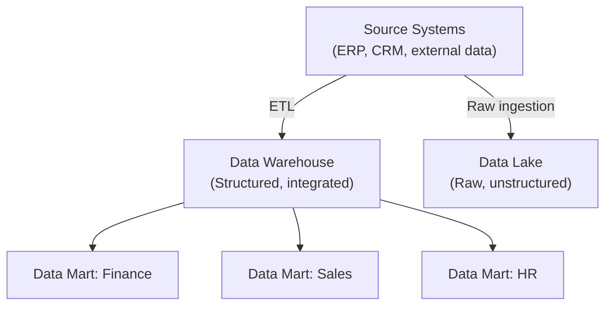
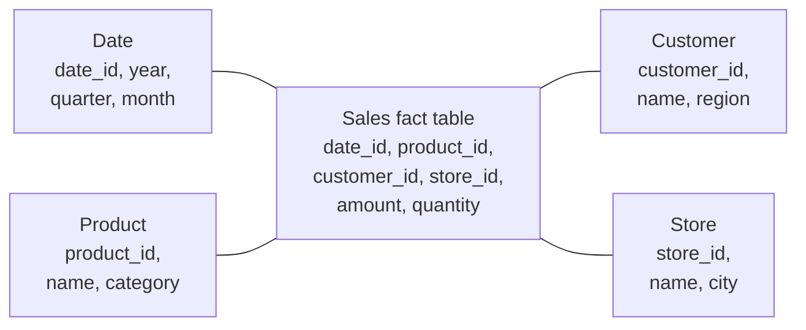

# Data Management

Almost every audit procedure and management decision now starts with a data set: a trial balance exported from the ledger, a list of journal entries pulled with a query, or sales figures combined from three regional systems. If the extraction misses records, or the query filters out the wrong ones, every conclusion built on that data inherits the error. That is why the ISC exam asks CPAs to understand how data is extracted, stored, structured, queried, and combined.

This chapter follows data through its life: how it is extracted, where it is stored, how databases are structured, how the data life cycle is controlled, how SQL queries retrieve it, and how data from different sources is integrated. It finishes with business process models. The application tasks here are practical: you may be shown a database design or a SQL query and asked whether the result is reliable.

---

## Data Extraction Methods and Techniques

**Data extraction** is retrieving data from one or more sources for analysis, reporting, or loading into another system. CPAs meet it in audit data analytics, financial reporting, and system migrations.

| Method | Description | Example |
|---|---|---|
| **Manual export** | A user exports data through the application's reporting or export features | Exporting a trial balance to a spreadsheet |
| **Query-based extraction** | A query, usually in SQL, retrieves specific records from a database | Pulling all journal entries over \$100,000 from the general ledger |
| **API-based extraction** | A program requests data through an application programming interface (API) | Pulling transactions from a SaaS application through its API |
| **ETL (extract, transform, load)** | An automated process extracts data from source systems, transforms it into a consistent format, and loads it into a target such as a data warehouse | A nightly job that loads sales from three regional systems into a central warehouse |

ETL is worth knowing step by step. **Extract** pulls the data from the sources. **Transform** cleans, validates, standardizes, and deduplicates it. **Load** writes it to the target. A weakness at any step, such as a transform step that never checks record counts against the source, makes the loaded data unreliable.

---

## Data Storage Types

Organizations store data differently depending on what they need to do with it:

| Storage Type | Description | Typical Use |
|---|---|---|
| **Data warehouse** | A central repository of structured, integrated data from many sources, organized for querying and reporting | Enterprise-wide reporting and analytics on historical data |
| **Data lake** | A large repository that holds raw data in its native format (structured, semi-structured, or unstructured) until it is needed | Storing large, varied data for exploration and machine learning |
| **Data mart** | A subset of a warehouse focused on one function or department | Faster, simpler reporting for finance, sales, or HR |



**Example:** **Polar Inc.** consolidates data from its ERP system, its CRM system, and external market feeds in a data warehouse. The finance team works from a finance **data mart** that holds only the data it needs, so its queries run faster than they would against the whole warehouse.

The key contrast is when structure is imposed. A warehouse applies structure before data is loaded (cleaned, consistent, ready for reliable reporting). A lake stores data first and applies structure only when someone reads it (flexible, but less controlled).

---

## Database Schemas

A **database schema** is the logical design of a database: which tables exist and how they relate. Data warehouses commonly use one of two designs, both built around a **fact table** that holds the measurements (sales amounts, quantities) and **dimension tables** that describe them (date, product, customer, store).

In a **star schema**, each dimension is a single table joined directly to the fact table, so the diagram looks like a star:



In a **snowflake schema**, the dimension tables are themselves normalized into sub-tables. The product dimension, for example, might link to a separate category table instead of repeating the category name on every product row.

| Feature | Star Schema | Snowflake Schema |
|---|---|---|
| Dimension tables | Denormalized (some data repeated) | Normalized into sub-tables |
| Structure | Simpler, fewer tables | More tables and joins |
| Query speed | Faster (fewer joins) | Slower (more joins) |
| Storage and redundancy | More redundancy | Less redundancy, more efficient storage |

---

## The Data Life Cycle

The blueprint defines the **data life cycle** as the span of the use of information, from creation, through active use and storage, to final disposition. Each stage needs its own controls:

| Stage | What Happens | Key Controls |
|---|---|---|
| **Creation or collection** | Data is generated internally or collected from outside sources | Input validation, authorization, data quality checks |
| **Storage** | Data is kept in databases, warehouses, or other repositories | Access controls, encryption, backup and recovery |
| **Active use** | Data is accessed, processed, analyzed, and shared | Access controls, processing integrity controls, audit trails, encryption in transit |
| **Archival** | Data no longer in active use but still required is moved to long-term storage | Retention policies, access controls, retrieval procedures |
| **Disposition** | Data no longer needed is destroyed | Secure deletion or destruction, documentation of destruction, adherence to retention schedules |

Disposition is the stage most often neglected. Deleting a file usually removes only the pointer to it, so the data can often be recovered until it is overwritten or the media is destroyed. The [Confidentiality and Privacy](../confidentiality-privacy-and-incident-response/confidentiality-and-privacy.md) chapter covers secure destruction methods.

---

## Relational Database Structure

A **relational database** stores data in **tables** (also called relations). Each table has **rows** (records) and **columns** (fields), and tables are linked through shared key values. The blueprint asks you to examine a database to see whether it applies integrity rules, uses a data dictionary, and normalizes its data.

### Data Integrity Rules

| Integrity Type | Rule | Example |
|---|---|---|
| **Entity integrity** | Every table has a **primary key**, and no primary key value may be null or duplicated | Every row in the Customers table has a unique, non-null CustomerID |
| **Referential integrity** | Every **foreign key** value must match a primary key value in the related table (or be null, if allowed) | Every CustomerID in the Orders table must exist in the Customers table |
| **Domain integrity** | Values in a column must fit the column's data type, format, and allowed values | An InvoiceDate column holds only valid dates; a State column holds only valid two-letter codes |

Referential integrity is the one that most often matters in an audit. Without it, an order can point to a customer who does not exist, and a query that joins the two tables may silently drop that order.

### Data Dictionary

A **data dictionary** is a central record of the metadata about a database: the tables and what they hold, each column's name, data type, and constraints, the primary and foreign key relationships, valid values and business rules, and who owns each data element. For an auditor it is the map of the database: it shows what each field means, which is essential before writing or reviewing a query.

### Normalization

**Normalization** organizes a database to reduce redundancy and protect integrity, by splitting tables so each fact is stored in one place:

| Normal Form | Rule | What It Eliminates |
|---|---|---|
| **First normal form (1NF)** | Each column holds a single (atomic) value; no repeating groups | Repeating groups |
| **Second normal form (2NF)** | 1NF, and every non-key column depends on the **whole** primary key | Partial dependencies |
| **Third normal form (3NF)** | 2NF, and every non-key column depends **only** on the primary key, not on another non-key column | Transitive dependencies |

**Example:** **Bear Co.**'s Employees table has the columns EmployeeID, EmployeeName, DepartmentID, and DepartmentName. DepartmentName depends on DepartmentID, not on EmployeeID, so the table is not in 3NF. If the Marketing department is renamed, every Marketing employee's row must be updated, and missing one leaves the data inconsistent. Moving DepartmentName to a separate Departments table, linked by DepartmentID, fixes the problem.

---

## Structured Query Language (SQL)

**Structured Query Language (SQL)** is the standard language for working with relational databases. The blueprint asks you to examine a standard query (its commands, clauses, operators, aggregate functions, and string functions) and decide whether the data it retrieves is **relevant and complete**. You will read SQL on the exam, not write it from scratch.

### Commands

| Command | Purpose | Example |
|---|---|---|
| `SELECT` | Retrieves data | `SELECT CustomerName, Balance FROM Customers` |
| `INSERT` | Adds rows | `INSERT INTO Customers (CustomerID, CustomerName) VALUES (101, 'Bear Co.')` |
| `UPDATE` | Changes existing rows | `UPDATE Customers SET Balance = 15000 WHERE CustomerID = 101` |
| `DELETE` | Removes rows | `DELETE FROM Customers WHERE CustomerID = 101` |

### Clauses

| Clause | Purpose | Example |
|---|---|---|
| `FROM` | Names the table or tables to read | `FROM Customers` |
| `WHERE` | Keeps only rows that meet a condition | `WHERE Balance > 10000` |
| `JOIN ... ON` | Combines rows from two tables on a related column | `JOIN Orders ON Customers.CustomerID = Orders.CustomerID` |
| `GROUP BY` | Groups rows that share a value so aggregates can be calculated per group | `GROUP BY DepartmentID` |
| `HAVING` | Keeps only groups that meet a condition (applied after grouping) | `HAVING SUM(Amount) > 50000` |
| `ORDER BY` | Sorts the results | `ORDER BY Balance DESC` |

Two joins matter most. An `INNER JOIN` (or plain `JOIN`) returns only rows that have a match in both tables. A `LEFT JOIN` returns every row from the first (left) table, with blanks (nulls) where the second table has no match.

### Operators

| Operator | Purpose | Example |
|---|---|---|
| `=`, `<>`, `>`, `<`, `>=`, `<=` | Compare values | `WHERE Status <> 'Closed'` |
| `AND`, `OR`, `NOT` | Combine or negate conditions | `WHERE Status = 'Active' AND Balance > 0` |
| `IN` | Matches any value in a list | `WHERE State IN ('IL', 'NY', 'CA')` |
| `BETWEEN` | Matches a range, including both endpoints | `WHERE Amount BETWEEN 1000 AND 5000` |
| `LIKE` | Matches a pattern; `%` stands for any characters, `_` for one character | `WHERE CustomerName LIKE 'Bear%'` |
| `IS NULL` | Finds missing values | `WHERE ApprovalDate IS NULL` |

### Aggregate and String Functions

| Function | Purpose | Example |
|---|---|---|
| `COUNT()` | Counts rows | `SELECT COUNT(*) FROM Transactions` |
| `SUM()` | Adds a numeric column | `SELECT SUM(Amount) FROM Transactions` |
| `AVG()` | Averages a numeric column | `SELECT AVG(Amount) FROM Transactions` |
| `MAX()` / `MIN()` | Returns the largest or smallest value | `SELECT MAX(Amount) FROM Transactions` |
| `UPPER()` / `LOWER()` | Converts text to upper or lower case | `SELECT UPPER(CustomerName) FROM Customers` |
| `TRIM()` | Removes leading and trailing spaces | `SELECT TRIM(CustomerName) FROM Customers` |
| `SUBSTRING()` | Extracts part of a string | `SELECT SUBSTRING(AccountCode, 1, 3) FROM Accounts` |
| `CONCAT()` | Joins strings together | `SELECT CONCAT(FirstName, ' ', LastName) FROM Employees` |
| `LENGTH()` / `LEN()` | Returns the number of characters | `SELECT LENGTH(CustomerName) FROM Customers` |

Here is how the pieces fit together. This query lists vendors paid more than \$100,000 in 2025:

```sql
SELECT VendorID, COUNT(*) AS InvoiceCount, SUM(Amount) AS TotalPaid
FROM Invoices
WHERE PaymentDate >= '2025-01-01' AND PaymentDate < '2026-01-01'
GROUP BY VendorID
HAVING SUM(Amount) > 100000
ORDER BY TotalPaid DESC
```

`WHERE` filters individual invoices **before** grouping, `GROUP BY` collects the remaining invoices by vendor, `HAVING` filters the vendor totals **after** grouping, and `ORDER BY` lists the largest first.

### Examining a Query for Relevance and Completeness

When a question shows you a query, check three things:

- **Relevance.** Does the query select the right columns from the right tables, and does its `WHERE` clause define the population the procedure needs?
- **Completeness.** Could a condition exclude records that belong in the population? Could an `INNER JOIN` drop records with no match in the other table? Does a date range capture the whole period?
- **Accuracy of summaries.** Are the aggregate functions the right ones, and does `GROUP BY` group at the right level?

**Example:** An auditor at **Bear Co.** needs every 2025 journal entry line posted to revenue accounts. The proposed query is:

```sql
SELECT JournalID, PostDate, AccountCode, Amount
FROM JournalEntries
WHERE AccountCode LIKE '4%'
  AND PostDate BETWEEN '2025-01-01' AND '2025-12-31'
  AND Amount > 0
```

Suppose Bear Co.'s system stores debits as positive amounts and credits as negative amounts. Revenue is recorded with credits, so `Amount > 0` keeps only the **debits** to revenue (returns, reversals, and corrections) and drops the entries that record revenue itself. The data set is badly incomplete, and the condition should be removed. Two more checks are worth making. `LIKE '4%'` is relevant only if every revenue account, and nothing but revenue accounts, begins with 4, which the chart of accounts will confirm. And if PostDate stores a time as well as a date, `BETWEEN ... '2025-12-31'` stops at midnight at the start of December 31 and misses that day's postings; `PostDate < '2026-01-01'` avoids the problem.

---

## Data Integration

**Data integration** combines data from different sources into one consistent view for analysis and decisions. The blueprint asks you to integrate data from different sources to support financial and operational analysis. The work is mostly about resolving differences:

| Challenge | Description |
|---|---|
| **Format differences** | The same data stored differently, such as dates as MM/DD/YYYY in one system and YYYY-MM-DD in another, or amounts in different currencies |
| **Duplicate records** | The same customer or vendor in several systems under different IDs or name spellings |
| **Data quality** | Missing values, errors, and out-of-date records |
| **Timing** | Sources updated on different schedules, so their figures do not agree at a given moment |
| **Meaning** | The same term defined differently, such as "revenue" in the sales system versus the general ledger |

Integration can be done by **ETL** into a central repository (the most common approach), by **data virtualization** (leaving the data in place and presenting a combined view), by **API integration** (systems exchanging data in real time), or by **manual consolidation** in spreadsheets, which carries the highest risk of error. Whatever the method, reconcile the integrated result back to the sources, for example by comparing record counts and control totals.

---

## Business Process Models

A **business process model** is a diagram of the steps, decisions, data flows, and people in a process. The blueprint asks you to investigate one and identify improvements.

| Model Type | What It Shows | Typical Use |
|---|---|---|
| **Flowchart** | The sequence of steps, decision points, and document flows | Documenting transaction processing and control points |
| **Data flow diagram (DFD)** | How data moves among sources, processes, data stores, and destinations | Understanding inputs, outputs, and transformations |
| **BPMN diagram** | A process in Business Process Model and Notation, a standard notation of events, activities, gateways, and flows | Detailed modeling in a widely shared standard |

When reading a model, look for **redundant steps** that add no value, **manual steps** that could be automated, **missing controls** where an approval, validation, or reconciliation should occur, **bottlenecks** where work queues up, and **unnecessary handoffs** between people or systems, each of which adds delay and a chance for error.

**Example:** **Illini Entertainment**'s accounts payable model shows a clerk typing each vendor invoice into a spreadsheet, and a second clerk re-entering it from the spreadsheet into the ERP system. The double entry adds cost and error without adding control. Entering invoices directly in the ERP system, or capturing them with automated invoice processing, removes the redundant step.

---

## Summary

| Topic | Key Takeaway |
|---|---|
| Data extraction | Manual export, queries, APIs, and ETL; ETL transforms and validates data before loading it |
| Storage types | Warehouses hold structured, integrated data; lakes hold raw data; marts are departmental subsets |
| Schemas | Star schemas are denormalized and fast; snowflake schemas are normalized and use less storage |
| Data life cycle | Creation, storage, use, archival, and disposition, each with its own controls |
| Relational databases | Entity, referential, and domain integrity; a data dictionary; normalization to 3NF |
| SQL | Read queries for relevance and completeness; watch `WHERE` conditions, join types, and date ranges |
| Data integration | Resolve format, duplicate, quality, timing, and meaning differences, then reconcile to sources |
| Business process models | Flowcharts, DFDs, and BPMN diagrams; look for redundancy, missing controls, and bottlenecks |

---

## Practice Questions

1. **Bear Co.** loads its data warehouse nightly from its ERP system through an ETL process. The finance team finds the same customer listed twice under slightly different names ("Bear Co." and "Bear Company"). At which ETL step should this be fixed?

2. An auditor reviews this query, which **Polar Inc.** uses to list large unpaid invoices:

   ```sql
   SELECT InvoiceID, VendorName, Amount
   FROM Invoices
   INNER JOIN Vendors ON Invoices.VendorID = Vendors.VendorID
   WHERE Amount > 50000
     AND PaymentDate IS NULL
   ```

   Some invoices carry a VendorID that was deleted from the Vendors table. Will those invoices appear in the results? What does their existence say about the database?

3. **Bear Co.** is considering a data lake alongside its data warehouse. What is the main difference between the two, and when is each more appropriate?

:::tip[Answers]

1. The **Transform** step. Transformation is where data is cleaned, standardized, and deduplicated, including matching records that refer to the same customer under different spellings.

2. **No.** An `INNER JOIN` returns only invoices with a matching vendor, so invoices whose VendorID no longer exists in the Vendors table are silently dropped, and the list of large unpaid invoices is incomplete. Using a `LEFT JOIN` would keep them (with a blank vendor name). Their existence also shows that the database is not enforcing **referential integrity**: a vendor was deleted while invoices still referred to it.

3. A **data warehouse** holds structured data that has been cleaned and integrated before loading, which suits consistent, reliable financial reporting. A **data lake** holds raw data of any type in its native format and imposes structure only when the data is read, which suits storing large, varied data for exploratory analysis or machine learning.

:::
