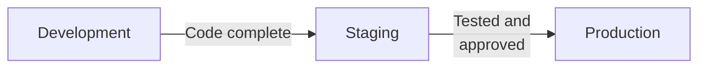

# Change Management

Information systems change constantly. Vendors release patches, developers fix bugs and add features, and administrators adjust configurations as the business grows. Each change is a chance to introduce an error, open a security hole, or knock a critical system offline. **Change management** is the set of processes and controls that govern how changes to systems are requested, approved, tested, put into production, and monitored afterward.

Change management failures are among the deficiencies the exam tests most often, because one weak spot (a developer who can push code straight to production) breaks several control principles at once. This chapter covers the purpose of change management, the tools and documentation it relies on, the separate environments changes move through, the types of testing, approaches to converting to a new system, patch management, and configuration settings. It closes with how to test change control policies, including in organizations that deploy code continuously.

---

## Purpose of Change Management

A sound change management process makes sure that every change to a system is:

- **Authorized**, so that only approved changes are made.
- **Tested**, so that it works and does not break anything else before it reaches users.
- **Documented**, so that there is a record of what changed, who changed it, and when.
- **Segregated**, so that the person who writes a change is not the one who approves it and moves it into production.
- **Reversible**, so that a failed change can be rolled back.

Without these, an unauthorized change can slip in malicious code or errors, an untested change can corrupt data, and an undocumented change makes problems impossible to trace. The risks apply to hardware as much as to software: replacing a server or reconfiguring a firewall needs the same discipline as changing application code.

---

## Tools and Documentation

The blueprint names several kinds of tools that support change management:

| Tool | Purpose |
|---|---|
| **Change tracking and ticketing systems** | Record each change request, its approvals, and its status (for example, Jira or ServiceNow) |
| **Version control systems** | Keep every version of the source code so changes can be compared and reversed (for example, Git) |
| **Test libraries** | Store test cases, scripts, and results for regression and acceptance testing |
| **Build automation tools** | Compile, package, and deploy code changes automatically |
| **Monitoring and logging tools** | Watch system behavior before and after a change to catch unexpected effects |

It also names the documentation that keeps the process accountable:

| Document | Purpose |
|---|---|
| **System component inventory** | A complete list of the hardware, software, and configuration items in the environment |
| **Baseline configuration** | The approved configuration of a system at a point in time; later changes are measured against it |
| **Change requests** | Formal requests describing a proposed change, its reason, its risk, and the approvals needed |
| **Ticketing records** | The history of each change from request through approval, testing, deployment, and closure |
| **Rollback procedures** | The steps for reversing a change that causes problems after deployment |

---

## Environments

A controlled process keeps changes in **separate environments** until they are ready:

| Environment | Purpose | Who Has Access |
|---|---|---|
| **Development** | Where developers write and change code | Developers |
| **Staging (test or QA)** | Where changes are tested in conditions that mirror production as closely as possible | Testers and QA staff |
| **Production** | The live system the business uses | End users and authorized operations staff; developers should have **no direct access** |

Keeping these environments separate is a control in its own right. Developers should not be able to change production directly; changes should move from development to staging to production through a controlled promotion step performed by someone other than the developer. Production data should not be copied into development or test environments unless it has been masked or anonymized.

**Example:** At **Polar Inc.**, a developer fixes a billing calculation error in the development environment. The fix is promoted to staging, where the QA team runs it against a set of test cases. Only after the tests pass and the change is approved does the release manager promote it to production. The developer never touches the production system.

:::tip[Exam Tip]

If a scenario says developers have direct access to production, that is a **segregation of duties** deficiency. The fix is to remove that access and have a separate person or team promote approved changes.

:::

---

## Types of Testing

Before a change reaches production, it is tested at increasing levels of scope:

| Test Type | Scope | Purpose |
|---|---|---|
| **Unit testing** | One component or module | Confirms each piece works on its own |
| **Integration testing** | Components working together | Confirms the pieces work correctly when combined |
| **System testing** | The entire system | Confirms the complete system meets its specifications |
| **Acceptance testing** | The business requirements | Confirms the system meets users' needs; usually the last step before deployment |

**Regression testing** reruns earlier tests after a change to confirm that the change did not break something that used to work.

---

## System Conversion Approaches

When an organization replaces a system, it must decide how to move from the old one to the new one. The approaches trade risk against cost:

| Approach | How It Works | Risk | Cost |
|---|---|---|---|
| **Direct (cutover)** | The old system is turned off and the new one goes live at once | **Highest**: nothing to fall back on if the new system fails | Lowest |
| **Parallel** | Both systems run side by side for a period, and their results are compared | **Lowest**: the old system remains as a fallback | Highest: two systems and duplicate work |
| **Pilot** | The new system goes live for one group or location first, then everywhere | **Moderate**: problems are contained, though some may surface only at full rollout | Moderate |
| **Phased** | The new system is introduced in stages, such as one module at a time | **Moderate**: each stage limits exposure | Moderate |

**Example:** **Kingfisher Industries** is replacing its legacy accounting system with a new ERP platform. Because the financial statements depend on it, management runs the two systems in **parallel** for three months, comparing outputs, before retiring the old system.

---

## Patch Management

**Patch management** is the process of finding, testing, and applying patches: vendor updates that fix bugs, close security vulnerabilities, or add features. Unpatched systems are a favorite target of attackers, so patch management sits at the intersection of change management and security. The process typically runs:

1. **Monitoring** vendor releases and security advisories for new patches.
2. **Prioritizing** each patch by the severity of the vulnerability and the importance of the affected systems.
3. **Testing** the patch in a non-production environment to make sure it does not break anything.
4. **Scheduling** deployment for a window that limits disruption.
5. **Deploying** the patch to production.
6. **Validating** that the patch installed correctly and the system works.
7. **Documenting** what was patched, where, and with what result.

A critical vulnerability that attackers are already exploiting may justify an emergency process that shortens testing. Even then, the emergency change should be documented and reviewed after deployment.

---

## Configuration Parameters

Much of a system's behavior is controlled not by code but by **configuration parameters**: settings chosen when the software is installed and adjusted afterward. In an ERP system these include the tolerance allowed in a three-way match, the dollar threshold that requires a second approval, password length and lockout rules, and which fields are mandatory. Changing one setting can switch a control on or off for every transaction, whether the software was developed in-house or bought from a vendor.

The blueprint asks you to test controls over how these parameters are **selected, implemented, maintained, and monitored**. A sound design documents the approved settings in a baseline configuration, restricts who can change them, routes every change through the change management process, and periodically compares the live settings with the baseline (often with an automated tool that flags differences). To test the design and implementation, you would inspect the documented baseline, inspect the system's access settings to see who can change parameters, compare a sample of live settings with the baseline, and trace a recent parameter change back to an approved change request.

**Example:** **Bear Co.**'s ERP system is supposed to block payment of any invoice that differs from its purchase order by more than 2%. The auditor finds the tolerance set at 20%, changed six months ago by an administrator with no change ticket. The control over configuration parameters failed, and every payment since then went through a much weaker match than management intended.

---

## Testing Change Control Policies

The blueprint asks you to test the design and implementation of change control policies. These are the policies to look for and the questions to ask about each:

| Policy | What to Test |
|---|---|
| **Acceptance criteria** | Are there defined criteria a change must meet before it is promoted? |
| **Authorization** | Is each change approved by an appropriate person before deployment? |
| **Code review** | Does someone other than the developer review the code? |
| **Testing** | Are the required tests performed and their results documented? |
| **Logging and monitoring** | Are changes logged, and is the system monitored after deployment? |
| **Segregation of duties** | Is the person who writes a change different from the person who approves and deploys it? |
| **Access restrictions** | Is the ability to change production limited to authorized people? |

### Continuous Integration and Continuous Deployment (CI/CD)

Many organizations now use **continuous integration (CI)**, in which developers merge code into a shared repository frequently and each merge triggers automated builds and tests, and **continuous deployment (CD)**, in which code that passes the automated tests is released to production automatically. Changes may go live many times a day with no person pressing a button.

The control objectives do not change, but the controls move into the pipeline:

- **Authorization moves earlier.** With no manual release step, approval usually happens when the code is merged: the repository is set so that a change cannot be merged until someone other than the author has reviewed and approved it.
- **Automated tests become gates.** The pipeline must stop any change that fails a required test, and no one should be able to skip a gate.
- **The pipeline itself is protected.** Whoever can edit the pipeline's configuration can remove its gates, so changes to the pipeline need the same control as changes to code.
- **The trail is complete.** The pipeline should log every build, test result, approval, and deployment.

**Example:** **Illini Security** runs automated unit and integration tests on every commit and deploys automatically when they pass. That design can be acceptable. The deficiency the auditor finds is that developers can merge their own code into the main branch without anyone else's review, so no independent person authorizes any change before it reaches production.

### Walking Through the Change Management Process

A walkthrough selects one change and follows it through the whole process to see whether the documented policy was followed:

1. **Select a change** from the change tracking system.
2. **Read the change request.** Was it documented and justified?
3. **Check authorization.** Did an appropriate person approve it before deployment?
4. **Check testing.** Were the required tests performed and their results kept?
5. **Check the environments.** Did the change move from development through staging to production?
6. **Check deployment.** Was it deployed by an authorized person other than the developer?
7. **Check monitoring.** Was the system watched after the change?
8. **Compare** what you observed with the documented policy.

Any difference between the observed procedure and the documented policy is a deviation to report.

---

## Summary

| Topic | Key Takeaway |
|---|---|
| Purpose | Changes must be authorized, tested, documented, segregated, and reversible |
| Tools and documentation | Ticketing, version control, test libraries, build automation, monitoring, baselines, rollback procedures |
| Environments | Development, staging, and production stay separate; developers do not change production |
| Testing | Unit, integration, system, and acceptance testing, plus regression testing |
| Conversion approaches | Direct (highest risk), parallel (lowest risk), pilot, and phased |
| Patch management | Monitor, prioritize, test, schedule, deploy, validate, document |
| Configuration parameters | Baseline the settings, restrict changes, route them through change management, and monitor for drift |
| CI/CD | Independent review before merge, test gates that cannot be bypassed, a protected pipeline, and a full log |

---

## Practice Questions

1. **Bear Co.** is replacing its payroll system. Because payroll errors would affect every employee, the HR director wants the lowest-risk conversion approach. Which approach should Bear Co. use, and why?

2. **Bear Co.** deploys its accounting application through a CI/CD pipeline that runs automated unit tests only. A developer's change passed the unit tests but contained a calculation error that was not found until month-end close. No one other than the developer reviewed the change. What change control weaknesses does this show?

3. During a walkthrough at **Polar Inc.**, you see that the person who developed a change to the inventory module also approved it and deployed it to production. What control deficiency is this?

:::tip[Answers]

1. **Parallel conversion.** Running the old and new payroll systems side by side lets Bear Co. compare results before retiring the old system, and it keeps a fallback if the new system fails.

2. Two weaknesses. **Testing was inadequate:** unit tests check components in isolation and missed a calculation error that integration, system, or acceptance testing would have been designed to catch. **There was no independent authorization:** no one other than the developer reviewed or approved the change before it reached production.

3. A **segregation of duties** deficiency. Developing, approving, and deploying a change should be split among different people so that no one person can put an unauthorized or untested change into production.

:::
