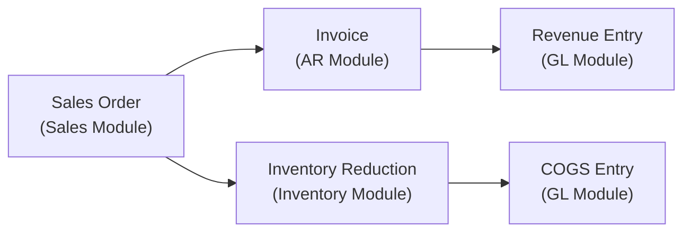

# Enterprise and Accounting Information Systems

A sale at a modern company does not get typed into a journal. Someone enters an order, and the system takes it from there: it checks credit, reserves inventory, triggers shipping, creates an invoice, and posts revenue, receivables, and cost of goods sold to the general ledger. The systems that do this work are **enterprise resource planning (ERP) systems** and **accounting information systems (AIS)**. Because so much of the accounting happens inside them, a CPA has to understand how they are built, what other systems feed them, and which controls keep their processing complete and accurate.

This chapter describes ERP systems and the business processes an AIS supports, then the other systems that exchange data with them, including electronic data interchange and blockchain. It then covers controls over processing integrity, how to reconcile an actual process to its documentation, and ways to improve an AIS. The exam tests this topic at every skill level, up to detecting processing integrity deficiencies in a SOC 2® engagement.

---

## Enterprise Resource Planning (ERP) Systems

An **ERP system** is an integrated software platform that runs an organization's core business processes from one shared database. Instead of separate programs for finance, purchasing, sales, and human resources, each with its own copy of the data, the ERP system's modules all read from and write to the same records.

| Module | Business Functions |
|---|---|
| **Financial accounting** | General ledger, accounts payable, accounts receivable, fixed assets, financial reporting |
| **Management accounting** | Cost centers, profit centers, product costing |
| **Human resources** | Payroll, benefits, time tracking |
| **Procurement** | Requisitions, purchase orders, vendor management, receiving |
| **Sales and distribution** | Sales orders, pricing, shipping, billing, customer records |
| **Production planning** | Bills of materials, production scheduling, capacity planning |
| **Treasury** | Cash management, bank reconciliation, investments |

The value of an ERP system is **integration**: one entry updates every module it touches.

**Example:** When **Polar Inc.** enters a sales order, its ERP system creates the receivable, reduces inventory, records cost of goods sold, and posts the related journal entries, all from that one entry. Nobody re-keys the data, so transcription errors disappear and the ledger is current.

Integration cuts both ways, though. If the sales module lets a clerk override prices without approval, the wrong price flows automatically into revenue, receivables, and margin reports. When you evaluate an ERP system, follow a control weakness downstream to every module it feeds.

---

## Accounting Information Systems (AIS)

An **accounting information system (AIS)** is the part of an organization's information system that collects, records, stores, and processes financial data to produce information for decision makers. An AIS may be a set of modules within an ERP system or a standalone application. The blueprint lists the key business processes an AIS supports:

| Business Process | Key Activities | Key Documents and Records |
|---|---|---|
| **Sales** | Order entry, credit approval, shipping, billing | Sales orders, shipping documents, invoices |
| **Cash collections** | Receiving and depositing payments, applying cash to receivables | Remittance advices, deposit records, bank statements |
| **Purchasing** | Requisitioning, selecting vendors, issuing purchase orders, receiving | Requisitions, purchase orders, receiving reports |
| **Disbursements** | Matching invoices, authorizing and making payments | Vendor invoices, payment vouchers, checks and electronic payments |
| **Human resources and payroll** | Hiring, time tracking, payroll processing, withholding | Personnel files, timesheets, payroll registers |
| **Production** | Work orders, material issues, labor tracking, cost allocation | Work orders, material requisitions, production reports |
| **Treasury** | Cash forecasting, investments, borrowing | Cash projections, bank and broker statements |
| **Fixed assets** | Acquisition, depreciation, impairment, disposal | Asset register, depreciation schedules |
| **General ledger and reporting** | Journal entries, trial balance, financial statements | Journal entries, trial balance, financial statements |

---

## Systems That Interact with ERP and AIS

An ERP system rarely works alone. It receives orders from e-commerce sites, sends payment files to banks, exchanges documents with customers and suppliers, sends data to payroll providers and data warehouses, and in some industries reads from or writes to a blockchain. The blueprint asks you to **recognize** these other systems, and it names two: electronic data interchange and blockchain.

Every one of these connections is an **interface**, and interfaces are control points. Data must arrive complete, accurate, and authorized, and it must not be duplicated or lost on the way. Typical interface controls include record counts and control totals compared on both sides, edit checks on incoming data, error queues that someone reviews, and reconciliations between the two systems.

### Electronic Data Interchange (EDI)

**Electronic data interchange (EDI)** is the computer-to-computer exchange of business documents, such as purchase orders, invoices, shipping notices, and payment remittances, between trading partners in a standard format. Because the format is standard, the receiving system can process the document without anyone re-entering it. Partners connect directly over the internet or through a third-party network provider.

EDI speeds up the order-to-cash and purchase-to-pay cycles and removes keying errors. It also removes the paper trail and lets transactions flow with little human review, so the risks are unauthorized or fictitious transactions, transmission errors, and duplicate processing. Common controls are a **trading partner agreement** that sets out each party's responsibilities, authentication of each partner, encryption in transit, acknowledgments confirming each transmission was received, edit checks on incoming documents, and logs of all transactions sent and received.

**Example:** **Polar Inc.** sends purchase orders to **Bear Co.** by EDI, and each order automatically becomes a sales order in Bear Co.'s ERP system. Bear Co.'s system checks every incoming order against its customer master file and approved price list, sends Polar Inc. an acknowledgment, and compares the day's count of orders received with the count Polar Inc. reports sending.

### Blockchain

A **blockchain** is a ledger that is shared across a network of participants (called nodes) instead of being held by one party. New transactions are grouped into blocks. Each block carries a cryptographic hash (a digital fingerprint) of the block before it, so changing an old record would break the chain and be obvious to everyone. The participants follow a **consensus mechanism**, a set of rules for agreeing which new blocks are valid. Public blockchains let anyone participate; private or permissioned blockchains limit participation to approved members. Many blockchains also run **smart contracts**, programs that execute automatically when specified conditions are met, such as releasing a payment when a shipment is recorded.

For the exam, see blockchain as one more system that exchanges data with the ERP and accounting systems. A company might track inventory across its supply chain on a shared blockchain, settle payments on one, or hold digital assets recorded on one. The ERP system receives data from the blockchain, or sends data to it, through an interface. The blockchain does not replace the company's own books. The entity still records its transactions in its general ledger, and the same interface questions apply: is the data coming from the blockchain complete and accurate, does it reconcile to the ledger, and who controls the private keys that authorize transactions?

:::note[Testing before January 1, 2027?]

The 2026 Blueprint also asked candidates to explain how the COSO internal control framework can be used to evaluate blockchain risks in financial reporting, based on COSO's *Blockchain and Internal Control: The COSO Perspective*. The 2027 Blueprint removed that task. If you test in 2026, be ready to apply the five COSO components to blockchain risks such as smart contract errors, private key management, and reconciling on-chain records to the general ledger.

:::

---

## Controls Over Processing Integrity

**Processing integrity** means that system processing is complete, valid, accurate, timely, and authorized to meet the entity's objectives. It is one of the five Trust Services categories, so it can be the subject of a SOC 2® engagement as well as an everyday control concern.

Processing controls are usually grouped by where they act:

| Control Type | Purpose | Examples |
|---|---|---|
| **Input controls** | Make sure data entered is complete, accurate, and authorized | Validation checks, required fields, approvals, batch totals |
| **Processing controls** | Make sure data is processed correctly and completely | Run-to-run totals, sequence checks, limit and reasonableness checks |
| **Output controls** | Make sure output is complete, accurate, and reaches only authorized recipients | Reconciling output to input, distribution lists, output logs |

Input validation deserves special attention because errors are cheapest to stop at the point of entry:

| Control | What It Does | Example |
|---|---|---|
| **Validity check** | Compares the entry with a list of valid values | The customer ID must exist in the customer master file |
| **Range (limit) check** | Confirms a value falls within set bounds | An hourly wage must be between \$7.25 and \$500.00 |
| **Completeness check** | Confirms required fields are filled in | An invoice cannot be saved without a purchase order number |
| **Check digit** | Uses a formula to catch mistyped identification numbers | Validates the last digit of a bank routing number |
| **Batch totals** | Compares control totals (record counts, dollar totals, hash totals) before and after processing | The total of invoices entered must equal the batch control total |
| **Duplicate check** | Rejects a transaction already entered | The system refuses a second payment of the same invoice number |

### Processing Integrity in a SOC 2® Engagement

In a SOC 2® engagement that includes processing integrity, the service auditor evaluates the service organization's controls against five additional criteria, on top of the common criteria that apply to every SOC 2® engagement:

| Criterion | In Plain English |
|---|---|
| **PI1.1** | The entity defines and communicates what it processes: data definitions and product and service specifications |
| **PI1.2** | Controls over inputs make them complete and accurate |
| **PI1.3** | Controls over processing produce the intended results |
| **PI1.4** | Output is delivered completely, accurately, and on time, in line with specifications |
| **PI1.5** | Inputs, items in processing, and outputs are stored completely and accurately |

The service auditor looks for two kinds of problems. A **design deficiency** exists when a needed control is missing, or when the control would not meet the criterion even if performed exactly as designed. An **operating deviation** exists when a well-designed control was not performed, or was performed incorrectly, during the period. The test is simple: if the control worked perfectly every time, would it address the risk? If not, the design is deficient. If it would, but it did not always work, the operation deviated.

**Example:** **Sloth Security** runs a billing platform for its customers and has a SOC 2® report that covers processing integrity. Its documented procedure says that any batch of usage records that fails to reconcile to the source system is held until an analyst resolves the difference. The service auditor finds that the platform has no reconciliation at all for one data feed added during the year (a design deficiency for that feed), and that in 3 of 25 sampled batches from the other feeds, an unreconciled batch was released without review (an operating deviation).

---

## Reconciling Actual Processes to Documented Procedures

Organizations document their processes in three common forms: **flowcharts**, which show the steps, decision points, and document flows; **business process diagrams**, often drawn in the standard Business Process Model and Notation (BPMN); and **narratives**, which describe the steps, controls, and people in words. The blueprint asks you to reconcile what actually happens in a key process to what the documentation says should happen.

The tool for this is a **walkthrough**. The auditor typically:

1. Selects one transaction from the process.
2. Traces it from initiation through processing, recording, and reporting.
3. Asks the people who perform each step what they do and which controls they apply, and inspects the evidence.
4. Compares each observed step, document, and tool with the documented procedure.
5. Notes where they differ.

Differences come in three kinds. The process may skip or alter a documented control (a deviation). The documentation may lack a control the process needs (a design gap). Or the process may have changed without approval, so the documentation is simply out of date.

**Example:** During a walkthrough of **Bear Co.**'s purchasing process, the auditor watches a purchasing agent approve a \$7,500 order on her own authority, even though the flowchart requires a manager's approval for orders over \$5,000. That is a deviation from a documented control. The auditor also notices that neither the flowchart nor the actual process compares vendor invoices with receiving reports before payment, so Bear Co. could pay for goods it never received. That is a design gap.

A walkthrough shows how a process works and whether a control has been implemented. It does not, by itself, show that the control operated throughout a period; that takes testing a sample over the period. The [Data Management](../data-management/data-management.md) chapter covers how to read a business process model to find improvements.

---

## Improving the Performance of an AIS

The blueprint also asks you to determine changes that would improve how an AIS performs. Three are named.

**Robotic process automation (RPA)** uses software "bots" to perform repetitive, rule-based tasks that people used to do by hand: matching invoices to purchase orders and receiving reports, comparing bank transactions to the ledger, posting recurring journal entries, or compiling standard reports. Bots work quickly, around the clock, and consistently, and they log what they do. The catch is that a bot automates whatever process it is given, flaws included. Bots also break when the systems they read from change, and each bot needs its own credentials, which should carry only the access the task requires. So RPA needs controls of its own: change management over the bot's logic, monitoring of its output, and least-privilege access.

**Outsourcing** moves a process, such as payroll or IT hosting, to a service organization. It can lower costs and bring in specialized skills, but the entity keeps responsibility for the process. It will need the provider's SOC report to understand the provider's controls, and it must perform the complementary user entity controls the report assumes.

**System changes** such as upgrading or replacing an AIS can improve integration and automate controls. They also bring conversion risk, which the [Change Management](./change-management.md) chapter covers.

---

## Summary

| Topic | Key Takeaway |
|---|---|
| ERP systems | One integrated database across business functions; a weakness in one module flows into others |
| AIS business processes | Sales, collections, purchasing, disbursements, payroll, production, treasury, fixed assets, and reporting |
| Interacting systems | EDI, blockchain, banks, e-commerce, and other systems connect through interfaces that need completeness and accuracy controls |
| Processing integrity | Input, processing, and output controls; in SOC 2®, criteria PI1.1-PI1.5 |
| Design vs. operation | A design deficiency fails even if performed perfectly; an operating deviation is a good control not performed as designed |
| Walkthroughs | Trace one transaction and compare each step with the documentation |
| Improving an AIS | RPA, outsourcing, and system changes, each with its own control needs |

---

## Practice Questions

1. **Bear Co.**'s ERP system accepted a sales order for a product that had been discontinued and removed from the product master file. What input control is missing?

2. **Polar Inc.**'s flowchart for cash disbursements requires two approvals for payments over \$10,000. In a walkthrough, the auditor sees that the second approval is routinely skipped for payments to long-standing vendors. Is this a design deficiency or an operating deviation?

3. **Bear Co.** uses an RPA bot to prepare bank reconciliations. Six months after the bot goes live, the bank changes its statement format and the bot begins misclassifying transactions. Nobody notices until quarter-end. Which controls over the bot failed?

4. **Kingfisher Industries** receives customer purchase orders electronically, in a standard format, directly into its ERP system. Last month several orders were processed twice. What kind of system is sending the orders, and which controls would catch the problem?

:::tip[Answers]

1. A **validity check**. The system should confirm that the product code on the order exists in the current product master file and reject the order if it does not.

2. An **operating deviation**. The documented control (two approvals over \$10,000) is suitably designed, but it is not being performed consistently.

3. **Change management and monitoring.** Changes to the systems a bot depends on should trigger review and testing of the bot, and someone should monitor the bot's output so errors are caught quickly.

4. The orders arrive through **electronic data interchange (EDI)**. A duplicate check on incoming documents (for example, rejecting a second order with the same customer purchase order number), together with comparing daily counts of orders received with the counts the customer reports sending, would catch the duplicates.

:::
