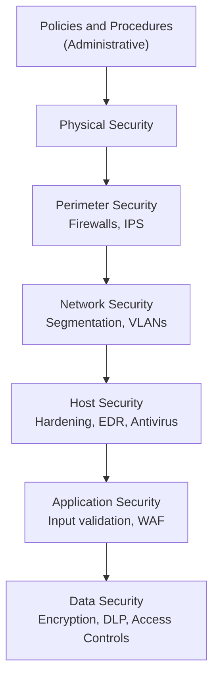
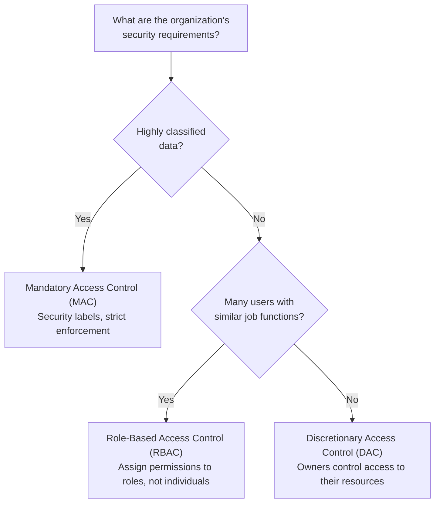

# Security Mitigation

The previous chapter described who attacks and how. This one describes the defenses. No single control stops every attack, so organizations combine people, processes, and technology in layers, each designed to **prevent, detect, or correct** a security event. A CPA evaluating a security program needs to know what each control does, which threat it answers, and whether it fits the situation.

The chapter starts with protecting networks and remote access, then vulnerability management, layered security, and the core access principles (least privilege, zero trust, allowlisting, and need to know). It covers acceptable use policies and how COSO's frameworks apply to cyber risk, then classifies controls as preventive, detective, or corrective. It ends with identification, authentication, and authorization. Many exam questions here are Application-level: given a scenario, choose the right control, authentication method, or authorization model.

---

## Protecting Networks and Remote Access

### Segmentation and Isolation

**Network segmentation** divides a network into smaller zones, each with its own access rules. If an attacker gets into one zone, segmentation keeps them from moving freely to the others (lateral movement).

| Technique | Description | Example |
|---|---|---|
| **VLANs** | Virtual LANs separate traffic logically on the same physical network | Accounting systems on one VLAN, guest Wi-Fi on another |
| **DMZ (demilitarized zone)** | A perimeter network between the internet and the internal network for public-facing services | Web servers in the DMZ, database servers inside |
| **Air gap** | Complete physical isolation from other networks | Highly sensitive industrial control systems |
| **Microsegmentation** | Fine-grained segmentation around individual workloads, common in cloud environments | Each virtual machine or container with its own security policy |

**Example:** **Kingfisher Industries** separates its finance systems from the network on its manufacturing floor. When malware infects a machine on the factory network, segmentation keeps it from spreading to the systems that hold financial data.

### Virtual Private Networks (VPNs)

A **virtual private network (VPN)** creates an encrypted tunnel across a public network, usually the internet. A **remote access VPN** connects an individual user, such as an employee working from home, to the organization's network. A **site-to-site VPN** connects two whole networks, such as headquarters and a branch office. VPN security depends on strong encryption protocols (such as IPsec or TLS), multi-factor authentication for every VPN login, prompt removal of departed users, and attention to **split tunneling**, a setting that lets a connected device reach the internet directly instead of through the corporate network, bypassing corporate defenses.

### Wireless Network Security

Wireless signals pass through walls, so wireless networks need extra protection:

- **Strong encryption**, preferably WPA3, the current standard, which replaces the weaker WPA2.
- **802.1X authentication**, which requires each user or device to authenticate to a central server before joining the network.
- **Separate guest networks**, which keep visitors off the corporate network.
- **Hidden network names (SSIDs)** and **MAC address filtering**, which add a little obscurity but are easily defeated (device addresses can be spoofed), so they should never be the main control.

### Endpoint Security

**Endpoint security** protects the individual devices (laptops, desktops, phones, and servers) that connect to the network:

| Control | Purpose |
|---|---|
| **Endpoint detection and response (EDR)** | Monitors devices continuously for suspicious behavior and can respond automatically |
| **Antivirus and anti-malware** | Detects and removes malicious software using signatures and behavior analysis |
| **Host-based firewall** | Controls the traffic into and out of the individual device |
| **Device encryption** | Protects stored data if the device is lost or stolen |
| **Mobile device management (MDM)** | Enforces security settings on mobile devices and allows remote wipe |

### System Hardening

**System hardening** shrinks a system's attack surface by removing everything it does not need: disabling unused services and ports, removing default accounts and changing default passwords, uninstalling unneeded software, restricting administrator rights, turning on logging, and applying a secure configuration baseline such as the CIS Benchmarks.

**Example:** **Polar Inc.** builds every new server from a hardened image that disables non-essential services, removes default accounts, and applies current patches before the server is connected to the production network.

### Intrusion Detection and Prevention

| Feature | Intrusion Detection System (IDS) | Intrusion Prevention System (IPS) |
|---|---|---|
| **What it does** | Detects suspicious activity and raises an alert | Detects suspicious activity and **blocks** it |
| **Placement** | Passive: watches a copy of the traffic | Inline: sits directly in the traffic path |
| **Response** | Alerts people to investigate | Drops or blocks the traffic automatically |
| **Main risk** | Alerts that no one acts on in time | Blocking legitimate traffic (false positives) |

Both can use **signature-based detection**, which compares traffic with known attack patterns and works well against known threats, and **anomaly-based detection**, which learns normal behavior and flags departures from it, catching some new (zero-day) attacks at the cost of more false positives.

:::tip[Exam Tip]

An IDS **detects and alerts**, so it is a detective control. An IPS **detects and blocks**, so it is a preventive control. If a question asks which control would stop an attack in progress, the answer is the IPS; if it asks which would notify the security team, the answer is the IDS.

:::

---

## Vulnerability Management

**Vulnerability management** is the ongoing process of finding, ranking, and fixing security weaknesses in systems and software. Its purpose is to shrink the window in which an attacker can exploit a known weakness. It runs as a cycle:

1. **Discover** the assets that need protecting, since you cannot scan what you do not know about.
2. **Scan** them for known vulnerabilities.
3. **Assess and prioritize** each finding by severity and by how important the affected system is.
4. **Remediate** by patching, reconfiguring, or adding a compensating control.
5. **Verify** that the fix worked, then start again.

**Vulnerability scanning** and **penetration testing** are often confused:

| Activity | Description | Approach | Frequency |
|---|---|---|---|
| **Vulnerability scanning** | Automated tools check systems for known weaknesses | Non-intrusive; lists potential weaknesses | Frequent (for example, weekly or monthly) |
| **Penetration testing** | Skilled testers try to exploit weaknesses as a real attacker would | Intrusive; shows what an attacker could actually do | Periodic (for example, annually) |

Two public resources help organizations prioritize. **CVE (Common Vulnerabilities and Exposures)** gives each publicly known vulnerability a standard identifier, such as CVE-2024-12345. The **Common Vulnerability Scoring System (CVSS)** rates severity from 0.0 to 10.0:

| CVSS Score | Severity |
|---|---|
| 0.0 | None |
| 0.1-3.9 | Low |
| 4.0-6.9 | Medium |
| 7.0-8.9 | High |
| 9.0-10.0 | Critical |

Most vulnerabilities are fixed by applying a vendor's patch, so vulnerability management depends on a sound patch management process, described in the [Change Management](../information-systems/change-management.md) chapter. A breach through a vulnerability whose patch had been available for weeks is a classic exam scenario. A good policy sets deadlines by severity, such as applying critical patches within days.

---

## Layered Security and Defense in Depth

**Defense in depth** uses several layers of different controls so that if one layer fails, others still protect the asset. No single control is trusted to do the job alone. Controls in the layers come in three broad types:

| Type | What It Is | Examples |
|---|---|---|
| **Physical** | Controls over the physical environment | Locked doors, guards, cameras, badge readers |
| **Technical (logical)** | Controls built into technology | Firewalls, encryption, access controls, IDS and IPS, anti-malware |
| **Administrative** | Policies, procedures, and people controls | Security policies, training, background checks, segregation of duties |

The layers are often pictured from the outside in, with policies wrapped around everything and the data at the center:

**Example:** **Illini Security** protects its financial data with a locked server room (physical), a firewall and database encryption (technical), role-based access (technical), annual security training (administrative), and a policy of quarterly access reviews (administrative). An attacker who gets past the firewall still faces encryption, access controls, and monitoring.

Defense in depth does not mean repeating the same control. Two firewalls from the same vendor with the same rules add little; a firewall plus encryption plus monitoring adds a great deal, because each fails in a different way.

---

## Least Privilege, Zero Trust, Allowlisting, and Need to Know

These principles govern who gets access to what:

| Principle | Definition | Application |
|---|---|---|
| **Least privilege** | Users and systems get only the minimum access needed for their duties | An accounts payable clerk can enter and process invoices but cannot approve payments or see payroll |
| **Zero trust** | No user, device, or network location is trusted by default; every request is verified | Users inside the office must authenticate and be authorized for each resource, just like remote users |
| **Whitelisting (allowlisting)** | Only explicitly approved items (applications, IP addresses, email senders) are allowed; everything else is denied | Only approved software can run on company workstations |
| **Need to know** | Access to specific information is limited to people who need that information for their job | A tax accountant at **Bear Co.** can see client tax returns but not audit engagement files |

Least privilege and need to know are close cousins. Least privilege limits the **level** of access (read, change, approve); need to know limits **which information** a person can see.

### Zero Trust

Traditional security drew a hard perimeter and trusted everyone inside it, sometimes called the "castle and moat" approach. Once an attacker crossed the moat, they could move freely. **Zero trust** drops the idea of a trusted inside. It rests on three ideas:

- **Verify explicitly.** Authenticate and authorize every request using all available signals: identity, device health, location, and the resource requested.
- **Use least privilege.** Grant the minimum access, for the minimum time.
- **Assume breach.** Design as if an attacker is already inside, using segmentation, encryption, and continuous monitoring to limit the damage.

Zero trust is an approach to architecture, not a product you can buy. If a scenario describes verifying every access request regardless of whether the user is inside or outside the corporate network, the principle is zero trust.

---

## Technology Acceptable Use Policies

A **technology acceptable use policy (AUP)** sets the rules for how employees and other users may use the organization's technology: computers, networks, email, internet access, and mobile devices. It sets clear expectations, reduces security and legal risk, supports compliance, and gives the organization a basis for discipline when the rules are broken.

| Section | What It Covers |
|---|---|
| **Scope** | Who the policy applies to (employees, contractors, vendors) and which systems |
| **Permitted use** | Business use and any allowed personal use |
| **Prohibited activities** | Such as installing unauthorized software, illegal downloads, harassment |
| **Security responsibilities** | Password rules, locking screens, reporting suspected incidents |
| **Monitoring** | Notice that the organization may monitor use of its systems |
| **Consequences** | Discipline for violations |

### BYOD and Mobile Devices

The blueprint asks specifically about mobile technology and **bring your own device (BYOD)** policies, which govern personal devices used for work. The organization controls these devices less, so the policy has to compensate:

| BYOD Risk | Policy Response |
|---|---|
| Data exposed when a personal device is lost or stolen | Require encryption, a passcode, and remote wipe |
| Personal and work data mixed together | Use containerization to keep work data in a separate, managed space |
| Outdated or insecure devices | Require a minimum operating system version and current updates before granting access |
| Unapproved apps reaching corporate data | Allow access to corporate data only through approved apps |
| Employee privacy concerns | State clearly what the organization can and cannot see or erase on a personal device |

**Example:** **Illini Entertainment** lets employees read email on personal phones only if they enroll in its MDM system, use at least a six-digit passcode, and keep encryption on. Company data is wiped remotely if the phone is reported lost or the employee leaves.

---

## COSO Frameworks for Cyber Risk

The blueprint asks how the COSO frameworks can be used to assess cyber risks and controls. The References limit this to COSO's *Managing Cyber Risk in a Digital Age*, which applies the five components of COSO's enterprise risk management (ERM) framework to cyber risk. The point is that cyber risk is a business risk, managed with the same discipline as any other, and not just an IT problem.

| ERM Component | Applied to Cyber Risk |
|---|---|
| **Governance and culture** | The board oversees cyber risk, and leadership builds a culture in which security is everyone's job |
| **Strategy and objective-setting** | Cyber risk is considered when setting strategy, and the organization defines how much cyber risk it will accept (its risk appetite) |
| **Performance** | Cyber risks are identified, assessed, and prioritized by severity, and responses are chosen and carried out |
| **Review and revision** | The organization watches for changes, such as new technology or new threats, that alter its cyber risk, and improves its approach |
| **Information, communication, and reporting** | Cyber risk information reaches the right people, including regular reporting to the board |

COSO's *Internal Control - Integrated Framework* (2013) is the other lens. Its five components (control environment, risk assessment, control activities, information and communication, and monitoring activities) apply to cybersecurity controls just as they apply to financial reporting controls, and one of its 17 principles specifically calls for general controls over technology. Using COSO lets management and auditors evaluate cyber risk with a structure they already know.

---

## Preventive, Detective, and Corrective Controls

Controls are also classified by **when** they act relative to a security event:

| Control Type | Purpose | Timing | Examples |
|---|---|---|---|
| **Preventive** | Stop the event from happening | Before | Firewalls, access controls, encryption, IPS, hardening, training |
| **Detective** | Discover that an event is happening or has happened | During or after | IDS, log analysis, security monitoring, audit trails |
| **Corrective** | Limit the damage and restore normal operations | After | Quarantining infected files, applying patches, restoring from backups, incident response |

| Control | Preventive | Detective | Corrective |
|---|---|---|---|
| Firewall | Yes | No | No |
| Intrusion prevention system | Yes | No | No |
| Intrusion detection system | No | Yes | No |
| Antivirus and anti-malware | Yes | Yes | Yes |
| System hardening | Yes | No | No |
| Log analysis and SIEM | No | Yes | No |
| Patches | No | No | Yes |
| Virus quarantining | No | No | Yes |
| Encryption | Yes | No | No |
| Security awareness training | Yes | No | No |
| Access control lists | Yes | No | No |
| Backup and recovery | No | No | Yes |

A single control can play more than one role. Anti-malware software **prevents** known malware from running, **detects** malware already present, and **quarantines** infected files. When a question asks for the primary classification, choose the control's main purpose. (Patches are listed as corrective because they fix a known flaw; applied before an attack, they also prevent it.)

**Example:** **Bear Co.** suffers a ransomware attack. Its preventive controls (email filtering and the firewall) fail to stop the phishing email. Its detective controls (EDR and a security information and event management, or SIEM, system) spot the mass encryption within minutes, and its corrective controls (isolating the affected machines and restoring from backups) limit the data loss to less than an hour of transactions.

---

## Identification and Authentication

**Identification** is claiming an identity, such as entering a username. **Authentication** is proving the claim. Together they come before any decision about what the user may do.

| Factor | Category | Examples |
|---|---|---|
| **Something you know** | Knowledge | Passwords, PINs, answers to security questions |
| **Something you have** | Possession | Smart cards, hardware tokens, authenticator apps, digital certificates |
| **Something you are** | Inherence (biometrics) | Fingerprints, facial recognition, iris scans, voice |

**Multi-factor authentication (MFA)** requires two or more factors from **different categories**. A password plus a PIN is not MFA, because both are something you know.

The blueprint lists several techniques to choose among in a scenario:

| Technique | Description | Factor |
|---|---|---|
| **Password management** | Rules for password length, complexity, and reuse; password managers; locking accounts after repeated failures | Something you know |
| **Single sign-on (SSO)** | One authentication gives access to many applications, so users have fewer passwords to manage; a stolen SSO login exposes everything, so SSO should be paired with MFA | Depends on the method used |
| **Multi-factor authentication** | Combines factors from different categories | Two or more |
| **PIN management** | Short numeric codes, usually combined with something you have (a card plus a PIN) | Something you know |
| **Digital signatures** | Public key cryptography that proves who signed a message and that it has not changed | Something you have (the private key) |
| **Smart cards** | Cards with embedded chips that store credentials | Something you have |
| **Biometrics** | Physical or behavioral traits | Something you are |

Biometric systems are judged by their error rates. The **false acceptance rate (FAR)** is the share of unauthorized users wrongly let in, the **false rejection rate (FRR)** is the share of authorized users wrongly kept out, and the **crossover error rate (CER)** is the point where the two are equal. A lower CER means a more accurate system.

**Example:** **Illini Security** requires a password (something you know) and a fingerprint (something you are) to reach its financial reporting system. A stolen password alone is no longer enough.

---

## Authorization Models

Once a user is authenticated, **authorization** decides what that user may access and do. The blueprint names three models:

| Model | How Access Is Decided | Who Sets Permissions | Typical Use |
|---|---|---|---|
| **Discretionary access control (DAC)** | The owner of each resource decides who may use it | Individual resource owners | Small, flexible environments |
| **Role-based access control (RBAC)** | Permissions are attached to job roles, and users get the permissions of their roles | Administrators, based on job functions | Most business systems |
| **Mandatory access control (MAC)** | The system compares security labels on users (clearances) and data (classifications) | A central security policy the system enforces | Military, government, and other highly sensitive settings |

The models are put into effect through specific controls:

| Control | Description | Example |
|---|---|---|
| **Access control list (ACL)** | A list attached to a resource stating who may access it and how | A file share that gives the finance group read access and denies everyone else |
| **Account restrictions** | Limits on accounts to reduce risk | Login hours, session limits, lockout after failed attempts |
| **Physical barriers** | Physical controls on sensitive areas | Badge readers, mantraps, locked server rooms |

DAC is the most flexible but the least controlled, because each owner can grant access without oversight. MAC is the most restrictive and is impractical for most businesses. RBAC sits between them and is the most common model in business systems, so it is the one exam scenarios most often point to.

**Example:** **Polar Inc.** uses RBAC in its accounting system. The Staff Accountant role can enter journal entries but not approve them; the Controller role can approve entries but cannot change the chart of accounts. The roles themselves enforce segregation of duties.

---

## Summary

| Topic | Key Takeaway |
|---|---|
| Network protection | Segmentation, VPNs, wireless security, endpoint security, hardening, and IDS/IPS work together |
| Vulnerability management | Discover, scan, prioritize, remediate, verify; scanning finds weaknesses, penetration testing exploits them |
| Defense in depth | Layers of different physical, technical, and administrative controls, so one failure is not fatal |
| Access principles | Least privilege limits the level of access, need to know limits the information, zero trust verifies every request, allowlisting denies by default |
| Acceptable use | Sets the rules for technology use, including BYOD |
| COSO and cyber risk | Managing Cyber Risk in a Digital Age applies the five ERM components to cyber risk |
| Control timing | Preventive stops, detective finds, corrective repairs |
| Authentication | MFA needs factors from different categories; match the technique to the scenario |
| Authorization | DAC (owners decide), RBAC (roles decide), MAC (labels decide) |

---

## Practice Questions

1. **Kingfisher Industries**' security team proposes that every user, in the office or remote, must authenticate and be authorized for each resource they use, with no trust based on network location. Which principle is this, and how does it differ from the traditional approach?

2. **Bear Co.** is breached through a known vulnerability with a CVSS score of 9.2. A patch had been available for 45 days but was never applied. The IT director says the intrusion detection system should have prevented the attack. Identify **two** problems.

3. **Bear Co.** is setting up access to a new ERP system for 200 users in 15 departments, each with defined functions such as accounts payable, accounts receivable, and payroll. Which authorization model fits best, and how should Bear Co. use it to enforce segregation of duties?

:::tip[Answers]

1. **Zero trust.** The traditional "castle and moat" model trusts everyone inside the network perimeter. Zero trust trusts no location: an employee at headquarters is verified as carefully as one working from home, with checks on identity and device and only the minimum access granted.

2. **First,** a critical vulnerability (CVSS 9.2) went unpatched for 45 days, a failure of vulnerability and patch management. **Second,** the IT director misunderstands the IDS. An intrusion **detection** system alerts; it does not block. Blocking requires an intrusion **prevention** system, and even an IPS may miss an exploit it has no signature for, which is why prompt patching matters.

3. **Role-based access control (RBAC).** With many users in defined job functions, Bear Co. can attach permissions to roles such as AP Clerk, AR Manager, and Payroll Specialist instead of to individuals. To enforce segregation of duties, it should design the roles so that conflicting permissions never sit in the same role (for example, the ability to create a vendor and the ability to approve payments to vendors), and check that no user is assigned two conflicting roles.

:::
