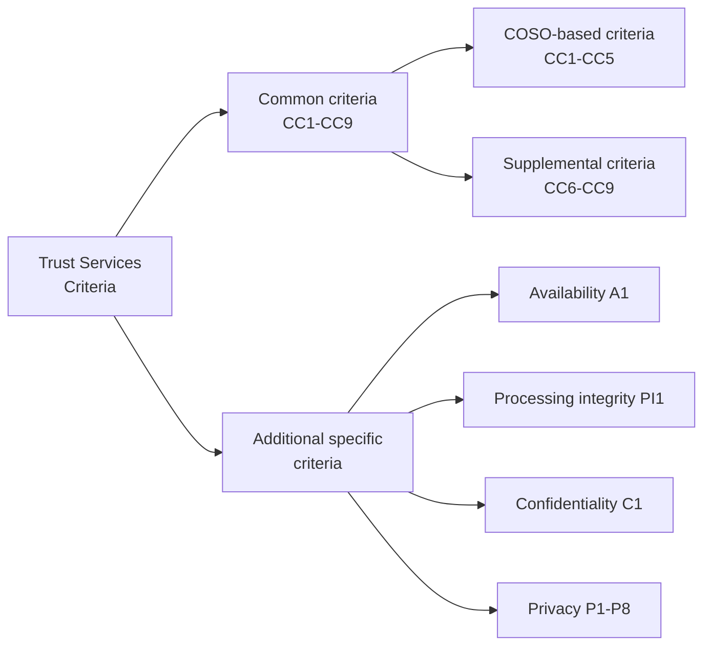

# Planning and Performing SOC Engagements

Companies hand more and more of their work to outside providers: payroll to a payroll processor, servers to a cloud host, claims to a third-party administrator. Each customer, and each customer's auditor, needs to know whether the provider's controls work, but hundreds of customers cannot all inspect the same provider. A **System and Organization Controls (SOC) report** solves the problem: one independent CPA examines the provider's system and controls, and the report serves all of its customers.

This chapter covers the work before and during a SOC examination. It starts with the parties and the types of SOC reports, then the Trust Services Criteria and management's assertions. It moves on to planning matters (independence, materiality, risk assessment, and subservice organizations), then the system itself: service commitments and system requirements, the system description and its boundaries, and complementary user entity controls. It ends with reporting mechanisms, written representations, and events after the period. The blueprint tests Area III at the Remembering and Understanding and Application levels. For SOC 1® engagements the exam covers planning, certain procedures, and reporting, but not the testing of controls over financial reporting itself.

---

## The Parties

| Party | Role | Example |
|---|---|---|
| **Service organization** | Provides services to other entities; its system and controls are the subject of the report | **Bear Co.**, a payroll processor |
| **User entity** | A customer of the service organization | A small business that uses Bear Co. for payroll |
| **User auditor** | The auditor of a user entity's financial statements, who uses a SOC 1® report as audit evidence | The small business's CPA firm |
| **Service auditor** | The CPA who examines and reports on the service organization's system and controls | The firm Bear Co. engages for its SOC report |
| **Subservice organization** | A vendor of the service organization whose controls, together with the service organization's, are needed to achieve the objectives | **Kingfisher Industries**, which hosts Bear Co.'s servers |

---

## Types of SOC Reports

The blueprint asks you to recall the purpose and intended users of four kinds of report:

| Report | Subject Matter | Criteria | Intended Users |
|---|---|---|---|
| **SOC 1®** | Controls at a service organization relevant to user entities' internal control over financial reporting (ICFR) | Control objectives specified by management, evaluated under AT-C 320 | **Restricted**: management of the service organization, user entities, and user auditors |
| **SOC 2®** | Controls at a service organization relevant to security, availability, processing integrity, confidentiality, or privacy | Trust Services Criteria, and Description Criteria (DC 200) for the system description | **Restricted**: management, user entities, and other specified parties with enough knowledge to understand it, such as business partners, prospective customers, and regulators |
| **SOC 3®** | The same subject as SOC 2®, without the detailed description or tests | Trust Services Criteria | **General use**: anyone; often posted on a company's website |
| **SOC for Cybersecurity** | An entity's whole cybersecurity risk management program; any entity, not just a service organization | Description criteria for the program, and control criteria such as the Trust Services Criteria | **General use**: boards, investors, analysts, business partners |

SOC 1® engagements are performed under AT-C section 320. SOC 2®, SOC 3®, and SOC for Cybersecurity engagements are examinations under AT-C sections 105 and 205, with AICPA guides for each. The AICPA also offers SOC for Supply Chain, which the blueprint does not list.

SOC 1® and SOC 2® reports come in two types:

| Attribute | Type 1 | Type 2 |
|---|---|---|
| **Covers** | A **point in time** (as of a specific date) | A **period of time**, commonly 6 to 12 months |
| **Opinion addresses** | The description and the **suitability of design** of controls | The description, the suitability of design, **and the operating effectiveness** of controls throughout the period |
| **Testing** | Procedures to confirm the controls exist and are designed suitably | Tests of controls (inquiry, observation, inspection, reperformance) across the period, usually on samples |

:::warning

A Type 1 report says nothing about whether controls **operated** effectively. A user auditor who plans to rely on a service organization's controls to reduce control risk generally needs a **Type 2** report covering a period that overlaps the user entity's fiscal year.

:::

---

## The Trust Services Criteria

The **Trust Services Criteria (TSC)** are criteria issued by the AICPA's Assurance Services Executive Committee for evaluating controls over **security, availability, processing integrity, confidentiality, and privacy**. They are the measuring stick in SOC 2® and SOC 3® engagements, and they can serve as control criteria in SOC for Cybersecurity.

The criteria are not limited to service organizations. A practitioner can be engaged to report, using the TSC, on controls within a service organization's system, on an entity's cybersecurity risk management program, on a system that produces or distributes products, or on controls at any level of an entity: the whole entity, a division or unit, a single function, or a particular type of information.

### How the Criteria Are Organized

The **common criteria** apply in every SOC 2® engagement. They are the complete criteria for the security category and the foundation for every other category. They have two parts.

**CC1 through CC5** follow the COSO *Internal Control - Integrated Framework* (2013): each of COSO's 17 principles appears as a criterion, grouped by COSO's five components.

| COSO Component | Criteria | Topics |
|---|---|---|
| **Control environment** | CC1.1-CC1.5 | Integrity and ethics, board oversight, structure and authority, competence, accountability |
| **Communication and information** | CC2.1-CC2.3 | Quality information, internal communication, external communication |
| **Risk assessment** | CC3.1-CC3.4 | Objectives, risk identification and analysis, fraud risk, significant changes |
| **Monitoring activities** | CC4.1-CC4.2 | Ongoing and separate evaluations, communicating deficiencies |
| **Control activities** | CC5.1-CC5.3 | Selecting control activities, general controls over technology, policies and procedures |

**CC6 through CC9** are **supplemental criteria**. They add detail that COSO's principles do not spell out but that matters for security: CC6 for logical and physical access, CC7 for system operations (detecting and responding to security events), CC8 for change management, and CC9 for risk mitigation (business disruption and vendor risk).

The **additional specific criteria** apply only when the related category is in scope: availability (A1.1-A1.3), processing integrity (PI1.1-PI1.5), confidentiality (C1.1-C1.2), and privacy (P1 through P8). The earlier chapters on [Availability](../information-systems/availability.md), [Enterprise and Accounting Information Systems](../information-systems/enterprise-and-accounting-information-systems.md), and [Confidentiality and Privacy](../confidentiality-privacy-and-incident-response/confidentiality-and-privacy.md) describe these.

Each criterion comes with **points of focus** (revised in 2022): characteristics that are often relevant to the criterion, offered as guidance. They are not criteria themselves, and management need not address every point of focus for a criterion to be met.

:::tip[Exam Tip]

**Security is always in scope.** Because the common criteria are the criteria for security and also underlie every other category, a SOC 2® report always covers security. Availability, processing integrity, confidentiality, and privacy are added when they are relevant to the service organization's commitments.

:::

---

## Management's Assertions

Service organization management prepares the system description and gives the service auditor a **written assertion** about it and about its controls. The assertion is a precondition of the engagement, and the service auditor's opinion addresses the same matters. The assertions differ by report type:

| Report | Management Asserts That... |
|---|---|
| **SOC 1® Type 1** | (a) The description fairly presents the system as designed and implemented **as of a date**; (b) the controls related to the control objectives were suitably designed as of that date to achieve those objectives |
| **SOC 1® Type 2** | (a) The description fairly presents the system as designed and implemented **throughout the period**; (b) the controls were suitably designed throughout the period; (c) the controls operated effectively throughout the period to achieve the control objectives |
| **SOC 2® Type 1** | (a) The description presents the system as designed and implemented **as of a date** in accordance with the description criteria; (b) the controls were suitably designed as of that date to provide reasonable assurance that the service commitments and system requirements would be achieved based on the applicable Trust Services Criteria |
| **SOC 2® Type 2** | (a) The description presents the system as designed and implemented **throughout the period** in accordance with the description criteria; (b) the controls were suitably designed throughout the period; (c) the controls operated effectively throughout the period to provide reasonable assurance that the service commitments and system requirements were achieved based on the applicable Trust Services Criteria |
| **SOC 3®** | The controls within the system were effective **throughout the period** to provide reasonable assurance that the service commitments and system requirements were achieved based on the applicable Trust Services Criteria |

Notice the pattern. A SOC 1® description must **fairly present** the system; a SOC 2® description must be **presented in accordance with the description criteria**. Type 1 assertions stop at design; Type 2 assertions add operating effectiveness. A SOC 3® report has no detailed description, so its assertion is a single statement about the effectiveness of controls over a period.

---

## Independence

The service auditor must be **independent of the service organization**, under the AICPA Code of Professional Conduct. The service auditor does not need to be independent of each user entity. For subservice organizations, the answer depends on the reporting method: under the **inclusive method**, the subservice organization's controls are part of what the service auditor reports on, so the service auditor should be independent of it as well; under the **carve-out method**, its controls are excluded and independence from it is not required.

The usual threats to independence apply:

| Threat | Example in a SOC Engagement |
|---|---|
| **Self-review** | The firm helped design or implement the controls it is now examining |
| **Management participation** | The firm operates or monitors controls for the service organization |
| **Advocacy** | The firm promotes the service organization's services to prospective customers |
| **Familiarity** | Long, close relationships between the engagement team and service organization management |

**Example:** **Sloth Security** designed and set up **Polar Inc.**'s user access controls last year, and Polar Inc. now asks Sloth Security to perform its SOC 2® examination. Sloth Security would be examining its own work (a self-review threat), and designing an attest client's controls is a management responsibility. Sloth Security should not accept the examination.

---

## Materiality

In a SOC engagement, materiality relates to the **subject matter**, meaning the system description and the controls, not to the financial statements of any user entity. The service auditor asks whether a misstatement or omission in the description, or a control deficiency or deviation, would matter to the decisions of the report's users. Because much of a SOC subject matter cannot be measured in dollars, **qualitative** factors carry great weight; the AICPA's guidance on materiality for subject matters that cannot be quantitatively measured is part of the exam References.

| Aspect | SOC 1® | SOC 2® |
|---|---|---|
| **What is evaluated** | Fair presentation of the description and the design and operation of controls to achieve the control objectives | Presentation of the description in accordance with the description criteria and the design and operation of controls to meet the applicable Trust Services Criteria |
| **Whose decisions** | User entities and user auditors assessing ICFR | User entities and other specified users relying on the system's security, availability, and so on |
| **Qualitative factors** | The nature of the control objective, the importance of the transactions processed to user entities' financial reporting, whether a deviation was intentional | The nature of the criterion, the sensitivity of the data, the effect on users, whether a deviation was intentional, whether an omitted item (such as a system incident) would mislead |
| **Quantitative factors** | Tolerable rates of deviation in tests of operating effectiveness; the volume and dollar value of transactions affected | Tolerable rates of deviation in tests of operating effectiveness |

Qualitative judgment can make a small number decisive. A single instance of an administrator account left active after its owner left might be material in a SOC 2® engagement even though no dollar amount is involved.

---

## Risk Assessment

**The service organization's risk assessment.** Management must identify the risks that threaten its objectives (the control objectives in SOC 1®, or the service commitments and system requirements in SOC 2®) and design controls to address them. In SOC 1®, management's identification of those risks is one of the criteria for deciding whether controls are suitably designed. In SOC 2®, the risk assessment is itself evaluated under the common criteria (CC3): specifying objectives, identifying and analyzing risks, considering fraud, and assessing significant changes.

**The service auditor's risk assessment.** The service auditor obtains an understanding of the service organization's system and its environment, then assesses the risks that the description is not presented as required and that controls were not suitably designed or did not operate effectively. Those risks drive the nature, timing, and extent of testing. Among other things, the service auditor considers:

- How complex the system is and how much it relies on IT and automated controls.
- Significant changes to the system or controls during the period.
- Deviations and other problems reported in prior SOC reports.
- The work of the service organization's internal audit function.
- **Fraud risk**, such as the risk that management misstates the description or that personnel override or circumvent controls.

---

## Subservice Organizations

A **subservice organization** is a vendor used by the service organization whose controls are necessary, together with the service organization's own controls, to achieve the control objectives (SOC 1®) or the service commitments and system requirements (SOC 2®). Not every vendor qualifies. A vendor is a subservice organization when:

1. It performs services that are **part of the service organization's system** provided to user entities; and
2. Its **controls are necessary**, in combination with the service organization's controls, for the objectives to be achieved.

If the service organization's own controls over the vendor's work, such as reviewing every output the vendor produces, are enough to achieve the objectives by themselves, the vendor is not a subservice organization.

**Example:** **Bear Co.** processes payroll for hundreds of small businesses. All of its payroll data is stored and processed on servers in **Kingfisher Industries**' data center, and Kingfisher's physical access and environmental controls are needed to protect that data. Kingfisher is a subservice organization. Bear Co.'s office cleaning company is not, because nothing it does is part of the payroll system.

### Inclusive and Carve-Out Methods

Management chooses one of two ways to present each subservice organization:

| Feature | Inclusive Method | Carve-Out Method |
|---|---|---|
| **Scope** | The subservice organization's relevant controls are **included** | The subservice organization's controls are **excluded** |
| **System description** | Describes the subservice organization's relevant services, system components, and controls | Describes the nature of the services it provides and lists the **complementary subservice organization controls (CSOCs)** the service organization assumes it performs |
| **Testing** | The service auditor tests the subservice organization's controls | The service auditor does not test them, but does test the service organization's own controls for monitoring the subservice organization |
| **Assertions** | Subservice organization management also provides a written assertion | Only service organization management asserts |
| **Independence** | The service auditor should be independent of the subservice organization | Not required |

The inclusive method gives users one report that covers the whole chain, but it requires the subservice organization to cooperate: to allow testing, to provide an assertion, and to accept the service auditor's access. Large providers such as major cloud hosts rarely agree, so the **carve-out method** is far more common in practice. Users of a carve-out report then obtain assurance about the subservice organization separately, usually from its own SOC report.

**Example:** If **Bear Co.** carves out **Kingfisher Industries**, Bear Co.'s description identifies Kingfisher, describes the hosting services it provides, and lists the CSOCs it assumes Kingfisher performs, such as restricting physical access to the data center and protecting servers against fire and power loss. The service auditor does not test those controls. It does test Bear Co.'s own controls over Kingfisher, such as Bear Co.'s annual review of Kingfisher's SOC 2® report.

:::tip[Exam Tip]

**Inclusive = included** in scope and tested. **Carve-out = cut out**: the subservice organization's controls are excluded and listed as CSOCs. Only the inclusive method requires the service auditor to be independent of the subservice organization.

:::

---

## Service Commitments and System Requirements

In a SOC 2® engagement, the service organization's objectives are expressed as its **service commitments and system requirements**:

- **Service commitments** are declarations service organization management makes to user entities and others about the system: in contracts, service level agreements, or published statements such as a security practices statement. A promise of 99.95% uptime is a service commitment.
- **System requirements** are specifications about how the system should function to meet those commitments, to meet commitments to vendors and business partners, to comply with laws and regulations, and to achieve the organization's other relevant objectives. They are set in policies, procedures, and system designs.

The Trust Services Criteria refer throughout to the "entity's objectives." In a SOC 2® engagement, those objectives are achieving the service commitments and system requirements, so every criterion is evaluated against them.

**Example:** **Polar Inc.** runs a cloud accounting platform and promises customers 99.95% uptime (a service commitment). To meet it, Polar Inc. requires redundant data centers, automatic failover, and round-the-clock monitoring (system requirements). A SOC 2® engagement covering availability evaluates whether Polar Inc.'s controls provide reasonable assurance of achieving that commitment, using criteria A1.1-A1.3 and the common criteria.

---

## The System Description

The **system description** tells users what the system is and how it works, and it defines the scope of the engagement. Service organization **management** prepares it; the service auditor evaluates it. The criteria it must meet differ between SOC 1® and SOC 2®.

**SOC 1®.** Under AT-C 320, a description fairly presents the system if it describes, as relevant:

- The types of services provided, and the classes of transactions processed.
- The procedures, automated and manual, by which transactions are initiated, authorized, recorded, processed, corrected, and transferred to reports for user entities.
- The related accounting records and supporting information.
- How the system captures and addresses significant events and conditions other than transactions.
- The process used to prepare reports for user entities.
- The specified control objectives and the controls designed to achieve them, including complementary user entity controls.
- Services performed by subservice organizations and the method used to present them.
- Other relevant aspects of the control environment, risk assessment, information and communication, control activities, and monitoring.
- For a Type 2 report, relevant changes to the system during the period.

The description must also not omit or distort information relevant to user entities' ICFR.

**SOC 2®.** The 2018 Description Criteria (DC 200) require the description to disclose:

| Criterion | Required Disclosure |
|---|---|
| **DC1** | The types of services provided |
| **DC2** | The principal service commitments and system requirements |
| **DC3** | The components of the system used to provide the services: infrastructure, software, people, procedures, and data |
| **DC4** | Any system incidents that resulted from controls that were not suitably designed or operating effectively, or that otherwise caused a significant failure to achieve the commitments and requirements, with their nature, timing, and extent |
| **DC5** | The applicable Trust Services Criteria and the related controls |
| **DC6** | The complementary user entity controls (CUECs), if any |
| **DC7** | The subservice organizations used and, depending on the method, either their relevant controls (inclusive) or the criteria they are relied on to meet and the CSOCs (carve-out) |
| **DC8** | Any applicable Trust Services criterion that is not relevant to the system, and why |
| **DC9** | For a Type 2 report, significant changes to the system and controls during the period |

The blueprint asks you to **prepare a comparison** of management's description to these criteria. In practice, that means going criterion by criterion: confirming that each required element is included, that what the description says matches the system as actually implemented (through inquiry, observation, inspection, and walkthroughs), and that nothing is left out or overstated in a way that would mislead users. A description that omits a significant system incident, for example, does not meet DC4.

### Understanding the System and Its Boundaries

In a SOC 2® engagement, the service auditor must understand the system, including its **boundaries** as management defines them. The system is made up of five components:

| Component | Description | Examples |
|---|---|---|
| **Infrastructure** | Physical and virtual resources | Servers, networks, data centers, cloud environments |
| **Software** | Application programs and system software | The application, operating systems, middleware, utilities |
| **People** | Personnel involved in operating and using the system | Developers, operators, security staff, support staff |
| **Procedures** | Automated and manual procedures | Change management, incident response, access provisioning |
| **Data** | Information used and supported by the system | Transaction data, files, databases, logs |

The boundaries set what is in scope. Services described in the description, the infrastructure and software that deliver them, the service organization's controls, and (under the inclusive method) a subservice organization's controls are in. User entities' own environments, CUECs, and carved-out subservice organizations' controls are out. The service auditor evaluates whether management has drawn the boundaries clearly and appropriately. A boundary that leaves out a component actually used to deliver the service, such as the system through which customers report security incidents, makes the description misleading.

---

## Complementary User Entity Controls (CUECs)

**Complementary user entity controls (CUECs)** are controls that management, in designing the service organization's system, assumed **user entities** would implement, and that are necessary, along with the service organization's controls, to achieve the objectives. The service organization lists them in its system description so users know what is expected of them.

| Characteristic | Description |
|---|---|
| **Identified by management** | Service organization management decides which user entity controls its system depends on |
| **Disclosed in the description** | CUECs are listed so user entities and user auditors can see them |
| **Not tested by the service auditor** | They operate at the user entities, outside the scope of the examination |
| **The user entity's responsibility** | Each user entity must actually perform them |
| **Relevant to the user auditor** | A user auditor relying on the SOC report must consider whether the client performs the CUECs |

Typical CUECs include managing the user entity's own user accounts in the service organization's application, notifying the service organization promptly when an authorized user leaves, reviewing and reconciling output reports, and keeping the devices used to reach the system secure.

**Example:** **Illini Entertainment** uses **Polar Inc.**'s cloud accounting platform. Polar Inc.'s SOC 2® report lists a CUEC: user entities are responsible for removing access for their own employees who leave. If Illini Entertainment never removes departed employees' accounts, the resulting gap is Illini Entertainment's, not Polar Inc.'s, and Polar Inc.'s report does not cover it. The [Reporting on SOC Engagements](./reporting-on-soc-engagements.md) chapter describes how CUECs appear in the report.

---

## Reporting Mechanisms for Failures, Incidents, Concerns, and Complaints

The common criteria on communication (CC2.2 for internal communication and CC2.3 for external communication) expect the service organization to tell its personnel and its external users how to report **system failures, incidents, concerns, and other complaints**. The blueprint asks you to perform procedures to understand how it does so: inspecting policies, training materials, customer contracts, and the service organization's website; asking personnel and examining how reports are received and tracked; and tracing a sample of reported issues to see that they reached the right people and were resolved.

| Mechanism | Description |
|---|---|
| **Service desk or support portal** | A central place for users and staff to report problems |
| **Security incident reporting channel** | A dedicated address, form, or line for suspected security incidents |
| **Ethics or whistleblower hotline** | A channel, often anonymous, for reporting misconduct |
| **Contractual notification procedures** | Procedures in customer agreements for reporting failures in either direction |
| **Published policies and notices** | Documents that tell personnel and customers where and how to report |

---

## Management's Written Representations

The service auditor must obtain **written representations** from service organization management in every SOC 1® and SOC 2® engagement, usually in a representation letter. They are dated as of the **date of the service auditor's report**. Typical representations confirm that management:

- Reaffirms its assertion about the description and the controls.
- Has provided all relevant information and access agreed to.
- Has disclosed any known deviations, design deficiencies, instances of fraud or noncompliance, and (in SOC 2®) system incidents that could affect the description or the controls.
- Has disclosed any events after the period, up to the report date, that could significantly affect its assertion.
- Has disclosed what it knows about subservice organizations relevant to the engagement.

If management refuses to provide requested representations, the service auditor discusses the matter with management, reconsiders management's integrity and the reliability of other evidence, and takes appropriate action, which may include **disclaiming an opinion or withdrawing** from the engagement.

---

## Subsequent Events and Subsequently Discovered Facts

Two time windows follow the end of the period (or the as-of date of a Type 1 report), and the blueprint tests both.

**Subsequent events** occur between the end of the period and the date of the service auditor's report. The service auditor asks management whether it knows of any events in that window that could significantly affect its assertion, and performs other procedures such as reading internal audit and regulatory reports and minutes. Subsequent events fall into two groups:

| Kind | What It Reveals | Effect |
|---|---|---|
| **Evidence about conditions during the period** | Something that already existed during the period comes to light, such as a deviation or a security breach | It may require changes to the description or affect the opinion on design or operating effectiveness |
| **Conditions arising after the period** | Something new happens after the period ends, such as a major system replacement | It does not affect the opinion on the period, but if it is significant enough that users would be misled without knowing it, it should be disclosed; if management does not disclose it in the description, the service auditor discloses it in the report |

**Subsequently discovered facts** become known to the service auditor **after the report date**: facts that, had they been known at that date, might have caused the auditor to revise the report. The service auditor has no duty to look for them, but if they come to light, the auditor discusses them with management, determines whether the report would have been affected, and, if so, works with management to inform users who may rely on the report. If management will not cooperate, the service auditor takes action (often with legal advice) to keep users from continuing to rely on the report.

**Example:** **Polar Inc.**'s SOC 2® Type 2 report covers calendar year 2025, and the report is dated February 27, 2026. On January 15, 2026, Polar Inc. discovers that a privileged account was compromised in November 2025. This **subsequent event provides evidence about a condition during the period**, so the service auditor evaluates its effect on the description (a system incident under DC4) and on the opinion on access controls. If Polar Inc. instead moved to a new data center on January 20, 2026, that would be a **condition arising after the period**: it does not affect the opinion on 2025, but it may need to be disclosed.

---

## Summary

| Topic | Key Takeaway |
|---|---|
| Report types | SOC 1® (ICFR, restricted), SOC 2® (Trust Services categories, restricted), SOC 3® (general use), SOC for Cybersecurity (entity-wide program, general use) |
| Type 1 vs. Type 2 | Type 1 is as of a date and covers design; Type 2 covers a period and adds operating effectiveness |
| Trust Services Criteria | Common criteria CC1-CC5 (COSO's 17 principles) and CC6-CC9 (supplemental), plus additional criteria for availability, processing integrity, confidentiality, and privacy; security always included |
| Assertions | SOC 1® descriptions "fairly present"; SOC 2® descriptions are "presented in accordance with the description criteria"; Type 2 adds operating effectiveness |
| Independence | Required from the service organization, and from a subservice organization only under the inclusive method |
| Materiality | Relates to the description and controls, not to user entities' financial statements; heavily qualitative |
| Subservice organizations | Inclusive includes and tests their controls; carve-out excludes them and lists CSOCs |
| Service commitments and system requirements | The "entity's objectives" against which SOC 2® controls are evaluated |
| System description | SOC 1® elements under AT-C 320; SOC 2® under DC1-DC9; five system components define the boundaries |
| CUECs | Assumed controls at user entities; disclosed, not tested |
| Representations | Written, dated as of the report date; refusal can lead to a disclaimer or withdrawal |
| Events after the period | Subsequent events (period end to report date) vs. subsequently discovered facts (after the report date) |

---

## Practice Questions

1. **Bear Co.**, a payroll processor, is having a SOC 2® Type 2 examination for calendar year 2025. Its servers are hosted by **Kingfisher Industries**, and Bear Co. uses the carve-out method. The service auditor notes that Kingfisher's physical access controls are essential to meeting the security criteria. How should the report handle this, and what does it mean for Bear Co.'s customers?

2. **Polar Inc.** is preparing for its first SOC 2® examination. Management wants to exclude its customer support ticketing system from the system boundaries because it "has nothing to do with security." That ticketing system is the main channel through which customers report security incidents and outages. Should the service auditor accept the boundary? Why do reporting mechanisms matter?

3. **Bear Co.**'s SOC 1® Type 2 report for April 1 to September 30, 2025 was dated and issued on November 14, 2025. On December 5, 2025, the service auditor learns that a key reconciliation control did not operate from July through September; the evidence the auditor examined had been fabricated by an employee who has since left. Is this a subsequent event or a subsequently discovered fact, and what should the service auditor do?

:::tip[Answers]

1. Under the **carve-out method**, Kingfisher's controls are **excluded** and not tested. Bear Co.'s description must identify Kingfisher as a subservice organization, describe the hosting services it provides, and list the **CSOCs** Bear Co. assumes Kingfisher performs, such as restricting physical access to the data center. The service auditor tests Bear Co.'s own controls for monitoring Kingfisher. Bear Co.'s customers cannot rely on Bear Co.'s report for assurance over Kingfisher's physical security; they need separate assurance, usually from Kingfisher's own SOC report.

2. **No**, not without evaluating it. The boundaries must include the components actually used to provide the service and meet the commitments. The common criteria on communication (CC2.2 and CC2.3) expect the service organization to tell its personnel and external users how to report failures, incidents, concerns, and complaints, and the incident response criteria (CC7) depend on those reports reaching the right people. Leaving out the main reporting channel would leave those controls unevaluated and would make the description misleading. The service auditor should discuss expanding the boundary with management, and if management refuses, consider the effect on the description and the report.

3. A **subsequently discovered fact**. The facts became known on December 5, after the November 14 report date, and they existed at that date. The service auditor should discuss the matter with Bear Co.'s management promptly and determine whether the report would have been different had the facts been known. Here it would: the control failed for half the period, which would likely have led to a modified opinion. The service auditor should then ask management to inform users who are relying on the report, and consider whether to issue a revised report. If management refuses, the service auditor should take its own steps, usually with legal advice, to prevent further reliance on the report.

:::
