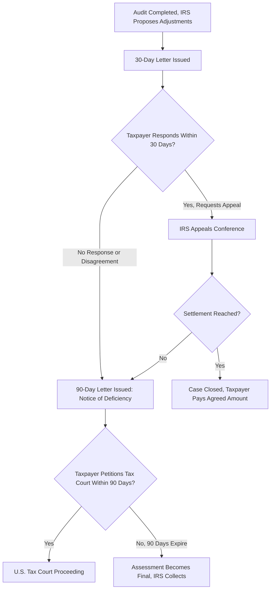

# Federal Tax Procedures

## Introduction

The federal income tax runs on **self-assessment**: taxpayers compute their own tax, file a return, and pay what they owe. The IRS then checks a small share of returns through examinations. When a taxpayer disagrees with the result, the dispute moves through IRS Appeals and, if necessary, the courts. This chapter follows that path, then covers the rules that decide how exposed a return is along the way: how long the IRS has to act, when a position must be disclosed, what substantiation is enough, which penalties apply, and how much weight each source of tax law carries. It ends with the reporting rules for foreign bank accounts.

The rules for tax return preparers and the penalties imposed on them are covered in [Ethics and Responsibilities in Tax Practice](./ethics-and-responsibilities-in-tax-practice.md).

---

## The Audit Process

### How Returns Are Selected

The IRS uses several methods to choose returns for examination:

| Method | Description |
|---|---|
| **Discriminant Information Function (DIF) scoring** | Statistical models score each return on the likelihood of errors; higher scores are more likely to be selected |
| **Information matching** | IRS systems match W-2s, 1099s, and K-1s against filed returns to find discrepancies |
| **Related examinations** | A return may be selected because a related party, such as a business partner, is already under audit |
| **Random selection** | The National Research Program examines randomly chosen returns to measure compliance |

### Types of Audits

| Audit Type | Description |
|---|---|
| **Correspondence audit** | Conducted entirely by mail; the IRS asks for documents supporting a specific item, such as charitable contributions |
| **Office audit** | The taxpayer brings records to a local IRS office; usually limited to a few issues |
| **Field audit** | A revenue agent examines the books and records at the taxpayer's home or place of business; the most comprehensive type |

> **Example:** Panda Industries, a mid-size manufacturer, reported unusually high cost of goods sold relative to revenue. Its DIF score flagged the return, and a revenue agent was assigned to conduct a **field audit** at Panda's offices.

### Math Error Notices

Not every IRS adjustment is an audit. For a **mathematical or clerical error**, the IRS may assess the corrected tax directly and send a math error notice. The taxpayer then has 60 days to ask the IRS to abate the assessment, and if the taxpayer does, the IRS must follow the normal deficiency procedures described below. OBBBA expanded this authority: a missing or incorrect Social Security number on a claim for the new senior, tips, and overtime deductions, the child tax credit, or the education credits is treated as a math error. A 2025 law, P.L. 119-39, also requires each math error notice to explain the error in plain language and state the abatement deadline; it is expected to be eligible for testing starting July 1, 2027.

---

## Appeals

A taxpayer who disagrees with an examiner's proposed changes can contest them within the IRS before going to court.

The **30-day letter** tells the taxpayer about the proposed changes and the right to appeal. It is an administrative step, not a statutory notice.

An **Appeals conference** is an informal meeting with an Appeals Officer. The Independent Office of Appeals is separate from the examination function and may settle a case based on the **hazards of litigation**, meaning its estimate of how likely the IRS is to win in court.

The **90-day letter**, or **statutory notice of deficiency**, is legally required before the IRS can assess additional income tax. The taxpayer has **90 days** (150 days if the notice is addressed to a taxpayer outside the United States) to file a petition with the U.S. Tax Court. If no petition is filed, the deficiency is assessed and the IRS may begin collection. The IRS cannot extend this period.

---

## The Federal Judicial Process

### Trial Courts

A taxpayer who litigates chooses among three trial courts. The choice turns on whether the taxpayer can pay first and whether a jury is wanted.

| Court | Pay the Tax First? | Jury Trial? | Key Features |
|---|---|---|---|
| **U.S. Tax Court** | **No** | **No** | Judges specialize in tax; the most common forum; petition due within 90 days of the notice of deficiency |
| **U.S. District Court** | **Yes** (pay, then sue for a refund) | **Yes**, the only forum with a jury | General jurisdiction; follows the law of its circuit |
| **U.S. Court of Federal Claims** | **Yes** (pay, then sue for a refund) | **No** | Sits in Washington, D.C.; appeals go to the Federal Circuit |

For disputes of **\$50,000 or less** for a year, the taxpayer may elect the Tax Court's **small tax case** procedure. It is informal, but its decisions cannot be appealed.

:::tip[Exam Tip]

The **Tax Court** is the only forum where the taxpayer does **not** have to pay the disputed tax before trial. If a question asks where a taxpayer can litigate without prepaying, the answer is the Tax Court.

:::

### Appellate Courts

Appeals from the Tax Court and the district courts go to the **U.S. Court of Appeals** for the taxpayer's circuit. Appeals from the Court of Federal Claims go to the Court of Appeals for the **Federal Circuit**. The **U.S. Supreme Court** hears tax cases only when it grants a **writ of certiorari**, which it does for very few tax cases each term.

> **Example:** Priya, a sole proprietor, receives a notice of deficiency for \$45,000. She disagrees but cannot afford to pay first. Her best option is to petition the **Tax Court** within 90 days.

---

## Statute of Limitations

The IRS has a limited time to assess additional tax, and the taxpayer has a limited time to claim a refund.

| Situation | Assessment Period |
|---|---|
| **General rule** | **3 years** after the later of the return's due date or the date it was filed (a return filed early is treated as filed on the due date) |
| **Omission of more than 25% of gross income** | **6 years** |
| **Fraudulent return, or no return filed** | **No limit** |
| **Agreement to extend** | The taxpayer and the IRS may agree in writing to extend the period |

Once tax is assessed, the IRS generally has **10 years** to collect it.

A **refund claim** must be filed within **3 years** of the date the return was filed or **2 years** of the date the tax was paid, whichever is later. For bad debts and worthless securities, the period is 7 years.

> **Example:** Bear Co. files its calendar-year 2025 return on March 1, 2026, before its April 15, 2026 due date. The return is treated as filed on April 15, 2026, so the IRS generally has until April 15, 2029 to assess more tax. If Bear Co. left out more than 25% of its gross income, the period runs to April 15, 2032.

When a federally declared disaster strikes, the IRS may **postpone** filing and payment deadlines for affected taxpayers, and it may now do the same for qualifying disasters declared by a state.

---

## Substantiation and Disclosure

### Standards for Return Positions

Each position on a return can be measured against a ladder of confidence. The percentages are rules of thumb used to compare the standards; they do not appear in the regulations. The higher the rung a position reaches, the more protection it gives against penalties, for the taxpayer and for the preparer.

| Standard | Rough Likelihood of Being Sustained | What It Does |
|---|---|---|
| **Not frivolous** | Above 5%-10% | The floor. A frivolous position cannot be saved by disclosure and can draw a separate penalty |
| **Reasonable basis** | About 20% | Enough for a **disclosed** position: the taxpayer avoids the substantial understatement penalty and the preparer avoids the §6694(a) penalty |
| **Substantial authority** | About 40% | Needed for an **undisclosed** position, by both taxpayer and preparer |
| **More likely than not** | More than 50% | Needed for **tax shelters** and **reportable transactions**, where disclosure does not help |

Substantial authority is an **objective** test. It asks whether the weight of the authorities supporting the position is substantial compared with the weight of those against it. Only certain sources count, as described under [authoritative hierarchy](#authoritative-hierarchy) below.

### Disclosing a Position

A taxpayer discloses an uncertain position on **Form 8275**, or on **Form 8275-R** if the position is contrary to a Treasury regulation. Disclosure lowers the standard the position must meet from substantial authority to reasonable basis. It does **not** protect a position with no reasonable basis, a tax shelter position, or an item the taxpayer failed to substantiate or keep records for.

### Substantiation

The taxpayer bears the burden of proving the income, deductions, and credits on a return, so adequate records are essential. Some items carry specific requirements:

| Item | What Is Required |
|---|---|
| **Travel, gifts, and listed property** (§274(d)) | Adequate records or sufficient evidence of the amount, the time and place, the business purpose, and (for gifts) the business relationship. Estimates are not allowed |
| **Receipts for business expenses** | Documentary evidence, such as a receipt, for any lodging cost and for any other expense of **\$75 or more** |
| **Cash or property contributions of \$250 or more** | A contemporaneous written acknowledgment from the charity |
| **Noncash contributions over \$5,000** | A qualified appraisal, in most cases |

> **Example:** Kodiak Partners deducts \$9,000 of client travel. Its employees kept hotel bills and airline receipts but no record of whom they met or why. Because §274(d) requires the business purpose to be documented, the substantiation is not sufficient, and the deduction can be disallowed even though the trips really happened.

### Reasonable Cause and Good Faith

A taxpayer can avoid the accuracy-related penalty (but **not** the fraud penalty) by showing **reasonable cause** for the underpayment **and** that the taxpayer acted in **good faith**. The IRS looks at the taxpayer's efforts to find the correct tax, the complexity of the issue, and whether the taxpayer reasonably relied on advice from a competent tax professional.

---

## Taxpayer Penalties

### Filing and Payment Penalties

| Penalty | Rate | Details |
|---|---|---|
| **Failure to file** | **5% per month** or partial month of the unpaid tax, up to **25%** | A return more than 60 days late owes at least the lesser of an indexed minimum (\$525 for returns due in 2026) or 100% of the tax due |
| **Failure to pay** | **0.5% per month** or partial month of the unpaid tax, up to **25%** | Rises to 1% per month after the IRS issues a notice of intent to levy; drops to 0.25% for an individual paying under an installment agreement on a timely filed return |

When both penalties apply in the same month, the failure-to-file penalty is reduced by the failure-to-pay penalty. The combined rate for that month is therefore 5%, not 5.5%.

> **Example:** Bear Co. files its return 3 months late without paying the \$100,000 tax due. The failure-to-pay penalty is 0.5% × 3 × \$100,000 = \$1,500. The failure-to-file penalty is (5% - 0.5%) × 3 × \$100,000 = \$13,500. The total is **\$15,000**, not \$16,500.

### Accuracy-Related Penalties (§6662)

The accuracy-related penalty is **20% of the underpayment** attributable to any of the following:

| Ground | Trigger |
|---|---|
| **Negligence or disregard of rules** | Failure to make a reasonable attempt to comply, including failure to keep adequate books and records |
| **Substantial understatement** | For individuals, the understatement exceeds the greater of 10% of the correct tax or \$5,000. For most C corporations, it exceeds the lesser of (1) 10% of the correct tax (or \$10,000, if greater) or (2) \$10,000,000 |
| **Substantial valuation misstatement** | The value or adjusted basis claimed for property is **150% or more** of the correct amount. The rate doubles to **40%** for a **gross** valuation misstatement (200% or more) |

### Fraud

| Type | Penalty | Burden of Proof |
|---|---|---|
| **Civil fraud (§6663)** | **75%** of the underpayment attributable to fraud | The IRS must prove fraud by **clear and convincing evidence** |
| **Criminal tax evasion (§7201)** | A felony punishable by fines and up to **5 years** in prison | The government must prove guilt **beyond a reasonable doubt** |

The civil fraud penalty and the accuracy-related penalty cannot apply to the same part of an underpayment. Once fraud is established for an amount, §6663 replaces §6662 for that amount.

### Other Taxpayer Penalties

| Penalty | Description |
|---|---|
| **Underpaid estimated tax** | Computed like interest on each underpaid installment for the period it was underpaid |
| **Excessive refund claim (§6676)** | **20%** of the excessive amount of a refund or credit claim, unless the taxpayer shows reasonable cause. OBBBA extended it to employment tax refund claims such as Employee Retention Credit claims |
| **Frivolous return (§6702)** | **\$5,000** for a return or submission based on a frivolous position or meant to delay tax administration |
| **Disallowed credits after reckless or fraudulent claims** | A taxpayer whose earned income credit, child tax credit, or American Opportunity credit is denied for reckless or intentional disregard of the rules may not claim it for **2 years**; for fraud, the ban is **10 years** |

---

## Authoritative Hierarchy

Not every source of tax law carries the same weight. **Primary authority** comes from the three branches of government; **secondary authority**, such as treatises, journal articles, and tax services, explains the law but is not law.

| Source | Examples | Weight |
|---|---|---|
| **Statutory** | The Constitution, the Internal Revenue Code, tax treaties | Highest. The Code controls over any regulation or ruling that conflicts with it |
| **Administrative** | Treasury regulations (final, temporary, proposed), revenue rulings, revenue procedures, private letter rulings, notices | Final regulations carry the most weight, then temporary regulations. Proposed regulations do not bind anyone. Revenue rulings and procedures bind the IRS and can be relied on by any taxpayer with the same facts. A private letter ruling binds the IRS only for the taxpayer who requested it |
| **Judicial** | Supreme Court, Courts of Appeals, Tax Court, district courts, Court of Federal Claims | A Supreme Court decision binds every court. A Court of Appeals decision binds the trial courts in its circuit, and the Tax Court follows the law of the circuit to which a case would be appealed |

How courts treat Treasury regulations changed in 2024. In ***Loper Bright Enterprises v. Raimondo***, the Supreme Court overruled the *Chevron* doctrine. Courts no longer defer to an agency's reasonable reading of an ambiguous statute; they decide for themselves what the statute means. Regulations remain highly persuasive, and courts still respect them where Congress expressly gave Treasury the authority to fill in details. But do not describe *Chevron* deference as current law.

For the **substantial authority** test, the regulations list what counts: the Code and other statutes; proposed, temporary, and final regulations; revenue rulings and revenue procedures; tax treaties and Treasury's explanations of them; court cases; congressional committee reports and the Joint Committee on Taxation's General Explanation (the "Blue Book"); private letter rulings and technical advice memoranda; and IRS notices, announcements, and press releases. Conclusions in treatises, journal articles, legal opinions, and opinions of other tax professionals are **not** authority, no matter how well reasoned.

---

## Reporting Foreign Accounts (FBAR)

A U.S. person (a citizen, resident, or domestic entity) with a financial interest in, or signature authority over, **foreign financial accounts** must file a **Report of Foreign Bank and Financial Accounts (FBAR)**, FinCEN Form 114, if the **aggregate** value of those accounts exceeds **\$10,000** at any time during the calendar year.

- The FBAR is filed electronically with the **Financial Crimes Enforcement Network (FinCEN)**, not with the tax return, although the IRS enforces it.
- It is due **April 15**, with an automatic extension to **October 15**.
- The \$10,000 threshold applies to the total of all foreign accounts, not to each account.
- Under FinCEN's current position, a foreign account that holds **only virtual currency** is not reportable on the FBAR. FinCEN has said it intends to propose changing this.

> **Example:** Priya, a U.S. citizen, has two bank accounts in India with peak balances of \$7,000 and \$5,000. Neither account alone exceeds \$10,000, but the aggregate of \$12,000 does, so Priya must file an FBAR.

| Violation | Penalty |
|---|---|
| **Non-willful** | Up to \$10,000 per violation (adjusted for inflation). The Supreme Court held in 2023 that the penalty applies per report, not per account |
| **Willful** | The greater of \$100,000 (adjusted for inflation) or 50% of the account balance at the time of the violation |
| **Criminal** | Fines and imprisonment for willful violations |

The FBAR is separate from **Form 8938**, which certain taxpayers attach to their income tax return to report specified foreign financial assets above higher thresholds. A taxpayer may have to file both.

:::warning

The FBAR is frequently tested. Remember two points: the threshold is based on the **aggregate** of all foreign accounts, and the report goes to **FinCEN**, not to the IRS with the return.

:::
