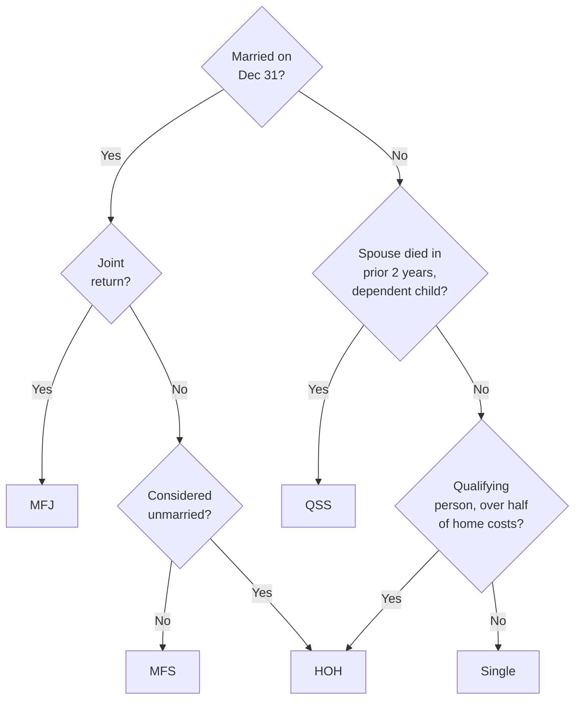

# Filing Status and Dependency

Filing status is the first decision on an individual return, and it shapes almost everything after it: the rate brackets, the standard deduction, which credits are available, and where phase-outs begin. There are five statuses. Two of them, head of household and qualifying surviving spouse, depend on whether a qualifying person lives in the taxpayer's home, so the dependency tests and the filing status rules have to be learned together.

This chapter starts with how marital status is determined, walks through the five statuses, and then sets out the qualifying child and qualifying relative tests. It closes with the exam's favorite filing status traps.

---

## Determining Marital Status: The December 31 Rule

Marital status is determined on the **last day of the tax year** (December 31 for a calendar-year taxpayer).

| Situation | Marital Status for the Year |
|---|---|
| Married on December 31, even if living apart | Married |
| Divorce final on or before December 31 | Unmarried |
| Legally separated under a decree of separate maintenance | Unmarried |
| Spouse died during the year | Married (a joint return is allowed) |
| Marriage annulled | Unmarried from the start (prior joint returns must be amended) |

An **interlocutory decree** (a divorce that is not yet final) does not make the taxpayer unmarried. The divorce must be final by December 31.

---

## The Five Filing Statuses

From most to least favorable, the statuses rank this way: married filing jointly (MFJ) and qualifying surviving spouse (QSS) share the widest brackets and the largest standard deduction; head of household (HOH) comes next; then single; then married filing separately (MFS), whose brackets and standard deduction are half of MFJ's. The dollar amounts are indexed each year and are not tested, but the ranking is.

### 1. Married Filing Jointly (MFJ)

Spouses filing jointly report all of their income and deductions on one return. To file jointly, the taxpayers must be married on December 31 (or one spouse must have died during the year), both must agree and sign, and neither may be a nonresident alien at any time during the year unless the couple elects to treat that spouse as a resident.

Both spouses are **jointly and severally liable** for the tax on a joint return, which means the IRS can collect the entire tax from either one. A spouse who did not know about an understatement may qualify for innocent spouse relief under §6015.

> **Example:** Jordan marries Alex on December 30, 2026. Although they were married for only two days, they may file a joint return for all of 2026.

### 2. Qualifying Surviving Spouse (QSS)

QSS lets a surviving spouse keep the MFJ brackets and standard deduction for the **two years after** the year of the spouse's death. In the year of death itself, the survivor files MFJ. The requirements are:

1. The spouse died in one of the two preceding tax years.
2. The taxpayer has not remarried by the end of the current year.
3. The taxpayer's home is the main home, for the entire year, of a **dependent child or stepchild**.
4. The taxpayer paid more than half the cost of keeping up that home.

> **Example:** Maria's spouse died in March 2025. Maria files a joint return for 2025. For 2026 and 2027, she files as a qualifying surviving spouse if she keeps a home for her dependent son and does not remarry. In 2028 she becomes HOH or single.

### 3. Head of Household (HOH)

HOH gives wider brackets and a larger standard deduction than single. The taxpayer must meet three requirements:

1. **Unmarried**, or "considered unmarried," on December 31.
2. **Paid more than half the cost** of keeping up a home for the year.
3. A **qualifying person** lived in that home for more than half the year.

The costs of keeping up a home include rent, mortgage interest, property taxes, insurance, repairs, utilities, and food eaten in the home. They do not include clothing, education, medical care, vacations, or life insurance.

| Qualifying Person | Must Live With the Taxpayer? |
|---|---|
| Qualifying child who is unmarried | Yes, more than half the year |
| Qualifying child who is married, if the taxpayer can claim the child as a dependent | Yes, more than half the year |
| Dependent parent | **No**, if the taxpayer pays more than half the cost of the parent's home |
| Other relative who is the taxpayer's dependent | Yes, more than half the year |

A qualifying person must be **related** to the taxpayer. A boyfriend or girlfriend who lives with the taxpayer all year can be a dependent under the qualifying relative test (described below), but never makes the taxpayer eligible for HOH.

**Considered unmarried.** A married taxpayer is treated as unmarried for HOH purposes if all of the following are true:

1. The taxpayer files a separate return.
2. The taxpayer paid more than half the cost of keeping up the home for the year.
3. The spouse did **not** live in the home at any time during the **last six months** of the year.
4. The home was the main home of the taxpayer's child, stepchild, or foster child for more than half the year.
5. The taxpayer can claim the child as a dependent, or could except that the taxpayer released the claim to the other parent.

> **Example:** Robin is married but has lived apart from Casey since March 1. Robin keeps up the family home for their daughter all year and pays all of its costs. Because Casey was gone for the last six months of the year, Robin is considered unmarried and files as HOH.

### 4. Single

Single is the status for an unmarried taxpayer who does not qualify as HOH or QSS.

### 5. Married Filing Separately (MFS)

Either spouse may choose MFS. It has the narrowest brackets, and it gives up a long list of benefits:

- The standard deduction is half of the MFJ amount, and if one spouse itemizes, the other must itemize too.
- The earned income credit is not available unless the spouses are separated, and education credits, the student loan interest deduction, and (in most cases) the child and dependent care credit and adoption credit are not available at all.
- A married taxpayer must file jointly to claim the senior deduction or the deductions for qualified tips or qualified overtime.
- The SALT cap, the capital loss limit (\$1,500), and many phase-out thresholds are cut in half.
- If the spouses lived together at any time during the year, up to 85% of Social Security benefits are taxable regardless of income.

MFS can still make sense when one spouse has large medical expenses (the 7.5%-of-AGI floor is easier to pass on a lower separate AGI) or when a spouse wants to avoid joint liability for the other's tax.

---

## Filing Status Selection Flowchart

This chart follows the order in which the statuses are tested. "Married" includes a taxpayer whose spouse died during the year.

---

## Dependents

The personal exemption deduction is permanently zero under the One Big Beautiful Bill Act (OBBBA, P.L. 119-21), so claiming a dependent no longer produces a deduction by itself. Dependency still matters because it unlocks HOH and QSS status and several credits: the child tax credit, the \$500 credit for other dependents, the child and dependent care credit, and (through the qualifying child rules) the earned income credit.

A person can be a dependent in one of two ways: as a **qualifying child** or as a **qualifying relative**. A few rules apply to both. The dependent generally cannot file a joint return (except one filed only to claim a refund), must be a U.S. citizen, national, or resident (or a resident of Canada or Mexico), and a taxpayer who is someone else's dependent cannot claim dependents of his or her own.

### Qualifying Child: The CARES Test

| Test | Requirement |
|---|---|
| **C**lose relative | Child, stepchild, eligible foster child, sibling, step-sibling, half-sibling, or a descendant of any of them |
| **A**ge | Under 19 at year-end, or under 24 and a full-time student, or permanently and totally disabled at any age; and younger than the taxpayer (unless disabled) |
| **R**esidency | Same main home as the taxpayer for more than half the year (temporary absences, such as for school, count as time at home) |
| **E**xempt from the gross income test | A qualifying child can have any amount of income |
| **S**upport | The child did not provide more than half of his or her own support |

When two taxpayers could claim the same child, **tiebreaker rules** decide: a parent wins over a non-parent; between two parents, the one the child lived with longer wins, and if that is equal, the parent with the higher AGI. If the parents do not claim the child, another eligible person may claim the child only if his or her AGI is higher than either parent's.

For divorced or separated parents, the **custodial parent** (the one the child lived with for more nights) may release the dependency claim to the noncustodial parent on Form 8332. The noncustodial parent then claims the child tax credit, but the custodial parent **keeps** HOH status, the earned income credit, and the child and dependent care credit.

### Qualifying Relative

| Test | Requirement |
|---|---|
| Not a qualifying child | The person is not the qualifying child of the taxpayer or of anyone else |
| Relationship or household | A relative listed in §152(d)(2) (children and descendants, siblings, parents and ancestors, stepparents, nieces, nephews, aunts, uncles, and in-laws), **or** any person who lives with the taxpayer all year as a member of the household |
| Gross income | Less than the exemption amount, which still exists for this test even though the deduction is zero (indexed; \$5,300 for 2026) |
| Support | The taxpayer provides more than half of the person's total support |

When no single person provides more than half of a relative's support, a **multiple support agreement** (Form 2120) lets one member of the group claim the relative. The claimant must provide more than 10% of the support, and the group together must provide more than half.

---

## How Filing Status Affects the Rest of the Return

| Provision | How Filing Status Matters |
|---|---|
| Standard deduction | MFJ and QSS get twice the single amount; HOH is in between; MFS is half of MFJ |
| Senior, tips, and overtime deductions | Married taxpayers must file jointly |
| Child tax credit phase-out | Begins at \$400,000 of MAGI for MFJ and \$200,000 for everyone else |
| SALT cap | Same cap for single, HOH, and MFJ; half for MFS |
| Earned income credit | Not available to MFS filers unless separated from the spouse |
| Student loan interest deduction | Not available to MFS filers |
| Net investment income tax threshold | \$250,000 MFJ and QSS; \$200,000 single and HOH; \$125,000 MFS |
| Capital loss deduction | \$3,000 (\$1,500 MFS) |

---

## Common Exam Scenarios and Traps

> **Scenario 1:** Pat is unmarried and supports her 70-year-old mother, who lives in her own apartment. Pat pays all of her mother's rent and living expenses. **Filing status: HOH**, because a dependent parent does not have to live with the taxpayer.

> **Scenario 2:** Sam's spouse died in November 2025, and Sam has no children. Sam may file a joint return for 2025. For 2026, Sam files as **single**, because QSS requires a dependent child.

> **Scenario 3:** Dana is married but separated without a divorce decree. Dana keeps up a home for a dependent child, and Dana's spouse moved out on August 15. **Filing status: MFS** (or MFJ if both spouses agree), not HOH. To be considered unmarried, the spouse must not have lived in the home at any time during the last six months of the year (July through December). Had the spouse moved out by June 30, Dana could file as HOH.

> **Scenario 4:** Lee is unmarried with no children. Lee's brother (age 30, earning \$50,000) lives with Lee all year. **Filing status: single**. The brother is too old to be a qualifying child, and his gross income is far above the qualifying relative limit.

---

## Summary

| Filing Status | Marital Requirement | Qualifying Person Requirement | Key Advantage |
|---|---|---|---|
| **MFJ** | Married on December 31 (or spouse died during the year) | None | Widest brackets; most credits available |
| **QSS** | Spouse died in either of the 2 prior years; not remarried | Dependent child in the home all year | MFJ brackets for 2 years after the death |
| **HOH** | Unmarried or considered unmarried | Qualifying person in the home more than half the year (dependent parent may live elsewhere) | Better brackets than single |
| **Single** | Unmarried | None | Default for an unmarried taxpayer |
| **MFS** | Married on December 31 | None | Separate liability; can help with the medical floor |
