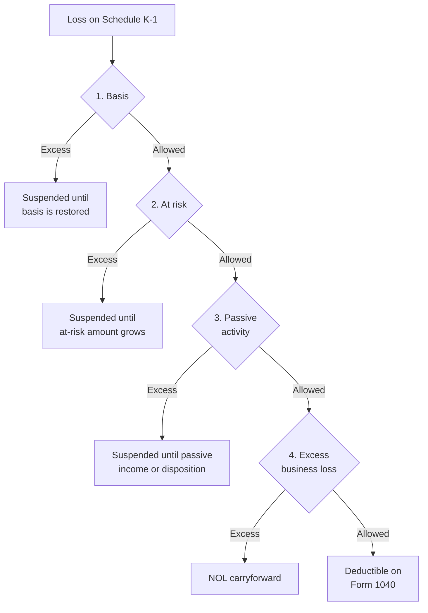

# Loss Limitations

The tax law generally lets taxpayers deduct losses, but it does not let them shelter other income with losses they have not truly borne, with losses from activities they do not run, or with losses from activities that are not really businesses. Several separate regimes enforce that idea: the capital loss limit (§1211), the basis, at-risk, passive activity, and excess business loss rules for business losses (§§704(d), 1366(d), 465, 469, and 461(l)), the hobby loss rules (§183), the wash sale rule (§1091), and the bar on losses from personal-use property.

This chapter takes them in that order. The four-step ordering for losses from partnerships and S corporations is one of the highest-yield topics in REG, because a single question can require all four steps.

---

## Capital Loss Limitations

### Netting Capital Gains and Losses

Capital gains and losses are first netted within each holding-period group, then across groups:

1. Net all **short-term** gains and losses to get a net short-term capital gain or loss.
2. Net all **long-term** gains and losses to get a net long-term capital gain or loss.
3. If one group shows a net gain and the other a net loss, offset them.

> **Example:** Pat has a short-term gain of \$8,000, a short-term loss of \$3,000, a long-term gain of \$2,000, and a long-term loss of \$10,000. Net short-term is a \$5,000 gain, and net long-term is an \$8,000 loss. Offsetting them leaves a **\$3,000 net capital loss** (long-term in character).

### Annual Deduction Limit and Carryforward

An individual may deduct up to **\$3,000** of net capital loss against ordinary income each year (**\$1,500** for MFS). The limit is fixed by statute. Any excess carries forward **indefinitely** and keeps its short-term or long-term character; individuals cannot carry capital losses back. In a later year, the carryforward simply joins that year's netting.

See [Gains and Losses](../property-transactions/gains-and-losses.md) for the rate groups within long-term gains and the order in which a net short-term loss offsets them.

---

## Pass-Through Losses: The Four Hurdles

A loss allocated from a partnership or S corporation must clear **four hurdles, in order**, before it can reduce the owner's other income. A loss stopped at one hurdle never reaches the next one in that year; it is suspended and tested again in a later year.

### Hurdle 1: Basis

An owner cannot deduct losses greater than his or her **tax basis** in the entity, and basis cannot go below zero.

| Entity | What Basis Includes |
|---|---|
| **S corporation** | Stock basis (investment, plus income, less distributions and losses) **plus debt basis** from loans the shareholder made directly to the corporation |
| **Partnership** | Outside basis (built the same way) **plus** the partner's share of **all partnership liabilities**, recourse and nonrecourse |

The difference in the second column is a favorite exam point. A partner's share of a bank loan to the partnership increases basis; an S corporation shareholder gets basis only from his or her own direct loans to the corporation, not from the corporation's borrowing, even if the shareholder guarantees it.

> **Example:** Lee invested \$50,000 in an S corporation and has received no distributions. The corporation allocates a \$70,000 loss to Lee, who has made no loans to it. Lee may deduct only **\$50,000**. The other \$20,000 is suspended and carries forward indefinitely until Lee has new basis.

### Hurdle 2: At Risk (§465)

A loss that passes the basis test is next limited to the amount the taxpayer has **at risk** in the activity. The at-risk amount generally includes:

- Cash and the adjusted basis of property contributed
- Amounts borrowed for the activity for which the taxpayer is **personally liable**
- Amounts borrowed and secured by property **not used in the activity**
- **Qualified nonrecourse financing** for real estate (generally a commercial lender's loan secured by the real property)

Other **nonrecourse** debt does not count. That is the usual gap between basis and at risk: a partner's share of the partnership's nonrecourse debt adds to basis but not to the amount at risk.

### Hurdle 3: Passive Activity Losses (§469)

A **passive activity** is a trade or business in which the taxpayer does not **materially participate**, plus (generally) any rental activity. Losses from passive activities can offset only **passive income**. Unused passive losses are suspended and carried forward.

#### Material Participation

A taxpayer materially participates in an activity by meeting **any one** of seven tests:

| Test | Description |
|---|---|
| 1 | More than **500 hours** of participation during the year |
| 2 | The taxpayer's participation is **substantially all** of the participation by anyone |
| 3 | More than **100 hours**, and no less than any other individual |
| 4 | The activity is a significant participation activity (over 100 hours), and total participation in all such activities exceeds 500 hours |
| 5 | Material participation in **any 5 of the prior 10** years |
| 6 | For a personal service activity, material participation in **any 3 prior years** |
| 7 | Based on all the facts, participation on a **regular, continuous, and substantial** basis (more than 100 hours) |

The 500-hour test is the one most often tested. A question that says the taxpayer "worked full time" in the business or "devoted 600 hours" to it is telling you the taxpayer materially participates. A limited partner can generally meet only tests 1, 5, and 6.

#### The \$25,000 Rental Real Estate Allowance

An individual who **actively participates** in a rental real estate activity (a lower bar than material participation, met by approving tenants and setting rents) may deduct up to **\$25,000** of rental losses against nonpassive income each year. The allowance shrinks by 50% of modified AGI over \$100,000 and is gone at \$150,000. These amounts are fixed by statute. An MFS filer who lived with his or her spouse at any time during the year gets no allowance.

> **Example:** Sam actively participates in a rental property that produces a \$30,000 loss, and Sam's modified AGI is \$120,000. The allowance is reduced by 50% × (\$120,000 - \$100,000) = \$10,000, leaving \$15,000. Sam deducts **\$15,000** and suspends the other \$15,000.

#### Disposing of a Passive Activity

When a taxpayer sells his or her **entire interest** in a passive activity to an unrelated party in a fully taxable transaction, all suspended losses from that activity are released and become deductible that year.

### Hurdle 4: Excess Business Loss (§461(l))

After the first three hurdles, a noncorporate taxpayer's **net business losses** for the year (business deductions minus business income and gains, combined across all businesses) are deductible only up to an indexed threshold. The excess is disallowed for the year and carries forward as part of the taxpayer's **net operating loss**. The One Big Beautiful Bill Act (OBBBA, P.L. 119-21) made this limit permanent (it was already scheduled to run through 2028) and reset the threshold to a lower base starting in 2026. For 2026, the threshold is \$256,000 (\$512,000 MFJ).

> **Example:** In 2026, Morgan and Casey file jointly. After the basis, at-risk, and passive limits, Morgan has an \$800,000 net loss from a partnership in which Morgan materially participates, and the couple has no other business income. The excess business loss is \$800,000 - \$512,000 = **\$288,000**. They deduct \$512,000 in 2026, and the \$288,000 becomes an NOL carryforward.

---

## Hobby Losses (§183)

If an activity is **not engaged in for profit**, its losses cannot offset other income. Whether there is a profit motive depends on all the facts. The regulations list nine factors, none of them decisive:

1. The manner in which the activity is carried on (businesslike records, separate accounts)
2. The expertise of the taxpayer or the taxpayer's advisors
3. The time and effort the taxpayer spends
4. The expectation that assets will appreciate
5. The taxpayer's success in similar activities
6. The activity's history of income or losses
7. The amount of any occasional profits
8. The taxpayer's financial status (other income to absorb losses)
9. Elements of personal pleasure or recreation

An activity that shows a profit in **3 of the last 5 years** (2 of 7 for horse breeding, training, showing, or racing) is presumed to be engaged in for profit. The presumption can be rebutted, and a taxpayer who misses it can still prove a profit motive.

Once an activity is a hobby, its gross income is fully taxable as other income on Schedule 1, and its expenses are **not deductible at all**. Before 2018, hobby expenses were miscellaneous itemized deductions subject to the 2% floor; that category was suspended for 2018 through 2025, and OBBBA eliminated it permanently.

> **Example:** Alex breeds show dogs as a hobby, selling puppies for \$8,000 and spending \$15,000 on the activity. Alex reports the \$8,000 as income and deducts **none** of the expenses, so the hobby adds \$8,000 to taxable income even though it lost money.

---

## Wash Sales (§1091)

A **wash sale** occurs when a taxpayer sells stock or securities at a loss and acquires **substantially identical** stock or securities within **30 days before or after** the sale, a 61-day window that includes the sale date.

| Rule | Detail |
|---|---|
| Effect | The loss is **disallowed**, not lost forever |
| Basis | The disallowed loss is added to the basis of the replacement shares |
| Holding period | The holding period of the shares sold tacks on to the replacement shares |
| Scope | Applies only to losses, not gains, and not to a dealer's sales in the ordinary course of business |

> **Example:** On November 10, Jordan sells 100 shares of XYZ Corp. stock at a \$4,000 loss. On November 28, Jordan buys 100 shares of XYZ Corp. for \$6,000. The \$4,000 loss is disallowed, and Jordan's basis in the new shares is \$6,000 + \$4,000 = **\$10,000**.

The statute covers "stock or securities." Under current law, no statute or guidance extends it to digital assets such as bitcoin that are not securities, so a taxpayer may sell such an asset at a loss and buy it back right away and still deduct the loss.

---

## Personal-Use Property

A loss on the sale of **personal-use property**, such as a personal residence, car, or boat, is **never deductible**. A gain on the same property is taxable. (A casualty loss on personal-use property is the narrow exception, covered in [Adjustments and Deductions](./adjustments-and-deductions.md).)

| Property Type | Gain | Loss |
|---|---|---|
| Personal use | Taxable (capital gain) | **Not deductible** |
| Investment | Taxable (capital gain) | Deductible (capital loss) |
| Business | Taxable (§1231 or ordinary) | Deductible (§1231 or ordinary) |

> **Example:** Kim sells the car she drove to work and on vacations for \$9,000. It cost her \$30,000. The \$21,000 loss is nondeductible. If she had sold the car for more than \$30,000, the gain would be a taxable capital gain.

---

## Net Operating Losses for Individuals

An individual has a **net operating loss (NOL)** when business deductions exceed income; nonbusiness deductions such as the standard deduction do not create an NOL. For losses arising in tax years beginning after 2017:

| Rule | Detail |
|---|---|
| Carryback | Generally **none** (farming losses are a limited exception) |
| Carryforward | **Indefinite** |
| Annual limit | The NOL deduction cannot exceed **80%** of taxable income computed before the NOL deduction |
| Older NOLs | NOLs from tax years beginning before 2018 are not subject to the 80% limit and are used first |

> **Example:** Morgan has a \$100,000 NOL carryforward from 2025. In 2026, Morgan's taxable income before the NOL deduction is \$80,000. The NOL deduction is limited to 80% × \$80,000 = **\$64,000**, and the remaining \$36,000 carries forward to 2027.

---

## Summary

| Loss Limitation | IRC Section | Key Rule |
|---|---|---|
| Capital losses | §1211 | \$3,000 a year against ordinary income (\$1,500 MFS); indefinite carryforward |
| Basis | §§704(d), 1366(d) | Losses limited to basis; partners count entity debt, S shareholders count only their own loans |
| At risk | §465 | Losses limited to amounts at risk; most nonrecourse debt does not count |
| Passive activities | §469 | Passive losses offset only passive income; \$25,000 rental allowance |
| Excess business loss | §461(l) | Net business losses above the threshold become an NOL carryforward; now permanent |
| Hobby losses | §183 | Income taxable, expenses not deductible |
| Wash sales | §1091 | Loss disallowed and added to replacement basis; stock and securities only |
| Personal-use property | §165(c) | Losses never deductible (except qualifying casualty losses) |
| Net operating loss | §172 | 80%-of-taxable-income limit; indefinite carryforward |
