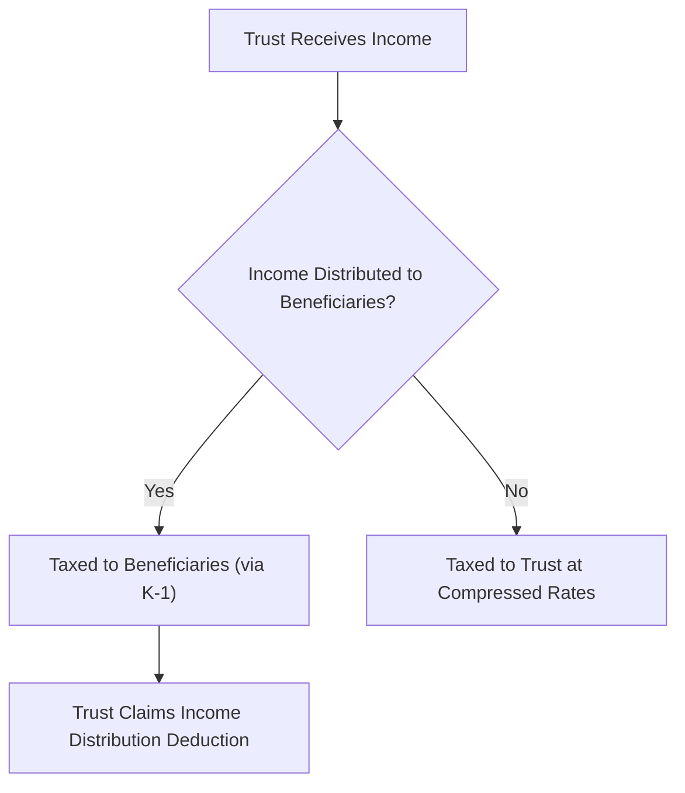

# Trusts

A trust is an arrangement in which a **grantor** transfers property to a **trustee**, who holds and manages it for one or more **beneficiaries**. For income tax purposes, most trusts are partial pass-through entities: income the trust distributes is taxed to the beneficiaries, and income it keeps is taxed to the trust. The tool that splits the income between them is **distributable net income (DNI)**. TCP tests the vocabulary (simple, complex, grantor, and revocable trusts, and the roles of the parties) and the computations: trust accounting income, DNI, the income distribution deduction, and the trust's taxable income. This chapter covers the types of trusts first, then works through one set of numbers from accounting income to taxable income.

The One Big Beautiful Bill Act (OBBBA, P.L. 119-21, signed July 4, 2025) did not amend the trust income tax rules, and it made the current rate structure permanent.

---

## The Parties and the Corpus

| Role | Description |
|---|---|
| **Grantor** | The person who creates the trust and funds it with property (also called the settlor) |
| **Trustee** | The person or institution that manages the assets and makes distributions under the trust instrument |
| **Beneficiary** | A person or organization entitled to income, corpus, or both |
| **Corpus** | The trust's principal: the property transferred to it, plus items such as capital gains that the trust instrument or state law adds to principal |

Beneficiaries who receive the current income are **income beneficiaries**. Those who receive the corpus when the trust ends are **remaindermen**. Their interests can conflict, which is why the line between income and corpus matters so much.

---

## Types of Trusts

### Simple and Complex Trusts

A **simple trust** meets three conditions for the year: the trust instrument requires it to distribute all of its accounting income currently, it makes no charitable contributions, and it distributes no corpus. Any trust that is not simple is a **complex trust**. The test is applied each year, so a simple trust that distributes corpus in a given year is complex for that year.

| Feature | Simple trust | Complex trust |
|---|---|---|
| **Income** | Must distribute all accounting income currently | May accumulate income |
| **Charitable contributions** | None | Allowed |
| **Corpus distributions** | None that year | Allowed |
| **Exemption** | **\$300** | **\$100** |

The exemptions are fixed in the Code and are not indexed. (A decedent's estate, which is taxed under the same rules, gets \$600.)

### Grantor Trusts

A **grantor trust** is one in which the grantor keeps enough control or benefit that the Code ignores the trust for income tax purposes. All of its income, deductions, and credits are taxed to the **grantor**, not to the trust or the beneficiaries. The trust reports the items to the grantor, either through a Form 1041 that serves as an information return or through an optional reporting method. Powers or interests that create grantor trust status include:

| Power or interest | IRC section |
|---|---|
| A **reversionary interest** worth more than 5% of the trust | §673 |
| Power to control **beneficial enjoyment** (decide who gets income or corpus) | §674 |
| Certain **administrative powers**, such as the power to deal with trust assets for less than adequate consideration or to borrow without adequate interest or security | §675 |
| Power to **revoke** the trust | §676 |
| Income that is or may be paid to, or accumulated for, the **grantor or the grantor's spouse** | §677 |

### Revocable Trusts

A **revocable trust** (often called a living trust) is the most common grantor trust. The grantor can amend or revoke it at any time.

| Stage | Treatment |
|---|---|
| **During the grantor's life** | A grantor trust: all income is taxed to the grantor |
| **At the grantor's death** | Becomes **irrevocable** and a separate taxpayer (simple or complex under its terms); because the assets are included in the grantor's estate, they get a basis equal to FMV at death |
| **Planning effect** | Avoids probate, but does **not** remove the assets from the gross estate |

### The Trust as a Conduit

A non-grantor trust is taxed only on income it keeps. It deducts what it distributes, and the beneficiaries report that income on their own returns from Schedule K-1 (Form 1041).

Keeping income in the trust is expensive. The trust brackets use the same 10%, 24%, 35%, and 37% rates as individuals, but they are compressed: for 2026 the 37% rate applies to taxable income over \$16,000 (the bracket amounts are indexed). Undistributed net investment income above that same point is also subject to the 3.8% net investment income tax. Distributing income to beneficiaries in lower brackets therefore saves tax. A complex trust can even elect to treat distributions made within the first **65 days** of the next year as made on the last day of the current year, which lets the trustee fine-tune the deduction after year-end.

---

## Income and Deductions

### Trust Accounting Income

**Trust accounting income** (also called fiduciary accounting income) is the amount available to the income beneficiaries. It is set by the **trust instrument** first and by **state law** (usually a version of the Uniform Principal and Income Act) where the instrument is silent. It is not the same as taxable income. Typical allocations are:

| Item | Usually goes to | Note |
|---|---|---|
| Interest, dividends, and rents | Income | Includes tax-exempt interest |
| Capital gains | Corpus | Unless the trust instrument allocates them to income |
| Stock dividends and stock splits | Corpus | They are part of the principal investment |
| Trustee fees | Split between income and corpus | Often half each under state law, unless the instrument says otherwise |
| Depreciation | Set by the instrument or state law | A trustee may reserve income to cover it |

> **Example:** The Bear Family Trust receives \$60,000 of taxable interest, \$20,000 of dividends, and a \$35,000 long-term capital gain. The trust instrument allocates capital gains to corpus and requires all income to be paid currently to the beneficiary, Dana, so it is a simple trust. Its accounting income is \$60,000 + \$20,000 = **\$80,000**. The \$35,000 gain stays in corpus.

### Distributable Net Income

**DNI** does three jobs:

1. It **caps the income distribution deduction**: the trust cannot deduct more than DNI.
2. It **caps what beneficiaries report**: they are not taxed on more than their share of DNI.
3. It **sets the character** of what they report: each distribution carries out a proportionate share of each kind of income in DNI.

| Step | Adjustment |
|---|---|
| Start with | The trust's taxable income **before** the income distribution deduction |
| Add | The exemption (\$300 or \$100) |
| Add | Tax-exempt interest, net of the expenses allocable to it |
| Subtract | Capital gains allocated to **corpus** (unless they are distributed or required to be distributed) |
| Add | Any net capital loss deducted (losses allocated to corpus stay out of DNI) |
| = | **DNI** |

Deductible expenses reduce DNI whether the trustee charges them to income or to corpus. Trustee fees and other costs that arise only because property is held in trust are deductible under §67(e), so the permanent repeal of miscellaneous itemized deductions does not reach them. The part of any expense that is allocable to tax-exempt income is not deductible.

> **Example:** The Kodiak Family Trust, a complex trust, has the following items for the year. The trustee allocates \$1,000 of the fees to the tax-exempt interest, so that \$1,000 is not deductible.
>
> | Item | Amount |
> |---|---|
> | Taxable interest | \$50,000 |
> | Dividends | \$30,000 |
> | Long-term capital gain (allocated to corpus) | \$25,000 |
> | Tax-exempt interest | \$10,000 |
> | Trustee fees (\$8,000 charged to income, \$2,000 to corpus) | \$10,000 |
>
> | Step | Amount |
> |---|---|
> | Taxable income before the distribution deduction: \$50,000 + \$30,000 + \$25,000 - \$9,000 deductible fees - \$100 exemption | \$95,900 |
> | Add: exemption | \$100 |
> | Add: tax-exempt interest net of allocable fees (\$10,000 - \$1,000) | \$9,000 |
> | Subtract: capital gain allocated to corpus | (\$25,000) |
> | **DNI** | **\$80,000** |

### Income Distribution Deduction

The **income distribution deduction** is how the trust avoids being taxed on income the beneficiaries report.

| Trust type | Deduction |
|---|---|
| **Simple trust** | The accounting income required to be distributed, but not more than DNI, minus the tax-exempt income included in it |
| **Complex trust** | The **lesser of** (1) income required to be distributed plus other amounts properly paid, or (2) DNI; either way minus the tax-exempt income included |

The trust's taxable income is then:

$$\text{Trust taxable income} = \text{Gross income} - \text{Deductions} - \text{Income distribution deduction} - \text{Exemption}$$

> **Example (simple trust):** The Bear Family Trust above has no tax-exempt income and no expenses.
>
> - Taxable income before the distribution deduction: \$60,000 + \$20,000 + \$35,000 - \$300 = \$114,700
> - DNI: \$114,700 + \$300 - \$35,000 capital gain = **\$80,000**
> - Income distribution deduction: the \$80,000 required distribution, limited to \$80,000 of DNI = **\$80,000**
> - Trust taxable income: \$115,000 - \$80,000 - \$300 = **\$34,700**, the capital gain less the exemption
>
> Dana reports \$60,000 of interest and \$20,000 of dividends. For a simple trust that distributes all of its income, the trust's taxable income is usually just its corpus capital gains less the exemption.

### Character of Distributions

Distributions carry out each class of income in DNI in proportion to its share of DNI, so a beneficiary who receives a distribution of a trust's tax-exempt interest keeps the exemption.

> **Example (complex trust):** The Kodiak Family Trust distributes \$60,000 to its beneficiary, Sam. Its \$80,000 of DNI is made up of \$50,000 of interest, \$21,000 of dividends (the trustee charged the \$9,000 of deductible fees against dividends), and \$9,000 of net tax-exempt interest. Sam's \$60,000 is 75% of DNI, so it carries out:
>
> | Class | Share of DNI | Carried out to Sam |
> |---|---|---|
> | Taxable interest | \$50,000 | \$37,500 |
> | Dividends | \$21,000 | \$15,750 |
> | Tax-exempt interest | \$9,000 | \$6,750 |
> | **Total** | **\$80,000** | **\$60,000** |
>
> Sam reports \$37,500 + \$15,750 = **\$53,250** and excludes the \$6,750. The trust's distribution deduction is the lesser of \$60,000 or \$80,000, minus the \$6,750 of tax-exempt interest, which is **\$53,250**, matching what Sam reports. The trust's taxable income is \$95,900 - \$53,250 = **\$42,650**: the \$25,000 capital gain plus the \$17,750 of interest and dividends it kept, less the \$100 exemption.

### Other Deduction Rules

| Deduction | Rule |
|---|---|
| **Charitable contributions** | Deductible with no percentage limit if paid out of gross income under the terms of the trust instrument (simple trusts cannot make them) |
| **Depreciation** | Divided between the trust and the beneficiaries in proportion to the accounting income allocated to each, unless the instrument requires a depreciation reserve |
| **Expenses allocable to tax-exempt income** | Not deductible |

---

## Summary

| Topic | Key rule |
|---|---|
| Simple trust | Distributes all income; no charitable gifts; no corpus distributions that year; \$300 exemption |
| Complex trust | Any other trust; may accumulate, give to charity, or distribute corpus; \$100 exemption |
| Grantor trust | Grantor keeps powers or benefits (§§673-677); all income taxed to the grantor |
| Revocable trust | Grantor trust during life; irrevocable at death; avoids probate but stays in the gross estate |
| Accounting income | Set by the instrument, then state law; capital gains usually go to corpus |
| DNI | Taxable income before the distribution deduction + exemption + net tax-exempt interest - corpus capital gains |
| Distribution deduction | Lesser of amounts distributed (or required) or DNI, minus tax-exempt income carried out |
| Character | Each distribution carries out a pro rata share of each class of income in DNI |
| Rates | Same rates as individuals, but the 37% rate starts at a low, indexed amount; the 65-day election helps time distributions |
