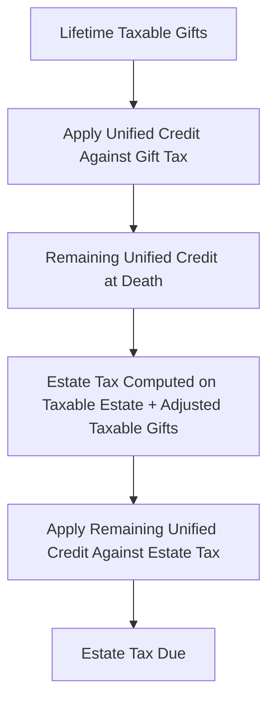

# Gift Taxation Compliance and Planning

The federal gift tax applies when one person transfers property to another and receives nothing, or less than full value, in return. It exists mainly to protect the estate tax: without it, anyone could avoid estate tax by giving everything away shortly before death. The two taxes therefore form one **unified transfer tax system**, with one rate schedule and one lifetime exclusion, so a gift made today affects the tax due at death. The TCP blueprint asks you to recall the exclusions and deductions, explain how the annual exclusion, the marital deduction, and the unified credit work together, calculate taxable gifts, and identify which property to give to reduce a donor's future estate. This chapter takes those in order.

The One Big Beautiful Bill Act (OBBBA, P.L. 119-21, signed July 4, 2025) set the lifetime **basic exclusion amount** at \$15,000,000 for 2026, indexed for inflation after 2026, with no expiration date. The cut to roughly half that amount that was scheduled for 2026 under prior law never took effect. This change has been eligible for TCP testing since July 1, 2026. The amounts for later years are indexed, and the exam does not test indexed amounts.

---

## What Is a Gift

A **gift** is any transfer of property, including money, for less than adequate and full consideration. Intent to make a gift is not required; a bargain sale to a family member is a gift of the difference between value and price.

| Element | Rule |
|---|---|
| **Who pays** | The **donor**, not the recipient (the **donee**) |
| **When the gift is complete** | When the donor gives up dominion and control; a transfer the donor can still revoke is not yet a gift |
| **Value** | **Fair market value (FMV)** on the date of the gift |
| **Return** | Form 709, due **April 15** of the following year; an extension of the donor's income tax return also extends Form 709 |

A donor must file Form 709 for any year in which gifts to any one donee (other than a U.S. citizen spouse) exceed the annual exclusion, the donor gives any **future interest**, or the donor and spouse elect to split gifts.

---

## Exclusions

### The Annual Exclusion

The **annual exclusion** lets a donor give a set amount to **each** donee every year without using any of the lifetime exclusion or filing a return. It is **\$19,000 for 2026** (the same as 2025), and it is indexed for inflation. There is no limit on the number of donees.

The exclusion is available only for gifts of a **present interest**, meaning the donee has an immediate right to use, possess, or enjoy the property. A **future interest**, such as a remainder interest in a trust, gets no annual exclusion. A gift in trust can be made a present interest by giving the beneficiary a temporary right to withdraw each contribution (a "Crummey" power). Contributions to a 529 education savings plan qualify, and a donor can elect to spread a large 529 contribution over 5 years, using 5 years of annual exclusions at once.

### Gift Splitting

A married couple can elect to **split gifts**, treating every gift either spouse makes to a third party during the year as made half by each. The election must be made on Form 709, both spouses must consent, and it applies to all of their gifts to third parties that year. In effect, it doubles the annual exclusion per donee.

> **Example:** Sam and Pat are married and want to make gifts to their three children in 2026. By splitting gifts, they can give each child up to **\$38,000** (2 × \$19,000) with no taxable gift, even if all the money comes from Sam. That is \$114,000 for the three children.

### Tuition and Medical Payments

Paying someone's **tuition** directly to an educational institution, or their **medical expenses** directly to a medical care provider, is not a gift at all (§2503(e)). These payments are unlimited and do not use the annual exclusion. The tuition exclusion covers only tuition, not books, room, or board.

:::tip[Exam Tip]

The tuition and medical exclusions require **direct payment** to the school or provider. A check written to the student or patient, even one used to pay the bill, is an ordinary gift subject to the annual exclusion.

:::

Contributions to a political organization are also not subject to gift tax.

---

## Deductions

### Marital Deduction

Gifts to a spouse who is a **U.S. citizen** qualify for an **unlimited marital deduction**. The deduction is generally not allowed for a **terminable interest**, one that ends when an event occurs, such as a life estate, unless the donor elects to treat it as qualified terminable interest property (QTIP), so that it will be taxed in the donee spouse's estate.

| Recipient spouse | Treatment |
|---|---|
| **U.S. citizen** | Unlimited marital deduction |
| **Not a U.S. citizen** | No marital deduction, but a much larger annual exclusion (\$194,000 for 2026, indexed) |

### Charitable Deduction

Gifts to qualified charities are deductible in full for gift tax purposes. Unlike the income tax deduction, there is no percentage limit.

---

## The Unified Transfer Tax System

### One Rate Schedule, One Credit

Gift tax and estate tax use the same rate schedule, which rises from 18% to a top rate of **40%** (reached once cumulative transfers exceed \$1,000,000). Both taxes are reduced by the same **unified credit** (the applicable credit amount), which equals the tax on the **basic exclusion amount**: \$5,945,800, the tax on \$15,000,000 for 2026. The practical result is that a donor can make \$15,000,000 of taxable gifts and bequests, combined, before owing any transfer tax.

The gift tax is **cumulative**. Each year's tax is figured on all taxable gifts made during the donor's life, so credit used against earlier gifts is not available again. At death, the estate tax is computed on the taxable estate **plus** the donor's lifetime taxable gifts (**adjusted taxable gifts**), and credit is allowed for gift tax already paid.

| Term | Meaning |
|---|---|
| **Basic exclusion amount** | The amount of taxable transfers the unified credit shelters: \$15,000,000 for 2026, indexed after that |
| **Unified credit** | The tax on the basic exclusion amount, applied against gift tax and then estate tax |
| **Adjusted taxable gifts** | Taxable gifts made after 1976, added to the taxable estate to compute the estate tax |
| **Portability** | An estate can elect on a timely estate tax return to pass the deceased spouse's unused exclusion (DSUE) to the surviving spouse, who can use it for gifts or at death |

The generation-skipping transfer (GST) tax, a separate 40% tax on transfers to grandchildren and more remote descendants, has its own exemption, also \$15,000,000 for 2026.

---

## Calculating Taxable Gifts and Gift Tax

### Taxable Gifts

| Step | Computation |
|---|---|
| 1 | Total gifts for the year, at FMV (after gift splitting, if elected) |
| 2 | Less: annual exclusions (per donee, present interests only) |
| 3 | Less: marital deduction |
| 4 | Less: charitable deduction |
| 5 | = **Taxable gifts** for the year |

Tuition and medical expenses paid directly are left out from the start, because they are not gifts.

> **Example:** In 2026, Morgan, who is married, makes these gifts:
>
> | Gift | Amount | Annual exclusion | Deduction | Taxable gift |
> |---|---|---|---|---|
> | Cash to child Alex | \$50,000 | (\$19,000) | None | \$31,000 |
> | Cash to spouse (U.S. citizen) | \$200,000 | (\$19,000) | (\$181,000) marital | \$0 |
> | Stock to friend Pat | \$25,000 | (\$19,000) | None | \$6,000 |
> | Cash to a qualified charity | \$100,000 | (\$19,000) | (\$81,000) charitable | \$0 |
> | Tuition paid directly to Alex's university | \$40,000 | Not a gift | Not a gift | \$0 |
> | **Total** | | | | **\$37,000** |
>
> Morgan files Form 709 because the gifts to Alex and Pat exceed the annual exclusion. The \$37,000 of taxable gifts uses part of Morgan's unified credit; no gift tax is due.

### Gift Tax Owed

When cumulative taxable gifts exceed the basic exclusion amount, gift tax is due. The computation is:

1. Tentative tax on **all** taxable gifts, this year's and earlier years'.
2. Less tentative tax on **earlier** years' taxable gifts.
3. Less the unified credit not already used.

> **Example:** Morgan made \$10,000,000 of taxable gifts in earlier years, all sheltered by the credit, and makes another \$6,000,000 of taxable gifts in 2026, for a cumulative total of \$16,000,000.
>
> | Step | Amount |
> |---|---|
> | Tentative tax on \$16,000,000 (\$345,800 + 40% × \$15,000,000) | \$6,345,800 |
> | Less: tentative tax on prior \$10,000,000 (\$345,800 + 40% × \$9,000,000) | (\$3,945,800) |
> | Tax on 2026 gifts before credit | \$2,400,000 |
> | Less: credit remaining (\$5,945,800 - \$3,945,800 used) | (\$2,000,000) |
> | **Gift tax due** | **\$400,000** |
>
> The shortcut gives the same answer: the \$1,000,000 by which cumulative gifts exceed the \$15,000,000 exclusion, taxed at 40%.

---

## Gift Planning

### Giving Appreciated Property

A donee's basis in gifted property is generally the donor's **carryover basis**, increased by the part of any gift tax paid that is attributable to the appreciation. A gift therefore moves the property's **future growth** out of the donor's estate, but the built-in gain moves with it. Property held until death gets a different result: the heir's basis becomes FMV at death, and the built-in gain is never taxed.

That trade-off drives the planning:

- If the donor's estate is likely to exceed the exclusion, a gift of appreciating property can save estate tax at 40% on all future growth.
- If the donor's estate will stay under the \$15,000,000 exclusion, there is no estate tax to save, and holding low-basis property until death usually saves more, because the heirs get a stepped-up basis.

### Giving Property With a Loss

If property is worth less than the donor's basis, the donee's basis depends on what happens later. For computing **gain**, the donee uses the donor's basis. For computing **loss**, the donee uses the **lower FMV at the date of the gift**. A sale at a price between the two produces neither gain nor loss.

:::caution

Giving away loss property usually wastes the loss: neither the donor nor, in most cases, the donee can deduct the decline that occurred before the gift. The donor should sell the property, deduct the loss, and give the cash.

:::

### Choosing Property to Reduce a Future Estate

To reduce a donor's future estate, give the property with the **highest expected appreciation**. The gift is valued now, at its current FMV, and everything it earns or gains afterward stays out of the estate.

> **Example:** Lee, the founder of Polar Inc., expects an estate well above the exclusion. He owns two assets, each worth \$500,000 today: Property X, expected to grow to \$2,000,000 over 10 years, and Property Y, expected to stay level. Giving Property X uses the same \$500,000 of exclusion (less the annual exclusion) as giving Property Y, but it keeps \$1,500,000 of growth out of Lee's estate and can save up to 40% × \$1,500,000 = **\$600,000** of estate tax. Before recommending it, compare that saving with the income tax the donee will owe on the built-in gain that a step-up at death would have erased.

### Shifting Income to Lower-Bracket Family Members

Giving income-producing or appreciated property to a family member in a lower bracket shifts future income and gain to that person. The **kiddie tax** limits the benefit for children: a child under 18, or a child who is 18 or a full-time student under 24 whose earned income does not exceed half of the child's support, pays tax at the parent's rate on unearned income above an indexed threshold (see [Individual Compliance and Tax Planning](../individual-compliance-and-tax-planning/individual-compliance-and-tax-planning.md)).

---

## Summary

| Concept | Key rule |
|---|---|
| Who pays | The donor |
| Annual exclusion | Per donee, per year (\$19,000 for 2026, indexed); present interests only; doubled by gift splitting |
| Tuition and medical | Unlimited and not a gift, if paid directly to the school or provider |
| Marital deduction | Unlimited for a U.S. citizen spouse; a larger annual exclusion for a noncitizen spouse |
| Charitable deduction | Unlimited for gift tax purposes |
| Basic exclusion amount | \$15,000,000 for 2026 (OBBBA), indexed after that, with no sunset; shared by gift and estate tax |
| Unified credit | The tax on the exclusion amount (\$5,945,800 for 2026); used against lifetime gifts first, then the estate |
| Taxable gifts | Total gifts - annual exclusions - marital deduction - charitable deduction |
| Gift tax | Tentative tax on cumulative gifts - tentative tax on prior gifts - remaining credit; top rate 40% |
| Appreciated property | Removes future growth from the estate; the donee takes carryover basis and loses the step-up at death |
| Loss property | Sell it and give the cash |
| Reducing the estate | Give the property with the highest expected appreciation |
