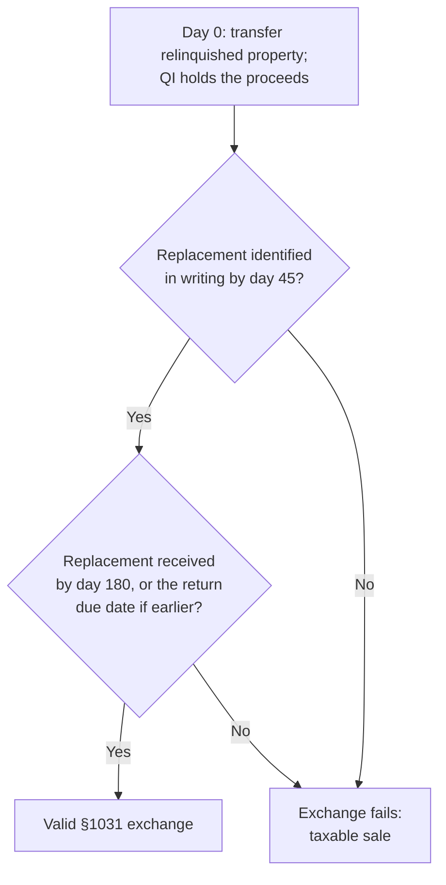

# Nontaxable Disposition of Assets

## Introduction

Selling property for cash ends an investment, and the tax law taxes the gain. But when a taxpayer swaps one building for another, or loses property to a fire or a condemnation and replaces it, the investment has not really ended. It has changed form. For these cases the Code lets the taxpayer defer the gain. TCP tests the two main nonrecognition rules, **like-kind exchanges** under IRC §1031 and **involuntary conversions** under IRC §1033, by asking you to compute realized, recognized, and deferred gain and the basis of the replacement property. It also asks you to review transactions and decide whether they qualify at all.

Four terms run through the whole chapter. **Realized gain** is the economic gain: amount realized minus adjusted basis. **Recognized gain** is the part taxed now. **Deferred gain** is the rest, which is not forgiven but carried into the replacement property through a lower basis. **Boot** is anything received that does not qualify for deferral. The chapter covers each rule with worked examples, then opportunity zone deferral, and ends with a framework for telling taxable from nontaxable transactions.

---

## Like-Kind Exchanges (IRC §1031)

### Qualifying Property

A **like-kind exchange** lets a taxpayer exchange real property held for productive use in a trade or business or for investment for other such real property and defer the gain (or loss). Since the Tax Cuts and Jobs Act of 2017, §1031 applies **only to real property**. Exchanges of equipment, vehicles, artwork, and other personal property are taxable.

| Qualifies for §1031 | Does Not Qualify |
|---|---|
| Improved real property (office building, warehouse) | Personal property (machinery, vehicles, furniture) |
| Unimproved real property (vacant land) | Inventory and property held primarily for sale (dealer property) |
| U.S. real property exchanged for U.S. real property | U.S. real property exchanged for foreign real property |
| A real property leasehold with 30 or more years remaining | Stocks, bonds, notes, and partnership interests |
| Rental residential property exchanged for commercial property | Personal residences |

**Digital assets** never qualify. Trading one cryptocurrency for another, or for an NFT, is a taxable sale of the asset given up, measured at the fair market value of what is received.

:::tip[Exam Tip]

For real property, "like kind" is very broad. Any real property held for business or investment can be exchanged for any other real property held for business or investment: an office building for farmland, or a warehouse for a retail store. What disqualifies a property is its **use**: personal use, or holding it as inventory.

:::

### Boot

A like-kind exchange is rarely an even swap. When values differ, one party adds **boot**: cash, other property, or relief from a liability.

| Item | Treatment for the Taxpayer |
|---|---|
| **Cash or other property received** | Boot received; triggers gain up to the realized gain |
| **Taxpayer's liability assumed by the other party** | Boot received |
| **Cash given** | Boot given; adds to the basis of the new property |
| **Other party's liability assumed by the taxpayer** | Boot given |

Giving boot never triggers gain on the like-kind property. (If the taxpayer gives appreciated non-like-kind property as boot, though, the transfer of that property is a taxable sale of it.)

When liabilities move in both directions, they are **netted**. Liabilities the taxpayer is relieved of are offset by liabilities the taxpayer assumes and by cash the taxpayer pays, and only net liability relief counts as boot received. Cash the taxpayer *receives* is never offset by liabilities the taxpayer assumes.

### Gain Recognition, Deferral, and Basis

$$
\text{Realized Gain} = \text{FMV of Property Received} + \text{Boot Received} - \text{Adjusted Basis of Property Given} - \text{Boot Given}
$$

$$
\text{Recognized Gain} = \min(\text{Net Boot Received},\ \text{Realized Gain})
$$

$$
\text{Deferred Gain} = \text{Realized Gain} - \text{Recognized Gain}
$$

**Losses are never recognized** in a like-kind exchange; a realized loss is deferred in full.

$$
\text{Basis of New Property} = \text{Adjusted Basis of Old Property} - \text{Boot Received} + \text{Boot Given} + \text{Gain Recognized}
$$

A quick check: the basis of the new like-kind property should equal its FMV minus the deferred gain (or plus a deferred loss). Non-like-kind property received takes a basis equal to its FMV.

The holding period of the relinquished property **tacks onto** the replacement property. If the taxpayer held the old property for 3 years, the new property is treated as already held for 3 years. Boot property received starts a new holding period.

### Example 1: No Boot

> **Example:** Bear Co. exchanges a warehouse (adjusted basis \$200,000, FMV \$350,000) used in its business for an office building (FMV \$350,000) owned by Grizzly Inc.

| Step | Calculation | Amount |
|---|---|---|
| FMV of office building received | | \$350,000 |
| Adjusted basis of warehouse given | | \$200,000 |
| **Realized gain** | \$350,000 - \$200,000 | **\$150,000** |
| **Recognized gain** | No boot received | **\$0** |
| **Deferred gain** | \$150,000 - \$0 | **\$150,000** |
| **Basis of office building** | \$200,000 - \$0 + \$0 + \$0 | **\$200,000** |

Check: \$350,000 FMV - \$150,000 deferred gain = \$200,000.

### Example 2: Cash Boot Received

> **Example:** Jordan exchanges an apartment building held for investment (adjusted basis \$300,000, FMV \$500,000) with Alex for retail space (FMV \$440,000) plus \$60,000 of cash.

| Step | Calculation | Amount |
|---|---|---|
| Amount realized | \$440,000 + \$60,000 cash | \$500,000 |
| Adjusted basis of apartment building | | \$300,000 |
| **Realized gain** | \$500,000 - \$300,000 | **\$200,000** |
| **Recognized gain** | min(\$60,000, \$200,000) | **\$60,000** |
| **Deferred gain** | \$200,000 - \$60,000 | **\$140,000** |
| **Basis of retail space** | \$300,000 - \$60,000 + \$0 + \$60,000 | **\$300,000** |

Check: \$440,000 FMV - \$140,000 deferred gain = \$300,000.

### Example 3: Liability Relief as Boot

> **Example:** Polar Inc. owns a factory (adjusted basis \$400,000, FMV \$700,000) subject to a \$150,000 mortgage. It exchanges the factory for Dana's distribution center (FMV \$550,000), and Dana assumes the mortgage. For Polar Inc., the mortgage relief is boot received.

| Step | Calculation | Amount |
|---|---|---|
| Amount realized | \$550,000 + \$150,000 mortgage relief | \$700,000 |
| Adjusted basis of factory | | \$400,000 |
| **Realized gain** | \$700,000 - \$400,000 | **\$300,000** |
| **Recognized gain** | min(\$150,000, \$300,000) | **\$150,000** |
| **Deferred gain** | \$300,000 - \$150,000 | **\$150,000** |
| **Basis of distribution center** | \$400,000 - \$150,000 + \$0 + \$150,000 | **\$400,000** |

Check: \$550,000 FMV - \$150,000 deferred gain = \$400,000.

### Example 4: Liabilities on Both Sides

> **Example:** Sam owns a rental property (adjusted basis \$250,000, FMV \$600,000) subject to a \$200,000 mortgage. Sam exchanges it for Priya's office building (FMV \$500,000), which is subject to a \$100,000 mortgage, and each party assumes the other's mortgage. Sam is relieved of \$200,000 and assumes \$100,000, so Sam has **\$100,000 of net boot received**.

| Step | Calculation | Amount |
|---|---|---|
| Amount realized | \$500,000 + (\$200,000 - \$100,000) | \$600,000 |
| Adjusted basis of rental property | | \$250,000 |
| **Realized gain** | \$600,000 - \$250,000 | **\$350,000** |
| **Recognized gain** | min(\$100,000, \$350,000) | **\$100,000** |
| **Deferred gain** | \$350,000 - \$100,000 | **\$250,000** |
| **Basis of office building** | \$250,000 - \$200,000 + \$100,000 + \$100,000 | **\$250,000** |

Check: \$500,000 FMV - \$250,000 deferred gain = \$250,000. Priya, who has net liabilities assumed, gave boot and recognizes no gain.

### Related Party Exchanges

If the parties to a like-kind exchange are **related** (under the §267(b) or §707(b)(1) definitions: family members, controlled entities, and so on), both must keep the property they received for at least **2 years**. If either one disposes of it sooner, the exchange is disqualified, and the gain that was deferred becomes taxable in the year of the later disposition. The rule stops related parties from swapping a high-basis property and a low-basis property so that the one with high basis can sell for cash with little gain. Exceptions apply for dispositions after the death of either party, for involuntary conversions, and when tax avoidance was not a principal purpose.

> **Example:** Blake exchanges investment land (basis \$100,000, FMV \$250,000) with his sister Harper for her rental building (FMV \$250,000). Fourteen months later, Harper sells the building for \$260,000. Because siblings are related and the sale came within 2 years, Blake must recognize his \$150,000 deferred gain in the year Harper sells.

The [Related Party Transactions](/tcp/property-transactions/related-party-transactions) chapter explains who is related and how constructive ownership is counted.

### Deferred (Starker) Exchanges

Most exchanges are not simultaneous. In a **deferred exchange** (also called a Starker exchange), the taxpayer transfers the relinquished property first and receives the replacement property later. A **qualified intermediary (QI)** holds the sale proceeds in between, so the taxpayer never touches the cash.

| Rule | Requirement |
|---|---|
| **45-day identification period** | Identify the replacement property in writing within 45 days after transferring the relinquished property |
| **180-day exchange period** | Receive the replacement property within 180 days after the transfer **or** by the due date (with extensions) of the return for that year, **whichever is earlier** |
| **Three-property rule** | Identify up to 3 properties of any value |
| **200% rule** | Or identify any number of properties whose total FMV does not exceed 200% of the relinquished property's FMV |

:::warning

If the taxpayer has **actual or constructive receipt** of the proceeds, for example because they were deposited in the taxpayer's own bank account, the exchange fails and the transaction is a taxable sale.

:::

> **Example:** On March 1, Ursa Security transfers a commercial building (adjusted basis \$500,000) to a buyer for \$900,000, which a QI holds. On April 10 (within 45 days), Ursa Security identifies an office complex. On July 15 (within 180 days), the QI uses the \$900,000 to buy the \$950,000 office complex, and Ursa Security pays the other \$50,000.

| Step | Calculation | Amount |
|---|---|---|
| FMV of office complex received | | \$950,000 |
| Adjusted basis of old building plus cash paid | \$500,000 + \$50,000 | \$550,000 |
| **Realized gain** | \$950,000 - \$550,000 | **\$400,000** |
| **Recognized gain** | No boot received | **\$0** |
| **Deferred gain** | \$400,000 - \$0 | **\$400,000** |
| **Basis of office complex** | \$500,000 - \$0 + \$50,000 + \$0 | **\$550,000** |

Check: \$950,000 FMV - \$400,000 deferred gain = \$550,000. Because Ursa Security reinvested all of the proceeds and more, it received no boot and defers the entire gain.

---

## Involuntary Conversions (IRC §1033)

### The Rule

An **involuntary conversion** occurs when property is destroyed, stolen, condemned, or sold under threat of condemnation, and the owner receives insurance proceeds, a condemnation award, or other compensation. The owner did not choose to sell, so §1033 lets the owner **elect** to defer the gain by reinvesting the proceeds in qualifying replacement property within the replacement period. Unlike §1031, which is mandatory when its requirements are met, §1033 deferral of gain on proceeds is **elective**. It applies only to gains; losses are handled under the ordinary loss rules.

| Qualifying Event | Description |
|---|---|
| **Destruction** | Fire, flood, storm, earthquake, or other casualty |
| **Theft** | Property stolen from the owner |
| **Condemnation** | The government takes the property through eminent domain |
| **Threat of condemnation** | The owner sells after learning that condemnation is imminent |

### Direct Conversion versus Proceeds Received

| Conversion Type | Rule |
|---|---|
| **Direct conversion** (the owner receives replacement property instead of cash) | No gain recognized (mandatory); the replacement property takes the old property's basis |
| **Proceeds received** (insurance or a condemnation award) | If the owner elects, gain is recognized only to the extent the proceeds exceed the cost of the replacement property |

### Replacement Property Requirements

| Situation | Replacement Standard | Replacement Period |
|---|---|---|
| **General rule** (destroyed, stolen, or condemned property) | **Similar or related in service or use**: the replacement must serve the same function | **2 years** after the close of the tax year in which gain is first realized |
| **Condemned real property held for business or investment** | **Like-kind**, the broader §1031 standard | **3 years** after the close of that tax year |
| **Principal residence in a federally declared disaster area** | Similar or related in service or use | **4 years** after the close of that tax year |

:::info

The replacement standard for **condemned business or investment real property** is the broad like-kind standard, while other conversions use the narrower functional-use test. This distinction is frequently tested.

:::

### Gain Recognition and Basis

$$
\text{Realized Gain} = \text{Proceeds} - \text{Adjusted Basis of Converted Property}
$$

$$
\text{Recognized Gain} = \min(\text{Realized Gain},\ \text{Proceeds Not Reinvested})
$$

$$
\text{Basis of Replacement Property} = \text{Cost of Replacement Property} - \text{Deferred Gain}
$$

When the election is made, the holding period of the converted property tacks onto the replacement property.

### Example 5: Full Reinvestment

> **Example:** Bear Co.'s warehouse (adjusted basis \$300,000) is destroyed by fire. Bear Co. receives \$500,000 of insurance proceeds and spends all of it on a new warehouse within 2 years.

| Step | Calculation | Amount |
|---|---|---|
| **Realized gain** | \$500,000 - \$300,000 | **\$200,000** |
| Proceeds not reinvested | \$500,000 - \$500,000 | \$0 |
| **Recognized gain** | min(\$200,000, \$0) | **\$0** |
| **Deferred gain** | \$200,000 - \$0 | **\$200,000** |
| **Basis of new warehouse** | \$500,000 - \$200,000 | **\$300,000** |

The deferred gain lives on in the lower basis of the new warehouse.

### Example 6: Partial Reinvestment

> **Example:** The city condemns investment land owned by Kodiak Partners (adjusted basis \$150,000) for a highway and pays a \$400,000 award. Kodiak Partners elects §1033 and buys replacement investment land for \$350,000 within 3 years (condemned investment real property, so the 3-year period applies).

| Step | Calculation | Amount |
|---|---|---|
| **Realized gain** | \$400,000 - \$150,000 | **\$250,000** |
| Proceeds not reinvested | \$400,000 - \$350,000 | \$50,000 |
| **Recognized gain** | min(\$250,000, \$50,000) | **\$50,000** |
| **Deferred gain** | \$250,000 - \$50,000 | **\$200,000** |
| **Basis of replacement land** | \$350,000 - \$200,000 | **\$150,000** |

### Example 7: Unreinvested Proceeds Exceed the Gain

> **Example:** Morgan's rental property (adjusted basis \$180,000) is destroyed by a storm. Morgan receives \$280,000 of insurance but spends only \$170,000 on replacement rental property within the replacement period.

| Step | Calculation | Amount |
|---|---|---|
| **Realized gain** | \$280,000 - \$180,000 | **\$100,000** |
| Proceeds not reinvested | \$280,000 - \$170,000 | \$110,000 |
| **Recognized gain** | min(\$100,000, \$110,000) | **\$100,000** |
| **Deferred gain** | \$100,000 - \$100,000 | **\$0** |
| **Basis of replacement property** | \$170,000 - \$0 | **\$170,000** |

Recognized gain can **never exceed** realized gain. Here the unreinvested proceeds are larger than the gain, so all of the gain is recognized, and the replacement property's basis is simply its cost.

### Example 8: Direct Conversion

> **Example:** The city condemns Bear Co.'s commercial building (adjusted basis \$450,000) and gives Bear Co. a replacement building worth \$600,000 instead of cash. No gain is recognized, and the replacement building's basis is \$450,000, carried over from the old building. Because Bear Co. never received cash, there was nothing to cash out.

---

## Qualified Opportunity Fund Deferral

One more deferral provision works differently from the two above. A taxpayer who sells **any** property at a capital gain can defer that gain by investing an amount equal to the gain (not the whole proceeds) in a **qualified opportunity fund (QOF)**, which invests in designated low-income communities, generally within 180 days of the sale. The replacement does not need to be like-kind. OBBBA made the program permanent, with new zone designations every 10 years, and changed the deferral rules:

| Rule | Gains Invested Before 2027 | Gains Invested After December 31, 2026 |
|---|---|---|
| **When deferred gain is taxed** | The earlier of a sale of the QOF investment or **December 31, 2026** | The earlier of a sale or **5 years** after the investment |
| **Basis increase** | No further increases available | 10% of the deferred gain after 5 years (30% for a qualified rural opportunity fund) |
| **Holding for 10 years** | Appreciation on the QOF investment is tax-free | Same |

For example, if Morgan invests a \$100,000 gain in a QOF in 2027 and holds the investment for five years, Morgan reports the deferred gain in 2032, reduced by the 10% basis increase, so \$90,000 is taxed. Under the AICPA's six-month rule, the new deferral rules for gains invested after December 31, 2026 should not be eligible for testing before July 1, 2027.

---

## Determining Taxable versus Nontaxable Transactions

### A Framework for Reviewing Transactions

When you review a disposition, ask three questions in order:

1. **Was the property involuntarily converted** (casualty, theft, condemnation, or sale under threat of condemnation)? If so, gain is deferred to the extent the proceeds were reinvested in qualifying property within the replacement period and the owner elected §1033. Otherwise, it is taxable.
2. **If not, was business or investment real property exchanged for other like-kind real property**, directly or through a qualified intermediary within the 45-day and 180-day deadlines? If so, gain is recognized only to the extent of net boot received.
3. **If neither applies**, the disposition is a taxable sale, unless the client reinvested a capital gain in a qualified opportunity fund.

### Documentation to Review

| Document or Fact | What It Shows |
|---|---|
| **Exchange agreement and QI agreement** | A qualified intermediary was used and the taxpayer never had access to the cash |
| **45-day identification notice** | The replacement property was identified on time |
| **Closing statements** | Amounts paid, boot received, and liabilities assumed or relieved |
| **Deeds** | Real property was actually transferred and received |
| **Insurance claim or condemnation award** | The conversion event and the proceeds |
| **Replacement purchase agreement** | Cost and date of the replacement, to test the replacement period |
| **Appraisals** | FMV of the properties, especially in related party exchanges |
| **Use and holding records** | The property was held for business or investment, not personal use or inventory |

### Comparing the Three Outcomes

| Feature | Taxable Sale | §1031 Like-Kind Exchange | §1033 Involuntary Conversion |
|---|---|---|---|
| **Trigger** | Voluntary sale | Exchange of like-kind real property | Casualty, theft, or condemnation |
| **Gain recognized** | All of it | To the extent of net boot received | To the extent proceeds are not reinvested |
| **Loss recognized** | Yes (subject to the usual limits) | **No**; deferred | §1033 does not apply to losses; business losses are deductible, and personal casualty losses only in limited cases |
| **Election required?** | No | No; mandatory if requirements are met | **Yes**, for proceeds received |
| **Replacement property** | Not applicable | Like-kind real property | Similar or related in service or use (like-kind for condemned real property) |
| **Time limits** | Not applicable | 45 days to identify, 180 days to receive | 2 years (3 for condemned real property, 4 for a disaster-area residence) |
| **Basis of new property** | Cost | Old basis - boot received + boot given + gain recognized | Cost - deferred gain |
| **Holding period** | Starts new | **Tacks** | **Tacks** when gain is deferred |

Personal casualty losses are deductible only for losses from federally declared disasters (and, starting in 2026, state-declared disasters), after a \$100 floor and 10% of AGI.

:::danger

A common trap: §1031 **defers losses**. If a question presents a like-kind exchange of property worth less than its basis, the answer is **no loss recognized**, and the unrecognized loss increases the basis of the new property. A taxpayer who wants the loss should sell the property for cash and buy the replacement separately.

:::

### Example 9: Sale Under Threat of Condemnation

> **Example:** Honey Entertainment receives a letter from the county saying it intends to take Honey's parking lot (adjusted basis \$120,000) for a public park. Honey sells the lot to the county for \$200,000 and spends \$185,000 on a replacement parking lot within 2 years.

A sale under **threat of condemnation** is treated as a condemnation, so §1033 applies. Because the property is business real property, the replacement period is 3 years and the like-kind standard applies.

| Step | Calculation | Amount |
|---|---|---|
| **Realized gain** | \$200,000 - \$120,000 | **\$80,000** |
| Proceeds not reinvested | \$200,000 - \$185,000 | \$15,000 |
| **Recognized gain** | min(\$80,000, \$15,000) | **\$15,000** |
| **Deferred gain** | \$80,000 - \$15,000 | **\$65,000** |
| **Basis of replacement lot** | \$185,000 - \$65,000 | **\$120,000** |

The threat must be real: the owner must have been notified or have reasonable grounds to believe condemnation is imminent. A rumor is not enough.

### Example 10: A Transaction That Does Not Qualify

> **Example:** Reese owns investment land (adjusted basis \$90,000, FMV \$160,000). Reese sells it to an unrelated buyer for \$160,000 cash and three months later uses the cash to buy other investment land for \$160,000.

This is a **taxable sale**. It is not a §1031 exchange, because Reese received the cash and no qualified intermediary was involved; a sale followed by a separate purchase is not an exchange. It is not a §1033 conversion, because the sale was voluntary. Reese recognizes the full \$70,000 gain, and the new land's basis is its \$160,000 cost.

---

## Summary

| Concept | Key Rule |
|---|---|
| **§1031: Qualifying property** | Real property held for business or investment only; personal property and digital assets do not qualify |
| **§1031: Recognized gain** | Lesser of net boot received or realized gain; losses are never recognized |
| **§1031: Basis of new property** | Old basis - boot received + boot given + gain recognized (equals FMV - deferred gain) |
| **§1031: Holding period** | Tacks from the relinquished property |
| **§1031: Deferred exchanges** | Identify within **45 days**; receive within **180 days** or by the return due date, if earlier; use a qualified intermediary |
| **§1031: Related parties** | Both must hold the property received for **2 years**, or the deferred gain is triggered |
| **§1033: Events** | Casualty, theft, condemnation, or threat of condemnation |
| **§1033: Election** | Elective for proceeds received; automatic for direct conversions |
| **§1033: Recognized gain** | Lesser of realized gain or proceeds not reinvested |
| **§1033: Basis** | Cost of replacement property - deferred gain |
| **§1033: Replacement** | Similar use within 2 years; like-kind within 3 years for condemned business or investment real property |
| **Opportunity funds** | Invest a capital gain in a QOF to defer it; pre-2027 deferrals ended December 31, 2026; new 5-year rules for gains invested after 2026 |
| **Taxable versus nontaxable** | Voluntary cash sales are taxable; exchanges and reinvested conversions defer gain |
